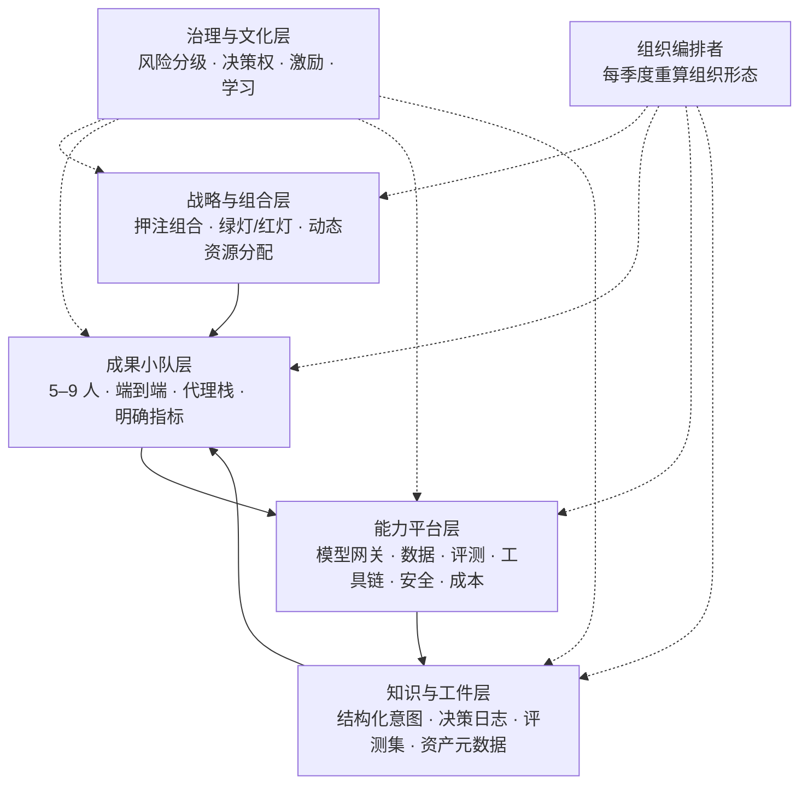
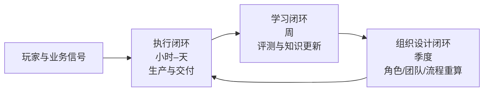

# 游戏行业如何组建智能组织

> 方向性分析与落地建议 · 2026 年 11 月

## 文档说明

本文回答一个问题：**游戏公司如何把"用 AI 提效"升级为"组建智能组织"**。它不是工具采购清单，也不是未来学预测，而是一份供决策讨论的框架：先给出判断和结论，再拆解目标形态、组建路径、角色人才、数据评测、治理风险和 90 天行动方案。

配套的落地样板见 **[《智能组织新项目样板 1.0》](ai-native-studio-playbook.md)**：含 30 人默认组织图、小队章程、角色记分卡、六道阶段门、运营日历、工件模板、预算模型和 24 个月路线图，可直接用于新项目启动。

数据来自公开报道、行业调查和公司公开信息（见附录 C），部分为厂商自述口径，未做独立审计。本文没有访问任何公司的内部数据；文中的目标值和门槛是建议起点，需要结合公司规模、品类和风险偏好校准。

---

## 目录

1. [结论先行](#一结论先行)
2. [定义：什么叫"智能组织"](#二定义什么叫智能组织)
3. [为什么是游戏行业，为什么是现在](#三为什么是游戏行业为什么是现在)
4. [目标形态：智能组织的参考架构](#四目标形态智能组织的参考架构)
5. [组建路径：从诊断到规模化](#五组建路径从诊断到规模化)
6. [角色与人才](#六角色与人才)
7. [数据、知识与评测](#七数据知识与评测)
8. [治理与风险](#八治理与风险)
9. [度量](#九度量)
10. [不同规模的三条路径](#十不同规模的三条路径)
11. [案例卡片](#十一案例卡片)
12. [失败模式](#十二失败模式)
13. [90 天行动清单](#十三90-天行动清单)
14. [完整决策清单（8 项）](#十四完整决策清单8-项)
15. [附录](#附录)

---

## 一、结论先行

### 1.1 五条核心判断

1. **智能组织的本质，不是"给每个人配 AI"，而是把组织的最小生产单元从"岗位"改成"人 + 代理 + 工件 + 评测"的能力单元，并据此重写角色、团队、工作流和决策权。** 只发工具、不改组织，收益会在个人效率层面见顶。
2. **游戏行业是最适合先做智能组织的行业之一**：数字原生、内容密集、反馈可量化、项目制、全球化。游戏公司的产出几乎全部是比特，天然适合代理执行和自动评测。
3. **行业现状是"高使用率、低深度、组织变革滞后"**：GDC《State of the Game Industry 2026》调查中 40% 的开发者使用生成式 AI，但仅 6% 的受访者表示用于最终玩家可见内容；开发者中 55% 认为 AI 对游戏有负面影响。工具已经进场，组织还没有。
4. **推荐"联邦制"而非"全集中"或"全分散"**：中央 AI 平台与治理（8–12 人）+ 业务单元内 5–9 人成果小队 + 一名直接向 CEO/管委会汇报的"组织编排者"。中央做平台、评测、安全和成本；小队做端到端交付；编排者每季度重算一次组织形态。
5. **组建顺序是"先证据、再管线、再组织、再规模化"**：90 天用 2–3 个可评测的试点拿到证据；6 个月重构一条端到端管线；12–24 个月复制到多项目并走向动态编排。不要先画组织架构图再找场景。

### 1.2 一句话公式

> **智能组织 = 小团队 × 强个体 × 代理军团 × 可评测的数据与知识底座 × 持续重设计组织的能力。**

前四项是"生产能力"，最后一项是"智能"的真正来源。多数公司只建前四项，所以停在"AI 工具化"。

### 1.3 最先要拍板的五个问题

| # | 决策 | 选项 | 本文建议 |
|---|---|---|---|
| 1 | 战略意图 | 效率优先 / 创新优先 / 新品类优先 | 双轨：12 个月以效率和质量为主，24 个月保留新品类期权 |
| 2 | 组织形态 | 中央 AI 部门 / 联邦制 / 完全分散 | 联邦制：中央平台 + 业务小队 + 组织编排者 |
| 3 | 玩家可见 AI 的边界 | 全面拥抱 / 谨慎分层 / 禁止 | 分层：内部先用，玩家可见必须同时满足"更好玩 + 可信 + 可披露" |
| 4 | 用工承诺 | 不裁员承诺 / 重组 / 自然减员 | 透明 + 转岗 + 绩效；不要把 AI 当作裁员的叙事工具 |
| 5 | 成功指标 | 使用率 / 周期与成本 / 玩家价值 | 平衡计分卡：周期、单位成本、质量、玩家指标、员工负荷 |

---

## 二、定义：什么叫"智能组织"

### 2.1 三个常见误解

**误解一：买了大模型、铺了 AI 工具，就是智能组织。**
这只改变了个人效率，没有改变信息流、决策权和激励。工具化能让一个人快 30%，但组织仍按旧方式交接、审批、开会，整体交付速度不会同比例提升。

**误解二：智能组织就是"用 AI 替换人"。**
降本不等于增智。Playtika 在 2026 年 1 月裁减 15% 员工、转向"AI 与自动化驱动的精简团队"，这是一次成本结构重组；它是否同时提升了组织能力，取决于平台、数据、评测和人才是否跟上。把 AI 当裁员工具，通常会同时损失士气和隐性知识。

**误解三：设一个 AI 部门就够了。**
如果中央团队只做 Demo、不建平台、不做评测、不管成本和安全，它会变成"AI 剧场"：演示很多，生产很少。中央团队的价值是降低全公司的边际创新成本，而不是替业务做所有 AI。

### 2.2 定义与五个特征

本文的定义：

> **智能组织是一种以数据和 AI 代理为生产底座、以小型跨职能成果单元为基本单位、能够把玩家与业务反馈持续转化为组织能力升级的组织形态。**

它和"学习型组织"不矛盾：学习型组织强调的是人的心智模式、团队学习和自我超越；智能组织把"学习"外化为评测集、决策日志、知识库和工作流更新，让组织学习可以被机器执行、被人审计、被规模化放大。

它有三个同时运行的闭环：

- **执行闭环**（小时–天）：人 + 代理完成内容、代码、测试、运营动作，评测门控质量。
- **学习闭环**（周）：玩家数据、事故、返工、成本回流，更新评测集、知识库和工作流。
- **组织设计闭环**（季度）：根据 AI 能力变化，重新组合角色、团队、工件、工作流和激励。

五个特征：

1. **小单元**：5–9 人端到端负责一个玩家体验，减少交接。
2. **强个体**：个体借助代理覆盖更宽的能力面，判断力和品味更值钱。
3. **代理军团**：代理是团队成员，有权限、有评测、有成本、有审计。
4. **可评测**：每个 AI 用例都有离线/在线评测和人工抽检，质量可解释。
5. **自学习**：反馈能自动进入评测、知识和组织设计，而不是停留在复盘 PPT。

### 2.3 成熟度模型

| 等级 | 名称 | 典型特征 | 主要指标 | 常见风险 |
|---|---|---|---|---|
| L1 | 工具增强 | 个人自选用 AI 工具；无统一平台；影子 AI 多 | 使用率、个人满意度 | 数据泄露、重复采购、不可复现 |
| L2 | 流程嵌入 | AI 进入美术/代码/QA/本地化管线；有模板和平台 | 周期、单位成本、返工率 | 工具堆叠、集成债、只优化局部 |
| L3 | 代理原生 | 代理作为团队成员；有评测、权限、成本、审计 | 代理成功率、人工负载、评测覆盖 | 失控、安全、责任不清 |
| L4 | 自学习组织 | 反馈自动更新评测/知识/工作流；组织按季度重设计 | 学习速度、复用率、实验吞吐 | 复杂度、治理过重 |
| L5 | 生态智能 | 与外部工作室、工具、玩家社区形成能力网络 | 生态产出、网络效应 | 治理碎片化、IP 风险 |

**大多数公司卡在 L1–L2。L3 是分水岭**：从"人用工具"变成"人管理代理"，需要评测、权限、成本和组织角色的配套。L4 才是"智能"的真正含义——组织能自己变聪明。

### 2.4 智能组织 ≠ AI 转型

| 维度 | AI 转型（常见做法） | 智能组织（本文所指） |
|---|---|---|
| 改动对象 | 工具、个别流程 | 角色、团队、工件、工作流、决策权 |
| 成功标准 | 使用率、降本 | 周期、质量、玩家价值、学习速度 |
| 组织单位 | 部门/岗位 | 5–9 人成果小队 + 代理栈 |
| 管理方式 | 项目制、审批 | 评测门控 + 动态编排 |
| 知识形态 | 文档、会议 | 结构化意图、决策日志、评测集 |
| 失败模式 | 买了不用 | 用了但不改变组织，收益见顶 |

---

## 三、为什么是游戏行业，为什么是现在

### 3.1 游戏是 AI 的天然试验场

- **数字原生**：美术、代码、关卡、文本、音频、运营素材全部是比特，代理可以直接生产、修改、验证。
- **反馈密集**：留存、付费、会话、关卡通过率、舆情，天然形成可量化的评测信号。
- **项目制**：立项、原型、纵向切片、上线、长线运营，阶段清晰，适合做"小赌注、快验证"。
- **内容密集**：美术资产通常占开发工作量的 50%–60%，3D 建模和动画是最大的重复劳动池（腾讯游戏效能团队口径）。
- **全球化**：本地化、社区、UA 素材、客服，都是高 volume、可评测的代理场景。
- **人才结构**：创意 + 工程的混合人才密度高，更容易接受"人机协作"的工作方式。

### 3.2 成本与竞争压力

3A 和大型手游的开发成本持续上升，UA 成本高企，玩家对内容更新速度的预期越来越高。与此同时，小团队借助 AI 有机会把原型成本显著压低。结果是：

- **供给侧**：更多小团队、更多原型、更快迭代，竞争从"谁能做大"转向"谁能更快找到并放大乐趣"。
- **需求侧**：玩家对"AI 味"的容忍度低，对质量和诚意的要求更高。
- **组织侧**：大公司的优势不再是人数，而是平台、数据、IP 和治理；劣势是层级、协调成本和风险厌恶。

### 3.3 2026 年的行业现实

| 事实 | 数据 | 含义 |
|---|---|---|
| 使用率 | GDC 2026：40% 开发者使用生成式 AI，较上年 +4% | 工具已普及，但增速放缓 |
| 使用深度 | 使用者中 73% 用于调研/头脑风暴，56% 用于代码，37% 用于原型，22% 用于概念图，仅 6% 的受访者用于最终玩家可见内容 | 多数停留在"辅助"而非"生产" |
| 态度 | 55% 认为 AI 对游戏有负面影响；27% 的 AAA 员工感到被鼓励或被施压使用 AI，独立开发者仅 9% | 信任赤字与组织压力并存 |
| 就业 | 约三分之一从业者近 24 个月被裁；68% 的 AAA 员工称公司裁过员 | 降本叙事主导，士气脆弱 |
| 工时 | 86% 报告曾一周工作超过 40 小时；65% 认为心理健康受影响 | 不能用 AI 继续加压 |
| 披露 | 2025 年上半年近 8,000 款 Steam 游戏披露使用生成式 AI，而 2024 年全年约 1,000 款 | 玩家可见 AI 已不可隐藏 |

### 3.4 三个残酷事实

**事实一：使用率高，不代表能力强。**
40% 的使用率里，大部分是个人辅助；真正进入生产管线、有评测、有成本核算、有责任人的用例仍是少数。使用率是虚荣指标，周期、质量和单位成本才是硬指标。

**事实二：组织变革滞后于工具。**
Krafton 公布的 2026 年 2 月内部调查显示，97.6% 的员工在使用 AI 工具；但真正的难点是它同时进行的组织重组、管理跨度调整、AI 人才独立人事体系和 40% 降本目标。工具可以一夜铺开，组织能力不能。

**事实三：玩家信任是硬约束。**
《Inzoi》因生成式 AI 遭玩家反弹，Krafton 的 Project Windless 在争议后回到"传统手工艺"路线；Steam 要求披露 AI 生成内容；SAG-AFTRA 围绕 AI 保护进行了近一年的罢工。玩家可见 AI 不是纯技术问题，而是品牌、版权和劳工问题。

### 3.5 窗口期判断

模型能力仍在快速提升，但**当前的瓶颈不是模型，而是组织**：数据是否可用、评测是否可信、权限是否清晰、成本是否可控、角色是否重定义、中层是否支持。先完成组织改造的公司，会把每一代模型进步转化为复利；只买工具的公司，会在每一代模型上重新开始。

### 3.6 反方观点：为什么有人选择慢一点

这份分析偏"积极推进"，但反方理由同样成立，决策时应一并权衡：

- **玩家信任风险**：AI 生成内容的"味道"、版权争议、对创作者的替代，可能带来差评、退款和品牌损伤；一次严重的翻车，修复成本可能高于几年的提效收益。
- **创意同质化**：模型倾向于"平均的正确答案"，而爆款往往来自非共识的审美和玩法判断。过度依赖生成，会让产品更安全、更平庸。
- **组织代价**：重组会消耗管理带宽、触发中层抵抗、造成短期产出波动；如果平台和评测没建好就大规模推广，返工和 token 成本会反噬。
- **成本与依赖**：算力、token、供应商锁定、安全事件，都是真实成本；小团队尤其容易被"工具订阅 + 算力"拖垮。

所以真正的问题不是"要不要做"，而是**"多快、多深、在哪些环节先做"**。本文的建议是：内部先行、低风险场景先行、有评测再扩大、玩家可见内容慢半拍但标准更高。

---

## 四、目标形态：智能组织的参考架构

### 4.1 五层架构

**战略与组合层**：决定"做几个赌注、每个赌注给多少资源、什么时候杀"。AI 降低了原型成本，应该增加早期赌注数量，而不是把省下的钱全部变成利润。

**成果小队层**：组织的基本单位。每个小队端到端负责一个玩家体验或一条内容管线，拥有达成结果所需的跨职能能力，嵌入 QA，配一套代理栈。

**能力平台层**：全公司复用的基础设施。没有平台，每个小队都会重复造轮子、重复踩安全坑、重复付 token 学费。

**知识与工件层**：组织的记忆。决策为什么做、评测标准是什么、资产元数据、代理提示与工具链，都要结构化沉淀，既给人用，也给代理用。

**治理与文化层**：决定什么可以做、谁拍板、怎么激励、怎么学习。它不是官僚审批，而是让代理可以安全地跑起来的"护栏"。

### 4.2 三个闭环

- **执行闭环**的关键是"代理能跑、人能把关"：权限、工具、评测、回滚。
- **学习闭环**的关键是"信号能回来"：玩家数据、事故、返工、成本、员工反馈，进入评测集和知识库。
- **组织设计闭环**的关键是"有人负责"：组织编排者每季度问三个问题——哪些工作该由代理做？哪些角色该合并？哪些流程的限速点还没打通？

### 4.3 七条设计原则

1. **先改工作流，再改组织图。** 组织图是工作流的影子；工作流不改，换架构只是换汇报关系。
2. **端到端小队，减少交接。** 每次交接都是一次信息损耗和等待；能把一件事做完的人，比只做一段的人更有价值。
3. **代理优先，但人类保留品味、判断、伦理和关系。** 代理适合高 volume、低失败成本、强评测、可逆的任务。
4. **评测是新的管理控制。** 过去用审批和层级控制质量；现在用评测集、抽检和在线指标。
5. **工件要为代理而设计。** 长文档不如"目标 + 约束 + 验收标准 + 状态 + 评测"；非结构化知识要变成可检索、可执行的资产。
6. **平台复用，业务自治。** 中央不替业务做决定，但提供模型、数据、评测、安全和成本底座。
7. **可逆实验，快速止损。** 每个组织改动都要有回滚方案和明确的评估周期。

### 4.4 人机分工的判定规则

| 任务特征 | 优先给代理 | 优先给人 | 人机协作 |
|---|---|---|---|
| 失败成本 | 低、可逆 | 高、不可逆 | 中等，加人工复核 |
| 评测强度 | 强、可自动验证 | 弱、难验证 | 先建评测再扩大 |
| 上下文 | 已结构化、可检索 | 隐性、依赖关系 | 人提供上下文，代理执行 |
| 目标清晰度 | 明确、稳定 | 模糊、需要协商 | 人定目标，代理探索 |
| 能力类型 | 生成、检索、转换、监控 | 品味、判断、伦理、关系、愿景 | 人导演，代理产出 |
| 规模 | 高 volume、高变体 | 低频、高价值 | 代理批量，人抽检 |

一句话：**代理放在"失败便宜、评测强"的地方；人放在"失败昂贵、上下文隐性、目标需要重新协商"的地方。**

### 4.5 决策权矩阵（示例）

| 决策 | 提议 | 决定 | 执行 | 验收 |
|---|---|---|---|---|
| 做什么游戏/功能 | 制作人/产品 | 绿灯委员会 | 成果小队 | 玩家指标 |
| 美术风格与品质 | 创意总监 | 创意总监 | 小队 + 代理 | 评审 + 玩家反馈 |
| 技术架构 | 主程 | 技术负责人 | 小队 + 代理 | 架构评审 + 测试 |
| AI 用例上线 | AI 产品 | 按风险分级对应负责人 | 小队 | 评测 + 人工抽检 |
| 模型/供应商选择 | 平台团队 | CTO/CAIO | 平台 | 成本 + 安全 + 质量 |
| 组织调整 | 组织编排者 | CEO/管委会 | HR | 季度复盘 |
| 高风险 AI 使用 | 业务 + 法务 | AI 治理委员会 | 小队 | 红队 + 审计 |

### 4.6 最小可行智能组织（MVIO）

不需要一开始就建几百人的 AI 部门。一个可运转的最小配置是 **8–12 人 + 代理栈**：

| 角色 | 人数 | 职责 |
|---|---|---|
| 转型负责人（C-level 赞助人） | 1 | 定方向、给资源、清除障碍 |
| 组织编排者 | 1 | 设计组织、重算角色/团队/流程、评估效果 |
| AI 平台负责人 | 1 | 模型网关、工具链、集成、成本 |
| 平台工程师 | 3–5 | 数据接入、评测、安全、可观测性 |
| 评测/数据负责人 | 1 | 评测集、抽检、数据质量、指标体系 |
| AI 产品/项目经理 | 1–2 | 场景筛选、试点推进、业务翻译 |
| 业务单元 AI Champion | 每单元 1 人（兼职） | 传播、培训、需求收集 |
| 法务/安全/HR | 兼职 | 政策、合规、用工、培训 |

这个团队的第一目标不是"做很多 AI 功能"，而是**让业务小队能安全、低成本、可评测地用上代理**。衡量它的指标是：平台复用率、试点转生产率、单位成本、事故率。

---

## 五、组建路径：从诊断到规模化

### 5.1 第 0 步：诊断与基线（2–4 周）

**目标**：知道钱、时间、质量漏在哪里，哪些环节适合 AI，哪些不适合。

**动作一：拆价值链。**
把从"立项"到"长线运营"的每个环节拆开，标注工作量、周期、返工率、失败成本、评测难度、AI 可介入点。

| 环节 | 典型工作 | AI 可介入点 | 失败成本 | 评测难度 | 优先级 |
|---|---|---|---|---|---|
| 立项/市场 | 竞品分析、市场判断 | 调研、数据汇总、情景模拟 | 高 | 高 | 中 |
| 概念 | 概念图、世界观、玩法假设 | 概念图、文案、方案变体 | 低 | 中 | 高 |
| 原型 | 灰盒、代码原型、可玩验证 | 代码、关卡、资产、Playtest bot | 低 | 中 | 高 |
| 预制作 | 设计文档、关卡、叙事 | 结构化意图、关卡生成、对白 | 中 | 中 | 高 |
| 美术 | 原画、3D、贴图、动画 | 生成、变体、绑定、动画 | 中 | 中 | 高 |
| 程序 | 功能、工具、优化 | 代码生成、审查、测试生成 | 中 | 低 | 高 |
| 音频 | 音效、配音、音乐 | 生成、变体、本地化 | 中 | 高 | 中 |
| 本地化 | 翻译、配音、文化适配 | 机器翻译 + 人工审校 | 低 | 低 | 高 |
| QA | 功能、性能、兼容、探索 | 测试生成、Bot、异常检测 | 高 | 低 | 高 |
| 发行/营销 | 商店素材、UA、社区 | 素材变体、投放分析、舆情 | 高 | 中 | 中 |
| 运营 | 活动、平衡、客服、反作弊 | 活动生成、个性化、监控 | 高 | 中 | 中 |

**动作二：建基线。**
至少采集：从想法到可玩原型的周期、从原型到纵向切片的周期、内容产出周期、单位资产成本、返工率、缺陷逃逸率、AI 工具使用率、token 成本、员工加班与满意度、玩家情绪。

**动作三：画"机会地图"。**
用"价值 × 可行性"排序：高价值、高可行性、低风险的先做。典型首批场景：概念图、代码审查、本地化、测试用例生成、内部知识助手、运营报表自动化。

**动作四：列"非 agentable 表面"。**
Excel 审批、邮件确认、口头决策、私有文件、手工报表、会议纪要——这些是代理时代的限速点。每一项都要问：能不能变成结构化数据、API、或明确的决策记录？

**诊断的十个问题**：

1. 哪个环节的周期最长、返工最多？
2. 哪个环节的失败成本最低、评测最容易？
3. 哪些数据是代理拿不到的？为什么？
4. 哪些决策没有记录，导致无法复盘？
5. 哪些岗位的大部分时间在做搬运、转换、检查？
6. 哪些中层的工作是协调而非判断？
7. 员工实际在用哪些 AI 工具？数据去了哪里？
8. 一次 AI 事故的成本是多少？有没有回滚方案？
9. 玩家能感知到哪些 AI 使用？我们准备怎么披露？
10. 如果明年模型能力翻倍，我们的组织哪里会先卡住？

### 5.2 第 1 步：平台与治理底座（0–3 个月）

**平台五件套**：

1. **模型网关与路由**：多模型统一接入，按质量/成本/延迟路由，统一计费和配额。
2. **数据与权限**：遥测、资产、知识库、代码的统一访问层；RBAC、脱敏、审计。
3. **评测与可观测**：评测集、自动回归、人工抽检、调用链追踪、失败样本回流。
4. **工具链与代理框架**：美术、代码、QA、本地化、运营的连接器；沙箱和回滚。
5. **安全与成本**：DLP、提示注入防护、权限最小化、预算护栏、成本看板。

再加一个"内部 AI 应用商店/案例库"：让成功用例可被发现、复用、评估。

**试点选择矩阵**：

| | 评测容易 | 评测困难 |
|---|---|---|
| **价值高** | 首选：概念图、代码审查、本地化、测试生成 | 谨慎：玩家可见内容、叙事、平衡 |
| **价值低** | 可做：报表、会议纪要、知识检索 | 不做：纯演示型项目 |

首批试点建议 2–3 个，覆盖"生产效率"和"质量控制"两类，避免全是"生成素材"。每个试点必须有：基线、目标、评测方法、负责人、成本上限、回滚方案。

**治理三件事**：

- **使用政策**：哪些数据可以进模型、哪些不可以；哪些输出需要人工复核；哪些场景禁止。
- **风险分级**：内部辅助 / 内部决策支持 / 玩家可见 / 收入与安全相关，四级不同审批。
- **事故响应**：谁负责、多久响应、怎么回滚、怎么对外沟通。

### 5.3 第 2 步：端到端重构（3–9 个月）

不要只优化单点。选一条**有明确负责人、有可测产出、跨多个职能**的管线，做端到端重构。比如：一个赛季的内容生产、一个纵向切片、一个 live-ops 活动、一个本地化版本。

**重构五件事**：

1. **小队重设**：5–9 人，跨职能，嵌入 QA，端到端负责一个玩家体验；有明确的成功指标和决策权。
2. **工件改造**：用"目标 + 约束 + 验收标准 + 状态 + 评测"替代长篇 PRD；建立决策日志；资产带元数据；代理可读。
3. **工作流改造**：每个步骤标注"人 / 代理 / 人机协作"；找出限速点；消除非 agentable 表面；把人工审批改成"评测 + 抽检 + 异常升级"。
4. **质量门**：自动评测 + 人工抽检；高风险内容必须由 owner 签字；玩家可见内容必须披露。
5. **度量与复盘**：改造前基线、改造后对比；周度看板；月度复盘；失败样本进入评测集。

**一个端到端管线的示例（赛季内容）**：

| 步骤 | 原来 | 改造后 | 人类角色 |
|---|---|---|---|
| 主题与需求 | 策划文档、评审会 | 结构化意图 + 约束 + 验收标准 | 创意总监定方向 |
| 概念 | 原画师出图 | 代理生成 20 个变体，人工筛选 | 主美策展 |
| 资产 | 手工建模/贴图 | 代理生成 + 技术美术校验 | 技术美术定标准 |
| 关卡 | 手工搭建 | 代理生成灰盒 + 人工调整 | 关卡设计师把关节奏 |
| 文案 | 编剧撰写 | 代理起草 + 编剧改写 | 叙事负责人保一致性 |
| 测试 | 手工用例 | 代理生成用例 + Bot 跑测 + 人工探索 | QA 设计评测 |
| 上线 | 人工配置 | 代理配置 + 人工审批 + 监控 | 运营负责人拍板 |
| 复盘 | 会后文档 | 自动汇总 + 决策日志 + 评测更新 | 制作人主持 |

### 5.4 第 3 步：规模化与动态编排（9–24 个月）

- **复制 playbook，而不是下命令**：把试点写成可复用的模式、模板、评测集、成本模型，让其他小队自己采纳。
- **组合制**：从"一年几个大项目"转向"多个小赌注 + 快速验证 + 及时杀死"；省下的原型成本再投入更多早期探索。
- **动态编组**：小队随项目形成和解散；建立内部人才市场；让优秀个体跨项目复用。
- **外部生态**：与 AI 原生工作室、外包、工具商、高校合作；用投资/发行获取外部创新能力。
- **L4 自学习**：每季度做一次"组织 meta 复盘"——哪些工作应该由代理接管？哪些角色应该合并？哪些流程仍是限速点？把结论变成下一季度的实验。

### 5.5 阶段门槛（go / no-go）

| 阶段 | 建议门槛（需按公司校准） | 不达标怎么办 |
|---|---|---|
| 试点（90 天） | 周期缩短 ≥20% 或单位成本下降 ≥30%，质量不劣化；目标团队采用率 ≥50%；无安全事故 | 缩小范围、换场景、补评测，不要硬推 |
| 管线（6 个月） | 端到端周期缩短 ≥25%；返工率下降；玩家/质量指标不劣化；token 成本可预测 | 回到平台/数据/评测找瓶颈 |
| 规模化（12–24 个月） | 多小队复用平台；组织层级/管理跨度改善；员工负荷不升；单位经济性持续改善 | 暂停扩张，先修组织与治理 |

---

## 六、角色与人才

### 6.1 角色地图

| 角色 | 变化 | 新职责 | 关键能力 |
|---|---|---|---|
| 创意总监 | 增强 | 定方向、策展、品味判断、玩家共鸣 | 审美、叙事、判断力 |
| 制作人 | 增强 | 组合管理、跨小队编排、风险与节奏 | 系统思维、数据、领导力 |
| 主程/技术负责人 | 增强 | 架构、评测、安全、代理工具链 | 架构、AI 工程、治理 |
| 主美 | 增强 | 美术方向、质量标准、代理管线 | 审美、技术美术、策展 |
| 原画/概念 | 压缩 + 升级 | 从"画"转向"探索 + 策展 + 定标准" | 创意、提示、审美 |
| 3D/动画 | 压缩 + 升级 | 技术美术、代理管线、质量校验 | 工具链、空间/动作审美 |
| QA | 转型 | 评测设计、探索测试、自动化、异常分析 | 评测思维、数据分析 |
| 本地化 | 压缩 | 机器翻译 + 人工审校 + 文化适配 | 语言、文化、质量管理 |
| 运营 | 增强 | 实验设计、社区、政策、异常处理 | 数据、用户洞察、判断 |
| 市场/UA | 压缩 + 增强 | 创意运营、投放分析、品牌 | 数据、创意、合规 |
| 中层管理者 | 转型 | 从分配任务到教练、编排、清障 | 系统设计、辅导、跨域协作 |

**新增角色**：

- **组织编排者（Organizational Orchestrator）**：设计组织本身，维护"人做什么/代理做什么"的能力地图，每季度重算角色、团队、工件、流程；对组织效能负责，而不是对某个项目负责。
- **AI 平台工程师**：模型网关、工具链、数据接入、可观测性、成本。
- **评测工程师**：评测集、自动回归、抽检、失败样本分析；相当于"AI 时代的 QA + 数据科学"。
- **数据管家（Data Steward）**：数据质量、权限、血缘、合规；让代理拿得到、用得对。
- **AI 产品经理**：把业务问题翻译成 AI 用例，管理试点、评测、成本、上线。
- **AI 治理/合规**：政策、版权、隐私、玩家披露、事故响应。
- **代理运营（Agent Ops）**：监控代理成功率、成本、异常、权限，维护代理目录。

### 6.2 人才标准的变化

- **更看重**：判断力、品味、学习速度、跨域协作、把问题讲清楚的能力、对 AI 边界的理解。
- **相对贬值**：纯执行、纯搬运、只在一个狭窄工具上熟练、以"年限/学历"为主要信号。
- **招聘**：作品集和实际解决问题的能力权重上升；增加"与 AI 协作完成一个真实任务"的面试环节；从人文、设计、数据等跨领域招人。
- **内部**：建立"AI 素养 + 工种专项 + 项目实战"三层培养；用黑客松、案例库、导师制、20% 时间加速扩散。

### 6.3 激励与文化

- **奖励分享与复用**：分享案例、沉淀评测、复用平台的人，应该被看见和奖励；不要只奖励"用了 AI"。
- **不要用使用率做 KPI**：会催生表演性使用；用周期、质量、成本、玩家价值。
- **心理安全**：明确沟通 AI 对岗位的影响、提供转岗和再培训；让员工参与工作流设计；避免"深夜邮件宣布裁员"。
- **中层是隐藏的关卡**：组织重构会缩小一些人的"领地"。要么给他们新的角色（教练、编排者、跨队负责人），要么坦诚地处理；否则他们会用流程和审批拖慢一切。

### 6.4 用工承诺的三种策略

| 策略 | 适用 | 优点 | 风险 |
|---|---|---|---|
| 不裁员承诺 + 转岗 | 增长期、人才稀缺 | 信任高、愿意分享隐性知识 | 成本刚性；需要真转岗 |
| 透明重组 + 绩效 | 成熟期、成本压力 | 资源可重新配置 | 士气、雇主品牌 |
| 自然减员 + 冻结招聘 | 温和调整 | 冲突小 | 关键岗位流失、能力断层 |

无论哪种，**不要把 AI 当作裁员的遮羞布**。员工和玩家都能看出来，代价是信任和口碑。

---

## 七、数据、知识与评测

### 7.1 数据资产

智能组织需要四类数据：

1. **玩家与业务数据**：留存、付费、会话、关卡、舆情、客服。
2. **生产数据**：资产、代码、关卡、配置、版本、缺陷、工时。
3. **决策数据**：为什么立项、为什么砍、为什么选这个方案、谁拍的板。
4. **运营数据**：活动、投放、社区、反作弊、事故。

关键不是"数据多"，而是**代理能不能拿到、拿到的对不对、用完能不能评估**。这需要数据目录、权限、血缘、质量监控和脱敏。

### 7.2 知识资产

- **决策日志**：每个重要决策的背景、选项、理由、预期、复盘。
- **评测集**：每个 AI 用例的"好/坏"样本、边界案例、回归集。
- **资产元数据**：风格、版权、来源、可复用性、性能开销。
- **代理与提示库**：可复用的代理、工具链、提示模板、失败案例。
- **隐性知识**：老员工的判断、玩家的真实反馈、社区梗；用访谈、录屏、标注把它变成可检索资产。

### 7.3 工件要"可被代理消费"

传统工件是给人看的：PRD、设计文档、会议纪要。代理需要的是：

- **意图**：要达成什么玩家/业务结果。
- **约束**：不能违反的风格、技术、合规、预算。
- **验收标准**：什么叫做好了，怎么测。
- **状态**：当前进度、已知问题、待决策。
- **评测**：用哪些样本/指标判断好坏。

这不是说不要文档，而是说**文档要结构化到代理能执行、人能审计**。一个可操作的格式是"一页意图 + 评测集 + 决策日志"，而不是 30 页没人看的规格书。

### 7.4 评测体系

- **每个用例都要有评测**：没有评测的 AI 用例，不应该进入生产。
- **离线 + 在线**：离线评测集保证回归；在线指标（留存、通过率、投诉、退款）保证真实效果。
- **人工抽检**：高价值/高风险内容必须有人签字；抽检比例按风险分级。
- **红队**：提示注入、版权、偏见、安全、玩家滥用。
- **失败样本回流**：每次事故/返工都进入评测集；这是学习闭环的核心。
- **评测负责人**：一个人对评测集的质量和更新负责，避免"谁都能改、谁都不负责"。

### 7.5 模型与成本

- **买前沿模型，建编排与领域能力**：不必自研基础模型，除非有明确的数据/成本/合规理由；把资源投在数据、评测、工具链和领域模型上。
- **多模型路由**：按任务选择质量/成本/延迟最优的模型；避免单供应商锁定。
- **单位经济性**：算清"每个资产/每个功能/每次调用"的成本；把 token 成本当作 COGS，而不是 IT 费用。
- **成本护栏**：预算、配额、异常告警、降级策略；Krafton 的做法是建成本看板和 LLM 性价比单价表，让一线自己选最优模型。
- **数据飞轮**：用生产数据 + 评测 + 人工反馈持续改进领域能力；这是长期壁垒。

### 7.6 安全

- **权限最小化**：代理只能访问完成任务所需的数据和工具。
- **沙箱与回滚**：高风险操作先在沙箱跑；保留回滚。
- **DLP**：防止源代码、未发布内容、玩家隐私进入外部模型。
- **提示注入防护**：对外部内容（网页、玩家输入、第三方资产）做隔离和过滤。
- **审计**：谁、何时、用什么模型、生成了什么、谁批准，全链路可追溯。
- **供应链**：第三方模型/工具的安全评估、合同条款、数据使用限制。

---

## 八、治理与风险

### 8.1 风险分级

| 级别 | 场景 | 要求 |
|---|---|---|
| T0 | 内部辅助（头脑风暴、文档、报表） | 使用政策 + 日志；无需逐次审批 |
| T1 | 内部决策支持（数据分析、代码建议、测试用例） | 人工复核 + 评测 + 抽检 |
| T2 | 玩家可见内容（美术、文本、配音、NPC） | Owner 签字 + 质量门 + 披露 + 版权审查 |
| T3 | 收入/安全/合规相关（定价、反作弊、未成年人、隐私） | 治理委员会 + 红队 + 回滚预案 + 审计 |

### 8.2 玩家信任

- **披露**：遵守平台规则（如 Steam 的 AI 生成内容披露），对玩家可见的 AI 使用保持透明。
- **质量**：AI 生成内容必须经过策展和质检；"AI 味"、重复、错误会直接损伤品牌。
- **版权与训练数据**：优先使用有授权的数据/内部数据；建立生成物的版权审查；尊重艺术家和配音演员的权益。
- **不要让 AI 成为"降本的借口"**：玩家对"AI 取代创作者"的叙事高度敏感；沟通重点是"更好、更快、更多可能性"，而不是"更便宜"。
- **案例教训**：《Inzoi》因生成式 AI 遭反弹；Project Windless 回到传统路线；SAG-AFTRA 的近一年罢工。玩家信任一旦破裂，修复成本远高于提效收益。

### 8.3 版权、训练数据与劳工

- **训练数据**：记录来源、许可证、使用范围；优先内部数据、授权数据、公共领域数据；对第三方模型要求 indemnity 或明确责任。
- **生成物**：明确归属、商用范围、二次修改权；对美术/音频/文本分别制定规则。
- **劳工**：与配音演员、艺术家、外包建立 AI 使用规则；透明沟通；提供同意/退出机制；遵守当地法律和工会协议。
- **外包**：合同里写清 AI 使用、数据、质量、版权、保密条款。

### 8.4 合规清单

- **中国**：《人工智能生成合成内容标识办法》自 2025 年 9 月 1 日起施行，生成合成内容需要显式/隐式标识；同时关注生成式 AI 服务管理、隐私、未成年人保护。
- **欧盟**：AI Act 的风险分级与透明度义务；游戏如涉及高风险场景需额外评估。
- **美国/其他**：版权、肖像权、声音权、消费者保护、州级 AI 法律；平台政策（Steam、主机平台）。
- **年龄分级**：AI 生成内容、聊天/NPC 互动可能影响分级。
- **隐私**：玩家数据进入模型前脱敏；跨境传输合规。

> 具体合规要求需由法务按业务所在地确认；本文只列方向，不构成法律意见。

### 8.5 治理组织

- **AI 治理委员会**：CEO/CTO/CAIO/法务/HR/创意负责人组成；负责政策、高风险用例、事故复盘。
- **风险负责人**：每个 T2/T3 用例有明确 owner。
- **审计**：定期抽查代理调用、数据访问、生成内容、成本。
- **与业务的关系**：治理不是"说不"，而是"让能做的事更快、更安全地做"；审批 SLA 要明确，否则业务会绕过。

---

## 九、度量

### 9.1 三层指标

| 维度 | 指标 | 定义 | 方向 |
|---|---|---|---|
| 速度 | 想法→可玩原型 | 从立项到可玩的天数 | 下降 |
| 速度 | 原型→纵向切片 | 从可玩到可对外演示的天数 | 下降 |
| 速度 | 内容周期 | 一个赛季/活动的端到端时间 | 下降 |
| 速度 | 决策延迟 | 从提出问题到拍板的时间 | 下降 |
| 质量 | 评测通过率 | 离线评测集通过比例 | 上升 |
| 质量 | 缺陷逃逸率 | 上线后发现的缺陷/总缺陷 | 下降 |
| 质量 | 玩家情绪 | 舆情、评分、退款、投诉 | 上升 |
| 质量 | 留存/付费 | D1/D7/D30、ARPPU | 上升 |
| 经济 | 单位学习成本 | 每次 validated learning 的成本 | 下降 |
| 经济 | 单位资产成本 | 每个可用资产的成本 | 下降 |
| 经济 | 人均收入 | 收入/员工 | 上升 |
| 经济 | token 成本占比 | token 成本/研发成本 | 可控 |
| 组织 | 层级/管理跨度 | 汇报层级数、直接下属数 | 层级下降、跨度上升 |
| 组织 | 创意时间占比 | 员工花在创造/判断上的时间 | 上升 |
| 组织 | AI 采用质量 | 有评测/有责任人的用例占比 | 上升 |
| 组织 | 员工负荷 | 加班、倦怠、eNPS | 改善 |
| 学习 | 实验吞吐 | 每周/每月有效实验数 | 上升 |
| 学习 | 复用率 | 平台/评测/资产的复用比例 | 上升 |
| 学习 | 事故→评测更新 | 从事故到评测集更新的时间 | 下降 |

### 9.2 反指标（要警惕的虚荣或有害指标）

- 提示词数量、工具数量、AI 生成代码行数。
- 单纯的"AI 使用率"（会催生表演性使用）。
- 用 AI 导致的裁员人数（短期财务好看，长期能力受损）。
- 演示数量、PPT 数量。
- 生成内容数量（不看质量就是垃圾）。

### 9.3 仪表盘与复盘节奏

- **周**：试点看板（周期、成本、质量、阻塞）。
- **月**：组合看板（各项目/小队的投入产出、风险、资源）。
- **季**：组织 meta 复盘（角色、团队、工件、流程、能力地图）。
- **年**：战略复盘（押注组合、平台投资、人才结构、玩家信任）。

---

## 十、不同规模的三条路径

### 10.1 大型发行商：平台 + 联邦 + 治理

- **组织**：中央 AI 平台/转型团队（Krafton 的 AI Transform、Nexon 的 AI 本部、腾讯的多条 AI 技术线）+ 业务单元内嵌小队 + AI 治理委员会 + CAIO/CTO 赞助。
- **投入**：算力（GPU 集群/云）、平台、培训、治理；Krafton 口径是 1000 亿韩元 GPU + 每年 300 亿韩元支持员工使用 AI 工具。
- **节奏**：12–24 个月；先平台和试点，再管线，再规模化。
- **关键**：避免"中央做 Demo、业务不买单"；用内部结算/复用率/生产率证明平台价值。
- **风险**：玩家反弹、成本失控、组织政治、中层抵抗。

### 10.2 中型工作室：一条端到端 AI 原生管线

- **组织**：5–9 人成果小队 × 若干；一名 AI 平台/工具负责人；一名组织编排者（可由制作人兼）；外部平台/工具合作。
- **投入**：轻量平台（模型网关、评测、成本看板）+ 培训 + 一个试点管线。
- **节奏**：6–12 个月；先把一条管线跑通，再复制。
- **关键**：不要照搬大厂的中央组织；用外部工具补平台，把精力放在工作流和评测。
- **风险**：工具堆叠、数据不足、过度依赖单一供应商。

### 10.3 小型/独立团队：代理优先的"小团队 + 大产能"

- **组织**：1–3 名核心 + 代理栈 + 外包/自由职业者；每个人负责一个端到端结果。
- **投入**：现成工具 + 少量自动化 + 评测习惯；不需要自建平台。
- **节奏**：0–6 个月；快速原型、快速上线、快速迭代。
- **关键**：把时间花在"找到乐趣"和"质量策展"，而不是"搭系统"；用 AI 扩大探索面，不要用 AI 掩盖品味不足。
- **风险**：质量不稳定、版权/披露、规模化困难、玩家信任。

### 10.4 对实验型组织的建议

如果团队不大、目标是"定方向"而不是"立刻全面转型"，建议：

1. **先做一个 5–9 人的 AI 原生小队**，选一条端到端管线（例如一个可玩原型或一个内容赛季），90 天跑通。
2. **平台轻量化**：模型网关 + 评测 + 成本看板 + 权限，先够用，不追求大而全。
3. **用证据定方向**：90 天后看周期、成本、质量、员工负荷四个数，再决定是否扩编/建平台/改组织。
4. **不要先改组织图**：先改工作流和工件，组织图跟着工作流走。
5. **保留期权**：把省下的原型成本投入更多小赌注，而不是立刻转为利润。

具体到组织图、岗位、阶段门、会议、模板和预算，直接使用配套的 **[《智能组织新项目样板 1.0》](ai-native-studio-playbook.md)**。

---

## 十一、案例卡片

### 11.1 Krafton：自上而下的"AI First"

- **做法**：2025 年 10 月宣布"AI First"，全面重组开发与运营；1000 亿韩元 GPU 集群；每年 300 亿韩元支持员工使用 AI 工具；2026 年 2 月设 CAIO；以 Agentic AI 自动化工作，让员工聚焦创意和复杂问题；97.6% 员工称在使用 AI（2026 年 2 月调查）；部分美术工作流单任务耗时最多降至 1/16；目标降本约 40%。
- **可借鉴**：最高层意志、平台与算力投入、培训预算、成本看板、工具"推荐不强制"。
- **要谨慎**：高调"AI First"会触发玩家反弹（Project Windless 回到传统路线）；组织重组要处理中层利益；降本目标不能压过质量。

### 11.2 Nexon：自下而上的 AX

- **做法**：把原有的技术支持/自动化组织发展为"AI 本部"；以 AI 素养教育、成功案例传播、 champions 发掘为主；用 AI 缩短 live 问题响应；尝试全公司部署 OpenClaw，因更新过快、安全、成本暂停；关注 token 成本和长期 AX 路线图。
- **可借鉴**：bottom-up + champions + 案例库；先让一线尝到甜头。
- **要谨慎**：没有平台和标准，bottom-up 会重复建设、安全失控；工具不是越多越好。

### 11.3 腾讯：平台化 + 工具产品化

- **做法**：混元 3D 3.0 落地 15+ 游戏场景；VISVISE 覆盖 3D、动画、智能 NPC，蒙皮效率 8 倍、4 秒生成 200 帧中间动画；CodeBuddy Code 让编码时间平均缩短 40%+，AI 生成代码占比 50%+，90%+ 工程师使用；50+ 外部公司、90+ 游戏接入 VISVISE。
- **可借鉴**：把内部工具做成产品，用外部客户验证能力；用可量化指标证明价值；平台复用摊薄成本。
- **要谨慎**：工具依赖、供应商锁定、工具堆叠；外部商业化会分散内部支持资源。

### 11.4 网易与米哈游：长期研发 + 生态杠杆

- **网易**：2017 年设伏羲实验室；《逆水寒》手游接入 DeepSeek 智能 NPC；与阿里云合作自动测试，研发提效 50%；《蛋仔派对》接入 VAST/Tripo、影眸 Rodin 做 UGC 3D。
- **米哈游**：2018 年组建"逆熵"；自研 Glossa 模型；设多家 AI 公司、投资 MiniMax；搭建 AI Agent 平台 Echo；AI 专项招聘。
- **可借鉴**：长期投入、外部合作补能力、把 AI 用到玩家体验而不只是降本。
- **要谨慎**：资本密集、周期长；自研基础模型不一定划算；组织能力要跟上投资。

### 11.5 Playtika：降本型重组

- **做法**：2026 年 1 月裁减 15%（约 3,000 人中的 450 人），转向"AI 与自动化驱动的精简团队"，重组成本 1,200–1,500 万美元。
- **可借鉴**：明确成本结构、砍掉没有清晰路径的项目、把资源转向增长。
- **要谨慎**：降本不等于增智；如果没有平台、数据、评测和人才，精简团队可能只是更累的团队；士气和雇主品牌代价高。

### 11.6 Starform：26 人的 AI 原生工作室

- **做法**：26 人运营 1,500 万玩家的《Metalstorm》；"AI-native 是旅程不是状态"；AI 带来的是吞吐量，不是新能力；大量决策仍需人指定；小团队的优势是文化、共识、反馈处理能力。
- **可借鉴**：小团队 + 代理 + 端到端；把人力放在高价值判断上；不要迷信"一句话生成游戏"。
- **要谨慎**：不是 AAA 模板；质量/规模/长线运营仍需组织能力。

### 11.7 Epic/Disney：强制 AI-first 的代价

- **做法**：2026 年 10 月报道，Epic 的 Disney 项目转向"AI-first"制作，要求"不再手写代码"、美术"全 AI 工作流"，项目延期；Tim Sweeney 称"巨大转向，重新配置开发者以最大化 AI 加速"，目标是"更多更好"，不是"更少人"。
- **可借鉴**：方向明确、最高层推动；把 AI 当成产能扩张而非单纯降本。
- **要谨慎**：强制指标（如"零手写代码"）可能伤害交付；没有评测/质量门，AI-first 会变成返工；延期是真实成本。

### 11.8 Supercell：小队自治 + 组合纪律

- **做法**：以小型独立"细胞"团队著称，团队对游戏有高度自主权；失败项目快速关闭；用极少的员工支撑全球业务。
- **可借鉴**：组织单元设计比 AI 更重要；小团队 + 高自主 + 快速止损；AI 放大的是这个模型，而不是替代它。
- **要谨慎**：细胞模型依赖高人才密度和文化；不是所有品类都适用。

### 11.9 跨行业参照：McKinsey 与 AI 原生初创

- **McKinsey**：6 万员工 + 约 2.5 万个 AI 代理，目标 1:1；"25 平方"改革——面向客户的顾问 +25%，后台支持 -25%；一年释放约 150 万小时。
- **HBS/INSEAD 研究**：AI 原生初创员工少约 25%，工程师占比高约 13%，基层和管理者各低约 15%，组织层级少约半层；关键不是"员工用 ChatGPT"，而是"AI 进入产品/流程"。
- **可借鉴**：代理可以成为"同事"；组织更扁平；但前提是流程、数据和评测到位。
- **要谨慎**：咨询公司和初创不能直接类比游戏工作室；裁减后台不等于提升创意产能。

---

## 十二、失败模式

| 反模式 | 表现 | 根因 | 对策 |
|---|---|---|---|
| AI 剧场 | Demo 很多，生产很少 | 没有业务指标、没有 owner | 每个用例必须有基线、目标、评测、上线计划 |
| 工具堆叠 | 工具越来越多，集成越来越差 | 没有平台/网关/标准 | 统一模型网关、工具目录、采购审批 |
| 只自上而下 | 员工疲劳、抵触、阳奉阴违 | 强制指标、缺少培训和支持 | 高层定方向 + 基层给工具/培训/champions |
| 只自下而上 | 重复建设、安全漏洞、成本失控 | 没有平台和治理 | 中央平台 + 轻量治理 + 案例复用 |
| 过度自动化创意 | 内容同质化、玩家反感 | 把"生成"当"创作" | 人保留策展、品味、最终签字 |
| 成本黑洞 | token 账单失控、ROI 说不清 | 没有单位经济性、没有路由 | 成本看板、预算、模型路由、按价值分配 |
| 玩家信任崩塌 | "AI slop"、差评、退款 | 披露不足、质量差、版权问题 | 质量门、披露、版权审查、玩家沟通 |
| 裁员叙事 | 员工恐惧、人才流失 | 把 AI 当裁员工具 | 透明沟通、转岗、再培训 |
| 数据泄露/IP 风险 | 源代码/未发布内容外泄 | 没有 DLP/权限/合同 | 数据分级、DLP、供应商条款、审计 |
| 组织先于能力 | 新架构空转、职责不清 | 先画图后找场景 | 先试点、再管线、再组织 |
| 虚荣指标 | 使用率很高、效果说不清 | 用活动指标代替结果指标 | 周期、质量、成本、玩家价值 |
| 中层抵抗 | 审批变多、信息不流 | 领地/身份受威胁 | 给新角色、参与设计、坦诚处理 |

---

## 十三、90 天行动清单

| 周 | 动作 | 产出 | 负责人 |
|---|---|---|---|
| 1–2 | 成立转型小组；确定赞助人；诊断价值链；建基线 | 机会地图、基线看板、试点候选 | 转型负责人 |
| 1–2 | 访谈员工/玩家/中层；识别非 agentable 表面 | 问题清单、阻力地图 | 组织编排者 |
| 3–4 | 选定 2–3 个试点；定义指标、评测、成本上限、回滚 | 试点章程 | AI 产品 + 业务 owner |
| 3–4 | 平台 MVP：模型网关、评测框架、成本看板、权限 | 可用平台 v0 | AI 平台 |
| 3–4 | 发布 AI 使用政策 v0、风险分级、事故响应 | 治理包 | 法务/安全 |
| 5–8 | 试点迭代；周度看板；培训；champions 网络 | 试点结果、案例 | 小队 + 平台 |
| 5–8 | 选一条端到端管线做流程/工件改造设计 | 管线重构方案 | 组织编排者 + 制作人 |
| 9–10 | 试点评估：周期、成本、质量、员工负荷；go/no-go | 评估报告 | 转型小组 |
| 11–12 | 制定 6 个月计划：管线、组织、预算、人才 | 路线图 + 预算 | 赞助人/管委会 |
| 11–12 | 向全员沟通：方向、影响、转岗/培训安排 | 沟通包 | CEO/HR |

**90 天必须拿到的四个数**：

1. 试点周期缩短多少（或单位成本下降多少）。
2. 质量有没有劣化（评测/玩家/返工）。
3. 员工负荷有没有上升（加班/倦怠）。
4. token/平台成本是否可预测、可扩展。

没有这四个数，不要谈"全面转型"。

---

## 十四、完整决策清单（8 项）

| # | 问题 | 选项 | 建议 | 影响 |
|---|---|---|---|---|
| 1 | 智能组织的第一目标是什么？ | 降本 / 提速 / 提质 / 新品类 | 12 个月"提速 + 提质"，24 个月保留新品类期权 | 决定试点选择和指标 |
| 2 | 组织形态？ | 中央 AI 部门 / 联邦 / 分散 | 联邦：中央平台 + 小队 + 编排者 | 决定权力、预算、人才 |
| 3 | 玩家可见 AI 的边界？ | 全面 / 分层 / 禁止 | 分层：T2 需好玩 + 可信 + 披露 | 决定品牌与合规风险 |
| 4 | 用工承诺？ | 不裁员 / 重组 / 自然减员 | 透明 + 转岗 + 绩效 | 决定信任与士气 |
| 5 | 投资节奏？ | 一次性大投入 / 分阶段 | 分阶段，以单位经济性加码 | 决定现金流与学习速度 |
| 6 | 谁对 AI 风险拍板？ | 业务 / 法务 / 委员会 | 委员会 + 分级授权 | 决定决策速度与安全 |
| 7 | 成功指标？ | 使用率 / 周期成本 / 平衡计分卡 | 平衡计分卡 | 决定行为 |
| 8 | 多快看到结果？ | 90 天 / 6 个月 / 12 个月 | 90 天试点、6 个月管线、12–24 个月规模化 | 决定预期管理 |

**一个建议的决策顺序**：

1. 先定"第一目标"（问题 1）——它决定一切。
2. 再定"玩家可见边界"（问题 3）——它决定品牌风险。
3. 再定"组织形态"（问题 2）——它决定资源和政治。
4. 最后定"投资/指标/节奏"（问题 5–8）。

---

## 附录

### 附录 A：诊断问卷（20 问）

**战略与组合**

1. 未来 12 个月，智能组织要解决的唯一最重要问题是什么？
2. 我们愿意为多少个"小赌注"提供资源？杀死一个项目的标准是什么？
3. 如果原型成本下降 50%，我们会多做什么？组织是否准备好承接更多实验？

**工作流**

4. 哪个环节的周期最长？瓶颈是能力、审批还是交接？
5. 哪些步骤是"非 agentable"的？为什么？
6. 哪些审批可以用"评测 + 抽检 + 异常升级"替代？
7. 一次返工的平均成本是多少？根因是什么？

**数据与评测**

8. 代理拿不到哪些数据？为什么？
9. 每个 AI 用例的"好/坏"标准是什么？谁负责评测集？
10. 事故/返工是否进入评测集？多久更新一次？
11. 我们能否算清每个资产/功能的单位成本？

**组织**

12. 一个端到端结果目前跨几个部门、几次交接？
13. 中层的时间有多少花在协调而非判断？
14. 如果明天把团队缩到 5 人，我们会保留谁？为什么？
15. 谁对"组织设计"负责？还是没人负责？

**治理与文化**

16. 哪些 AI 使用是禁止的？员工知道吗？
17. 玩家能感知到哪些 AI 使用？我们怎么披露？
18. 发生 AI 事故时，谁负责、多久响应、怎么回滚？
19. 员工害怕 AI 吗？我们做了什么来建立信任？
20. 我们奖励"分享/复用"，还是只奖励"用 AI"？

### 附录 B：指标定义（简表）

| 指标 | 定义 | 采集方式 |
|---|---|---|
| 想法→可玩原型 | 立项到可玩 demo 的自然日 | 项目管理工具 |
| 原型→纵向切片 | 可玩到可对外演示的自然日 | 里程碑 |
| 内容周期 | 一个赛季/活动从构思到上线的自然日 | 生产系统 |
| 单位学习成本 | 试点总成本 / 有效学习次数 | 财务 + 实验记录 |
| 评测通过率 | 离线评测集通过样本 / 总样本 | 评测平台 |
| 缺陷逃逸率 | 上线后缺陷 /（上线前 + 上线后缺陷） | 缺陷系统 |
| 代理成功率 | 代理完成任务无需人工返工的比例 | 代理日志 |
| 人工复核负载 | 每人每天用于复核 AI 输出的时间 | 工时/问卷 |
| token 成本占比 | token 成本 / 研发总成本 | 财务 + 网关 |
| 组织层级 | 从 CEO 到一线的汇报层级数 | HR |
| 管理跨度 | 管理者直接下属数 | HR |
| 创意时间占比 | 员工自报用于创造/判断的时间比例 | 问卷 |
| 实验吞吐 | 每周有效实验数（有假设、有评测、有结论） | 实验平台 |

### 附录 C：参考资料

> 以下为公开报道与行业调查，访问日期 2026-11-16。部分数据为厂商自述或媒体转述，建议决策前核对原始报告。

**行业调查与数据**

1. GDC State of the Game Industry 2026（GamesIndustry.biz 报道）：https://www.gamesindustry.biz/gdc-state-of-the-game-industry-report-40-of-developers-are-using-generative-ai-for-work
2. Game Developer 对 GDC 2026 使用场景的解读：https://www.gamedeveloper.com/production/genai-using-developers-say-they-mostly-use-it-for-research-and-brainstorming-
3. GDC 2026 报告（官方入口）：https://gdconf.com/state-of-the-game-industry-november-2026/
4. 3DNews 对 GDC 2026 的汇总（含 34% 裁员口径）：https://3dnews.ru/1151234/uvolneniya-zasile-ii-i-umershie-nadegdi-issledovanie-pokazalo-udruchayushchee-sostoyanie-igrovoy-industrii-v-2026-godu

**公司与案例**

5. Krafton AI-first 与组织重组（VGC）：https://www.videogameschronicle.com/news/pubg-publisher-krafton-creates-new-chief-ai-officer-executive-role-as-it-continues-its-ai-first-strategy/
6. Krafton AI 转型分析（Naavik，含 16x、40% 降本、四支柱）：https://naavik.co/ai-gaming/kraftons-radical-ai-transformation-strategy/
7. Krafton 工作室访谈（GamesIndustry.biz）：https://www.gamesindustry.biz/pubg-and-inzoi-directors-offer-a-glimpse-of-kraftons-ai-first-culture
8. Krafton 1000 亿韩元计划（GameLook）：http://www.gamelook.com.cn/2025/10/580820/
9. Nexon 与 Krafton 的 AX 经验（NDC26，GameMeca）：https://www.gamemeca.com/zh/view.php?gid=1776687
10. 腾讯、网易、米哈游 AI 布局（GameLook）：http://www.gamelook.com.cn/2025/09/579472/
11. Playtika 裁员 15%、转向 AI 精简团队（GameDeveloper）：https://www.gamedeveloper.com/business/playtika-cutting-15-percent-of-global-workforce-in-pursuit-of-ai-and-automation-
12. Starform 26 人、AI-native（PocketGamer.biz）：https://www.pocketgamer.biz/starforms-lou-fasulo-on-staying-at-26-people-ai-native-development-and-who-really-funds-a-live-game/
13. Epic/Disney AI-first 与延期（GameDeveloper）：https://www.gamedeveloper.com/programming/no-more-hand-written-code-epic-s-disney-project-reportedly-shifts-to-ai-first-development
14. Supercell 重组与细胞团队（HBR）：https://hbr.org/podcast/2026/10/restructuring-mobile-game-giant-supercell-for-a-turnaround

**组织与 AI 原生研究**

15. McKinsey 6 万员工 + 2.5 万代理（TechOrange 编译）：https://techorange.com/2026/01/13/ces-mckinsey-ai-agent/
16. AI 原生初创更小、更扁平（TechOrange 编译 HBS/INSEAD 研究）：https://techorange.com/2026/07/21/ai-native-firms-startup/
17. Joseph Kim《The Organizational Meta》（角色/团队/工件/流程 + 组织编排者）：https://www.gamemakers.com/p/the-organizational-meta-a-new-blueprint
18. Joseph Kim 播客《Why Your Game Studio's Organizational Structure Is the Real Problem》：https://www.gamemakers.com/p/why-your-game-studios-organizational
19. McKinsey《The agentic organization》：https://www.mckinsey.com/capabilities/people-and-organization/our-insights/the-agentic-organization-contours-of-the-next-paradigm-for-the-ai-era

**治理、版权与合规**

20. Steam AI 披露规则更新（VGC）：https://www.videogameschronicle.com/news/valve-has-significantly-rewritten-steams-rules-for-how-developers-much-disclose-ai-use/
21. SAG-AFTRA 与游戏公司就 AI 达成临时协议（CBC）：https://www.cbc.ca/news/video-game-actors-strike-deal-1.7556903
22. 《人工智能生成合成内容标识办法》（最高检转发）：https://www.spp.gov.cn/spp/tt/202503/t20250314_690508.shtml

---

### 附录 D：术语速查

| 术语 | 含义 | 在本文中的用法 |
|---|---|---|
| 智能组织 | 以数据和代理为生产底座、能持续把反馈转化为能力升级的组织形态 | 全文主题 |
| 代理（Agent） | 能感知上下文、调用工具、执行多步任务的 AI 程序 | 团队成员，有权限/评测/成本/审计 |
| 评测（Eval） | 用固定样本、指标和人工抽检判断 AI 输出好坏 | 新的管理控制手段 |
| 工件（Artifact） | 文档、规格、资产、决策记录等生产中间物 | 要结构化到代理能执行、人能审计 |
| 成果小队（Pod） | 5–9 人、跨职能、端到端负责一个结果的团队 | 组织的基本单位 |
| 组织编排者 | 负责设计组织本身、每季度重算角色/团队/流程的人 | 新增关键角色 |
| 模型路由 | 按任务把请求分发给不同模型，平衡质量/成本/延迟 | 平台能力 |
| Token 成本 | 调用大模型按 token 计费的成本 | 当作 COGS 管理 |
| DLP | 数据防泄漏（Data Loss Prevention） | 防止源码/未发布内容/隐私外泄 |
| T0–T3 | 本文的风险分级：内部辅助/内部决策/玩家可见/收入安全合规 | 决定审批与评测强度 |
| MVIO | 最小可行智能组织（Minimum Viable Intelligent Organization） | 8–12 人 + 代理栈的起步配置 |

---

### 结语

游戏行业的智能组织，不会从一张完美的组织架构图里长出来，而会从**一条被重构的管线、一个被评测的代理、一次被记录下来的决策**里长出来。方向可以现在定，组织必须边走边改。

如果只能记住一句话：

> **不要问"我们用了多少 AI"，要问"我们的组织，比一年前更快、更准、更会学习了吗"。**

下一步：用配套的 **[《智能组织新项目样板 1.0》](ai-native-studio-playbook.md)** 选一个真实项目，跑 90 天，再回来改这份分析。
