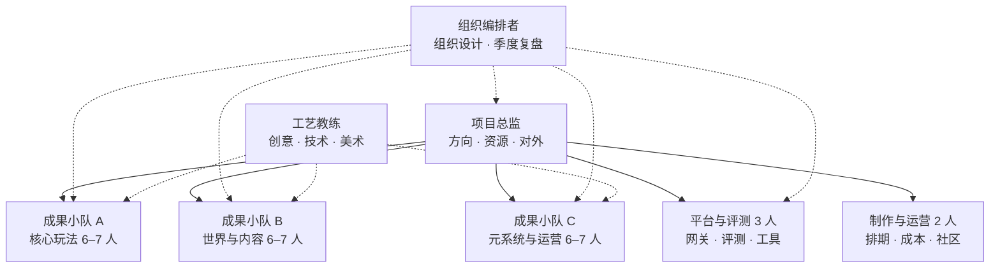

# 智能组织新项目样板 1.0

> 从 0 到 1 组建 AI 原生游戏项目的组织、流程与模板
> 配套《[游戏行业如何组建智能组织](ai-native-org-gaming.md)》使用 · 2026 年 11 月

## 目录

1. [使用说明](#0-使用说明)
2. [一页纸项目画布](#1-一页纸项目画布)
3. [组织设计](#2-组织设计)
4. [开发流程与阶段门](#3-开发流程与阶段门)
5. [运营节奏](#4-运营节奏)
6. [工件与模板](#5-工件与模板)
7. [平台与工具栈](#6-平台与工具栈)
8. [人才与招聘](#7-人才与招聘)
9. [治理与风险](#8-治理与风险)
10. [度量](#9-度量)
11. [项目路线图](#10-项目路线图)
12. [预算模型](#11-预算模型)
13. [启动清单](#12-启动清单)
14. [FAQ](#13-faq)
15. [附录](#14-附录)

## 0. 使用说明

### 0.1 这是什么

这是一份**可直接抄、可填空、可裁剪**的新项目组织样板。它回答的不是"智能组织是什么"，而是：

- 新项目第一天，组织怎么搭？
- 30 个人怎么分工、谁向谁汇报、谁拍板？
- 从概念到上线，设几道门、每道门看什么？
- 每周/每月/每季度开什么会、产出什么？
- 需要哪些模板、工具、预算和岗位？
- 90 天内怎么证明这套组织跑得通？

默认场景：**一个 30 人左右、18–24 个月、PC/主机或移动端的新游戏项目**。可按 15 人、40–60 人裁剪，见 2.4。

### 0.2 适用条件

这套样板成立的前提是：

1. 你对团队组成和开发流程有控制权，不是纯外包/纯移植。
2. 你能把团队拆成 5–9 人的跨职能成果小队。
3. 你愿意为 AI 平台、评测和治理投入至少 3–5 个人（可以和公司共享）。
4. 你接受"阶段门 + 快速止损"，而不是一次性押注全部预算。
5. 你愿意让玩家可见 AI 慢半拍，先把内部效率和质量跑通。

### 0.3 不适用

- 纯外包、纯美术代工、纯发行，没有设计和流程控制权。
- 需求完全固定、不允许探索和 pivot 的项目。
- 团队规模小于 8 人且不打算扩充：可直接用第 13 节 Q1 的"小团队精简版"。
- 组织不允许改变岗位、汇报线或审批方式：先解决授权问题，再谈样板。

### 0.4 30 分钟快速开始

如果你现在就要启动，按这个顺序做：

1. 填完第 1 节的《一页纸项目画布》。
2. 在 2.4 选一个规模配置（默认 30 人）。
3. 写 3 份《成果小队章程》（模板见附录 D）。
4. 把第 3 节的六道阶段门写进项目计划。
5. 把第 4 节的运营日历放进团队日历。
6. 复制第 5 节和附录的模板，建一个"项目操作系统"文档库。
7. 按第 10.2 节的 90 天计划启动。

### 0.5 和《分析》的关系

- **《游戏行业如何组建智能组织》**：回答"为什么、是什么、有哪些路径和风险"，用于对齐方向。
- **本样板**：回答"具体怎么搭、怎么跑、用什么模板"，用于启动和执行。
- 建议顺序：先用分析对齐管理层，再用样板启动项目；不要反过来。

---

## 1. 一页纸项目画布

这是新项目的第一个工件。**一页纸，总监 owner，每月更新一次，不超过 10 分钟阅读。**

| 字段 | 要回答的问题 | 示例（虚构项目 Project Atlas） |
|---|---|---|
| 项目代号 | 内部怎么称呼 | Project Atlas |
| 一句话 | 用什么体验、给谁、在什么平台 | 一款 3 人合作、以物理建造为核心的合作闯关游戏，PC/主机 |
| 目标玩家 | 谁会玩、为什么玩 | 喜欢合作解谜与沙盒建造的 16–35 岁玩家 |
| 核心体验 | 玩家每 5 分钟感受到什么 | "我们一起把不可能的结构搭出来"的协作快感 |
| 品类/平台 | 对标与差异 | 合作动作/建造；PC + 主机，支持跨平台 |
| 团队规模 | 峰值人数与外包 | 30 人 + 美术外包 |
| 预算/时间 | 总预算、首发窗口 | 18–24 个月，预算按公司口径填 |
| 成功指标 | 3–5 个硬指标 | 外部测试推荐率 ≥40%；D7 留存 ≥25%；原型到切片 ≤6 个月 |
| 关键假设 | 最可能错的三件事 | 建造手感、合作同步、关卡复用性 |
| 不做什么 | 明确排除 | 不做开放世界；不做 PvP；不做 UGC 编辑器（首发） |
| 最大风险 | 一个最致命的风险 | 物理同步在 3 人合作下的稳定性 |
| AI 使用边界 | 哪些用、哪些不用、玩家可见怎么披露 | 内部美术/代码/QA 先用；玩家可见 AI 需 Gate 2 单独评审 |
| 阶段门 | 下一道门是什么、什么时候 | Gate 1 可玩原型，第 3 个月末 |

**使用规则**：

- 只写一页；写不下就说明还没想清楚。
- 每个字段必须有 owner，不能是"大家"。
- 每月复盘一次；重大变化写进决策日志。
- 这页纸是给团队和出资人看的，不是给市场看的。

---

## 2. 组织设计

### 2.1 先选组织形式，再画组织图

"智能组织"没有唯一正确的组织形式。先根据项目阶段、规模、不确定性和平台成熟度选形式，再画组织图。

| 形式 | 结构 | 优点 | 缺点 | 适合 |
|---|---|---|---|---|
| 职能制 | 按专业分部门（策划/程序/美术/QA） | 工艺深度、标准统一、人才培养 | 交接多、决策慢、端到端责任弱 | 稳定的大团队、技术平台 |
| 矩阵制 | 专业线 + 项目线双汇报 | 兼顾工艺与项目 | 双重领导、协调成本高、责任模糊 | 多项目共享专家 |
| 项目制 | 临时项目组，按项目聚散 | 目标清晰、速度快 | 资源频繁重组、知识沉淀弱 | 短期、明确的交付 |
| 成果小队 | 5–9 人跨职能，端到端 | 速度快、ownership 强、交接少 | 工艺标准可能碎片化 | 大多数游戏项目 |
| 细胞/工作室 | 小型自治团队，独立决策 | 创业感、决策快、责任清 | 重复建设、平台浪费、质量波动 | 多 IP、组合下注 |
| 平台 + 联邦 | 中央平台/评测 + 业务小队 | 复用、标准、速度兼顾 | 平台/业务边界要设计好 | 20–200 人、多个项目 |
| 网络/生态 | 核心团队 + 外部工作室 | 弹性、外部创新 | IP/质量/治理难 | 发行/组合 |
| AI 原生新建 | 小团队 + 代理栈，从零设计 | 无历史包袱、速度快 | 规模/质量/治理风险 | 新 IP、0→1 实验 |

**选择规则**：

- 0→1、强不确定性、10–20 人：AI 原生小队或项目制，先把乐趣跑通。
- 20–40 人、1–3 个项目：平台 + 联邦（本样板默认）。
- 40–200 人、多项目共享技术：平台 + 联邦，工艺社区保标准。
- 多个小赌注/多 IP：细胞/工作室 + 中央平台。
- 稳定长线游戏：职能制 + 成果小队混合（平台保稳定，小队保迭代）。
- 纯发行/外部研发：网络/生态，核心团队做标准、发行和治理。

**为什么默认是"平台 + 联邦"**：

- 20–40 人是"平台能摊薄、层级还没爆炸"的甜蜜点。
- 小队端到端，保留速度和 ownership；平台提供模型、评测、数据、安全和成本，避免重复踩坑。
- 工艺教练/社区保留标准，避免小队各自为战。
- AI 让平台更值钱（共享模型/评测/安全），也让小队更强（代理栈），两端互相放大。

**常见错配**：

- 10 人团队照搬大厂中央平台 → 平台比业务还重。
- 100 人团队坚持纯项目制 → 重复建设、知识流失。
- 创意驱动团队用强矩阵 → 决策慢、责任模糊。
- 多个 IP 共用一个巨型职能组织 → 每个 IP 都慢。

### 2.2 五条设计原则

1. **最多 3–4 层，管理跨度 6–10。** 多一层就多一次信息损耗；跨度太小就是隐性官僚。
2. **5–9 人成果小队端到端负责一个玩家体验。** 小队有自己的指标、决策权和交付物，不等别人"支援"。
3. **工艺负责人是教练，不是部门老板。** 创意/技术/美术总监对标准和人才负责，不拥有所有资源；资源在小队。
4. **平台与评测是服务，不是关卡。** 平台团队的目标是让小队更快、更安全、更便宜，而不是增加审批。
5. **组织编排者对"组织设计"负责。** 每季度重算角色、团队、工件、工作流；这个角色可以由项目总监兼任，但必须有明确时间。

### 2.3 默认 30 人组织图



**读图要点**：

- 项目总监对结果、预算、对外负责；不直接管每个功能。
- 三个小队是交付主体；每个小队有自己的玩家结果和指标。
- 平台与评测是共享服务；小队可以"消费"，但不能绕过评测和安全。
- 制作与运营负责节奏、成本、外包、社区和发布；不是"催进度"。
- 工艺教练虚线连接小队，负责标准、评审、人才培养；不拥有小队资源。
- 组织编排者虚线连接所有单元，负责组织设计；不参与日常项目管理。

### 2.4 三种规模配置

| 规模 | 小队 | 平台/评测 | 制作/运营 | 工艺教练 | 适用 | 注意 |
|---|---|---|---|---|---|---|
| 15–20 人 | 2 个（6–8 人） | 1–2 人（可共享公司平台） | 1 人 | 2 人兼职 | 原型、小体量、垂直切片 | 总监兼任编排者；不要设纯管理岗 |
| 25–35 人 | 3 个（6–7 人） | 3 人 | 2 人 | 2–3 人（部分兼职） | 默认配置 | 平台/评测不能省；QA 嵌入小队 |
| 40–60 人 | 5–6 个（6–9 人） | 4–6 人 | 3–4 人 | 3–4 人 | 中大型、长线运营 | 增加"代理运营/数据管家"；避免部门墙 |

**裁剪规则**：

- 人少时，先砍"纯协调"和"纯管理"，不要砍评测、平台、QA。
- 人多时，先加小队，不要加层级；平台团队按"每 10–12 个小队 4–6 人"配置。
- 外包可以补产能，但不能补"判断"和"标准"；核心管线必须内部有人负责。
- 如果公司已有中央 AI 平台，项目内只留 1–2 名"平台联络人 + 评测负责人"，不要重复造轮子。

### 2.5 成果小队章程（模板）

每支小队一份，**一页纸**，由小队队长和项目总监共同签字。

| 字段 | 内容 |
|---|---|
| 小队名称 | 例如：核心玩法小队 |
| 使命 | 一句话：我们为什么存在 |
| 玩家结果 | 玩家能感受到什么变化 |
| 范围 | 负责什么（3–5 项） |
| 不负责 | 明确边界，避免扯皮 |
| 指标 | 1 个北极星 + 2–3 个辅助指标 |
| 成员 | 姓名/角色/投入比例 |
| 决策权 | 哪些事小队可以自己定 |
| 接口 | 依赖谁、向谁交付、多久同步 |
| 代理栈 | 用哪些代理/工具，谁维护 |
| 仪式 | 站会、demo、评审、复盘 |
| 风险 | 最大的 2–3 个风险 |

**示例：核心玩法小队**

- 使命：让"建造 + 合作"在 5 分钟内产生可感知的乐趣。
- 玩家结果：玩家会说"我们一起搭出来的东西真酷"，而不是"我按了按钮"。
- 范围：建造手感、物理交互、合作机制、核心关卡原型。
- 不负责：叙事、元系统、商业化、长线运营。
- 指标：原型可玩性评分 ≥4/5；3 人合作完成率 ≥60%；核心循环崩溃率 <1%。
- 决策权：原型范围内的玩法、参数、关卡草稿；超出范围需 Gate 评审。
- 代理栈：代码代理、灰盒生成、Playtest bot、评测集。
- 风险：物理同步、建造上限、合作分工不清晰。

### 2.6 角色记分卡

| 角色 | 使命 | 3 个关键结果 | 决策权 | 关键能力 | AI 杠杆 |
|---|---|---|---|---|---|
| 项目总监 | 对项目结果和团队健康负责 | 按时过门；预算可控；团队稳定 | 立项/砍项目、预算、招聘、对外 | 判断、领导、组合管理 | 用代理做竞品/数据/进度分析，不外包判断 |
| 小队队长 | 端到端交付一个玩家结果 | 小队指标；交付质量；成员成长 | 小队内优先级、方案、任务分配 | 跨职能协作、产品/技术判断 | 用代理做拆解、评审、测试、文档 |
| 创意总监 | 守住体验和品味 | 核心体验成立；风格统一；玩家共鸣 | 创意方向、体验取舍、最终品质 | 审美、叙事、玩家洞察 | 用代理做变体探索，人来策展 |
| 技术总监 | 守住架构、性能、安全和工具链 | 技术风险可控；管线高效；无重大事故 | 架构、技术选型、安全标准 | 架构、AI 工程、治理 | 用代理做代码审查、测试生成、监控 |
| 美术总监 | 守住美术标准和管线 | 风格成立；资产质量；管线效率 | 美术方向、外包标准、最终验收 | 审美、技术美术、策展 | 用代理做概念/变体/贴图，人来定标准 |
| 制作人 | 让节奏、资源和风险可见 | 里程碑达成；成本透明；风险闭环 | 排期、资源协调、外包、发布节奏 | 系统思维、数据、沟通 | 用代理做排期模拟、成本分析、风险汇总 |
| AI 平台负责人 | 让小队安全、便宜、可评测地用上代理 | 平台可用率；单位成本；事故率 | 模型/工具选型、权限、预算护栏 | 平台工程、集成、安全 | 自身就是杠杆，重点是复用 |
| 评测/QA 负责人 | 让质量可测、可回归、可解释 | 评测覆盖；缺陷逃逸率；抽检质量 | 评测标准、上线质量门、抽检比例 | 评测设计、数据分析、探索测试 | 用代理生成用例、跑回归、聚类失败 |
| AI 产品/用例负责人 | 把业务问题翻译成可上线用例 | 试点转生产率；用例 ROI；采用率 | 用例优先级、试点范围、上线建议 | 产品、数据、流程设计 | 用代理做需求分析、原型、评估 |
| 组织编排者 | 让组织随 AI 能力持续进化 | 组织实验数；角色/流程更新；效能提升 | 组织设计建议、季度复盘议程 | 组织设计、系统思维、数据 | 用代理做组织网络分析、效能诊断 |

> 小团队可以合并角色（如总监兼编排者、制作人兼 AI 产品），但**不要合并"评测"和"交付"**，否则质量门会失效。

### 2.7 RACI（示例）

R = 负责执行，A = 最终拍板，C = 被咨询，I = 被通知。

| 决策 | 项目总监 | 小队队长 | 创意总监 | 技术总监 | 制作人 | 平台/评测 | 组织编排者 |
|---|---|---|---|---|---|---|---|
| 立项/继续/砍掉 | A | C | C | C | C | I | I |
| 核心玩法方向 | A | R | C | C | I | I | I |
| 美术风格 | C | R | A | I | I | I | I |
| 技术架构 | I | C | I | A | I | R | I |
| AI 用例上线 | I | R | C | C | I | A（质量/安全） | I |
| 玩家可见 AI 内容 | A | R | C | C | I | C | I |
| 预算/招聘 | A | C | C | C | R | C | I |
| 外包选择 | A | C | C | C | R | I | I |
| 上线决策 | A | C | C | C | R | C | I |
| 组织调整 | A | C | C | C | C | C | R |

**使用规则**：

- 每个决策只能有一个 A；没有 A 的决策不开会。
- R 可以多人，但必须有一个"主 R"。
- C 要限制人数；咨询所有人等于没人负责。
- 决策后 24 小时内写进决策日志。

### 2.8 管理跨度与层级

**目标**：

- 3 层：总监 → 小队队长 → 个人（30 人以内）。
- 4 层：总监 → 制作/平台负责人 → 小队队长 → 个人（60 人以上，谨慎）。
- 管理跨度 6–10；低于 4 说明有隐性层级，高于 12 说明队长过载。

**预警信号**：

- 一个决策要经过 3 个以上审批。
- 小队要等另一个部门"排期"才能开始。
- 出现"纯协调"岗位，且不拥有任何结果。
- 队长每周 >30% 时间在开会/写汇报，而不是在帮小队解决问题。
- 同一个问题在 3 个会上重复讨论。

---

## 3. 开发流程与阶段门

### 3.1 六个阶段与六道门

| 阶段 | 目标 | 建议时长 | 关键交付 | AI 使用 | 人的角色 | 出门标准 |
|---|---|---|---|---|---|---|
| 0. 立项/概念 | 证明"值得做一个原型" | 2–4 周 | 一页纸画布、玩家假设、竞品/市场简报、原型计划 | 调研、竞品分析、概念图、情景模拟 | 判断方向、定假设 | 画布签字；风险清单；原型预算 |
| 1. 可玩原型 | 证明"核心乐趣成立" | 4–8 周 | 可玩 demo（5–10 分钟）、核心循环、初步评测集、Playtest 报告 | 代码、灰盒、资产、Playtest bot | 判断"好不好玩" | 内部可玩性 ≥4/5；核心循环成立；决定 go/pivot/kill |
| 2. 纵向切片 | 证明"能做出目标品质" | 8–12 周 | 30–60 分钟纵向切片、风格样片、生产管线、成本模型 | 美术/动画/音频/QA 管线 | 定品质标准、策展 | 外部测试推荐率达标；管线可复现；预算/排期可信 |
| 3. 预制作/管线 | 证明"能规模化生产" | 8–12 周 | 内容计划、工具链、评测体系、外包方案、生产排期 | 资产变体、测试生成、本地化、自动化 | 定标准、建管线 | 管线跑通 2 个迭代；评测覆盖核心用例；风险可控 |
| 4. 生产/Alpha/Beta | 按计划产出并收敛质量 | 6–12 个月 | 内容完整、功能完整、Alpha/Beta、认证、上线准备 | 批量内容、QA、本地化、运营素材 | 策展、集成、拍板 | Alpha 内容完整；Beta 质量达标；上线清单完成 |
| 5. 上线/长线运营 | 稳定上线并持续迭代 | 持续 | 上线、live-ops、社区、数据复盘、下一季计划 | 活动生成、个性化、客服、反作弊 | 政策、判断、玩家沟通 | 认证/压测/客服/披露/回滚就绪；首月复盘计划 |

**每道门只回答一个问题**：继续、转向、还是停止。不要用"再给一点时间"代替决策。

### 3.2 每阶段的 AI 使用清单

| 阶段 | 优先用 AI 做 | 不要用 AI 做 | 必须有的评测 |
|---|---|---|---|
| 概念 | 调研、竞品、概念图、文案变体、市场情景 | 替团队决定做什么 | 概念图质量抽检；来源/版权检查 |
| 原型 | 代码、灰盒、占位资产、Playtest bot、日志分析 | 替人判断"好不好玩" | 核心循环指标；崩溃率；可玩性问卷 |
| 切片 | 美术/动画/音频、关卡草稿、测试用例、本地化 | 直接出最终资产而不策展 | 风格一致性；性能；外部测试 |
| 预制作 | 资产变体、绑定/动画、自动化测试、知识库 | 绕过技术美术/主美标准 | 管线复现；评测覆盖；成本 |
| 生产 | 批量内容、QA 回归、本地化、运营素材 | 无 owner 签字的玩家可见内容 | 缺陷逃逸率；玩家情绪；合规 |
| 上线/运营 | 活动变体、个性化、客服、反作弊、舆情 | 无人工复核的定价/封号/合规决策 | 在线指标；事故率；申诉率 |

### 3.3 阶段门评审模板

**Gate 评审备忘录（一页纸）**：

| 字段 | 内容 |
|---|---|
| 门 | Gate 1：可玩原型 |
| 日期/owner | 第 12 周 / 项目总监 |
| 证据 | demo 链接、Playtest 报告、评测结果、成本 |
| 标准 | 可玩性 ≥4/5；3 人完成率 ≥60%；崩溃率 <1% |
| AI 评测 | 代码/资产/测试的评测通过率；人工抽检结论 |
| 风险 | 物理同步、建造上限、合作分工 |
| 决策 | Go / Pivot / Kill |
| 下一步 | 预算、人员、时间、下一道门 |
| 决策日志 | 链接 |

**通用出门标准**：

- 交付物齐全，且 owner 签字。
- 指标达到门槛，或有明确的例外批准。
- 风险有 owner、有缓解、有触发条件。
- 预算/排期更新，且被出资人确认。
- 决策写进决策日志，团队可见。

**Kill/Pivot 标准（示例）**：

- 核心乐趣在 2 次原型迭代后仍不成立。
- 外部测试推荐率连续 2 次低于阈值。
- 单位内容成本无法在预算内收敛。
- 关键技术风险无法在 4 周内降到一个可接受水平。
- 团队连续 6 周加班且没有实质进展。

### 3.4 组合管理

- 新项目不是"一个 All-in 的赌注"，而是"2–3 个小赌注 + 阶段加码"。
- 每道门重新分配预算：过门加码，不过门止损。
- 每月一次组合复盘：每个赌注的进展、风险、下一步；砍掉不再值得的项目。
- 省下的原型成本，投入到更多早期探索，而不是立刻变成利润。

---

## 4. 运营节奏

### 4.1 运营日历

| 频率 | 会议 | 参与者 | 目的 | 产出 |
|---|---|---|---|---|
| 每日 15 分钟 | 小队站会 | 小队全员 | 昨天/今天/阻塞/代理异常/交接 | 阻塞清单、当天计划 |
| 每周 60 分钟 | 小队 Demo | 小队 + 相关方 | 展示可玩/可用产出，收集反馈 | 下周优先级、评测更新 |
| 每周 60 分钟 | AI Guild | 平台 + 各队 AI 代表 | 分享用例、失败、成本、工具 | 案例库、复用清单 |
| 每两周 60 分钟 | 制作同步 | 总监/队长/制作/平台 | 跨队依赖、风险、资源 | 依赖解决、风险登记 |
| 每月 90 分钟 | 组合复盘 | 总监/队长/制作/财务 | 赌注进展、预算、砍/加码 | 资源调整、决策日志 |
| 每月 60 分钟 | 成本与风险 | 制作/平台/法务/安全 | token/工具/外包成本、风险 | 预算调整、缓解计划 |
| 每季度 2 小时 | 组织 Meta 复盘 | 总监/队长/编排者/HR | 角色/团队/工件/流程重算 | 下季度组织实验 |
| 每道门后 60 分钟 | 门复盘 | 相关方 | 哪里做对了、哪里要改 | 流程/评测更新 |

### 4.2 会议模板

**每日站会（15 分钟）**：

1. 昨天完成了什么（只讲结果，不讲过程）。
2. 今天最重要的一件事。
3. 阻塞/需要谁帮忙。
4. 代理异常/失败（哪个代理、什么影响、谁处理）。
5. 交接（跨队依赖）。

**每周 Demo（60 分钟）**：

1. 5 分钟：上周目标 vs 实际。
2. 20 分钟：Demo（可玩/可看，不讲 PPT）。
3. 15 分钟：指标 + 评测 + 玩家反馈。
4. 15 分钟：下周优先级 + 风险。
5. 5 分钟：决策/需要谁拍板。

**阶段门评审（90 分钟）**：

1. 10 分钟：目标与标准回顾。
2. 30 分钟：证据（demo、数据、评测、成本）。
3. 20 分钟：风险与备选方案。
4. 20 分钟：决策（Go/Pivot/Kill）。
5. 10 分钟：下一步、owner、日期。

**组织 Meta 复盘（2 小时）**：

1. 30 分钟：过去季度哪些工作变了（AI 能力/工具/成本）。
2. 30 分钟：哪些角色/团队/工件/流程成了瓶颈。
3. 30 分钟：下季度 3 个组织实验（可逆、有指标）。
4. 30 分钟：决策、owner、复盘日期。

### 4.3 决策与信息流

- **区分"单向门"和"双向门"**：可逆决策（工具、参数、排期）由小队自己定；不可逆决策（砍项目、架构、玩家可见 AI）上评审。
- **决策日志**：每个重要决策记录日期、背景、选项、理由、预期、复盘日期、owner。
- **异步优先**：先写一页纸意图，再开会；会议只解决分歧，不读文档。
- **升级路径**：小队 → 项目总监 → 出资人/委员会；明确 SLA（例如 48 小时）。
- **信息透明**：指标、预算、风险、决策对全员可见；不要用"保密"掩盖坏消息。

### 4.4 远程/混合

- 每天至少 3 小时重叠时间；跨时区用异步 demo + 录屏。
- 所有决策、评测、资产元数据进同一个知识库；不要散落在聊天记录。
- 每周一次"无会日"，保护深度工作。
- 代理任务要有清晰的输入/输出/验收，避免"异步等待"变成"无人负责"。

---

## 5. 工件与模板

### 5.1 工件清单

| 工件 | 用途 | Owner | 频率 | 模板 |
|---|---|---|---|---|
| 一页纸项目画布 | 对齐方向、范围、指标 | 项目总监 | 每月 | 第 1 节 |
| 小队章程 | 定义使命、边界、决策权 | 小队队长 | 每季度 | 附录 D |
| 一页纸意图 | 定义单个功能/内容的意图和验收 | 功能 owner | 每个功能 | 附录 A |
| 评测卡 | 定义 AI 用例的质量标准和测试 | 评测负责人 | 每个用例 | 附录 B |
| 决策日志 | 记录重要决策和复盘 | 决策 owner | 每次决策 | 附录 C |
| AI 用例画布 | 评估 AI 用例的价值/风险/成本 | AI 产品 | 每个用例 | 附录 E |
| 风险登记册 | 跟踪风险、触发条件、缓解 | 制作人 | 每月 | 附录 F |
| 代理登记册 | 管理代理的权限、评测、成本 | 平台负责人 | 每月 | 5.7 |
| 阶段门备忘录 | 记录门评审证据和决策 | 项目总监 | 每道门 | 3.3 |
| KPI 仪表盘 | 跟踪北极星和关键指标 | 制作/评测 | 每周 | 9.4 |
| 招聘记分卡 | 统一面试标准 | 招聘负责人 | 每个岗位 | 7.3 |
| 入职 30/60/90 | 让新人快速产出 | 队长/HR | 每个新人 | 7.4 |

### 5.2 一页纸意图（摘要）

每个功能/内容都写一页，包含：

- **结果**：要达成什么玩家/业务结果。
- **体验**：玩家会感受到什么。
- **约束**：风格、技术、合规、预算、时间。
- **验收标准**：什么叫做好了，怎么测。
- **评测计划**：用哪些样本/指标。
- **状态**：当前进度、已知问题、待决策。
- **Owner**：谁对结果负责。

> 详细模板见附录 A。核心原则：**给代理看的意图，要比给人看的 PRD 更结构化。**

### 5.3 评测卡（摘要）

每个 AI 用例一张卡，包含：

- 用例名称、owner、使用场景。
- 质量维度（正确性、风格、性能、安全、版权）。
- 测试集（正例/反例/边界）。
- 门槛（通过率、人工抽检比例）。
- 失败处理（回滚、降级、人工接管）。
- 成本上限。

> 详细模板见附录 B。没有评测卡的 AI 用例，不允许进生产。

### 5.4 决策日志（摘要）

每条记录包含：日期、决策、背景、选项、理由、预期结果、复盘日期、owner、影响范围。

> 详细模板见附录 C。决策日志是组织学习的最小单位。

### 5.5 AI 用例画布（摘要）

| 字段 | 问题 |
|---|---|
| 问题 | 哪个工作流步骤痛？ |
| AI 角色 | 生成/检索/转换/监控/决策支持？ |
| 输入 | 需要什么数据/上下文？ |
| 输出 | 交给谁、什么格式？ |
| 评测 | 怎么判断好坏？ |
| 成本 | 每次/每月多少钱？ |
| 风险 | 失败会怎样？谁负责？ |
| 上线 | 试点范围、回滚、owner |

> 详细模板见附录 E。

### 5.6 风险登记册（摘要）

| 风险 | 概率 | 影响 | Owner | 缓解 | 触发条件 | 状态 |
|---|---|---|---|---|---|---|
| 物理同步不稳定 | 中 | 高 | 技术总监 | 早期验证/降级 | 崩溃率 >5% | 跟踪 |

> 详细模板见附录 F。每月复盘一次；高风险必须进组合复盘。

### 5.7 代理登记册（摘要）

| 代理 | 用途 | 模型 | 工具/权限 | 评测卡 | Owner | 月成本 | 状态 |
|---|---|---|---|---|---|---|---|
| 关卡灰盒代理 | 生成灰盒草稿 | 多模型 | 编辑器只读 | EV-012 | 关卡组长 | 200 美元 | 试点 |

**规则**：

- 没有 owner 的代理不允许上线。
- 权限最小化；高风险工具需要人工审批。
- 每月审计一次调用量、失败率、成本、异常。

### 5.8 阶段门备忘录

见 3.3 的模板。每道门一页纸，附证据链接。

### 5.9 KPI 仪表盘

见 9.4。至少包含：北极星、周期、质量、成本、员工负荷、玩家情绪。

### 5.10 招聘记分卡

见 7.3。每个岗位 5–7 个维度，面试官独立打分，避免"感觉不错"。

### 5.11 入职 30/60/90

见 7.4。30 天理解项目和工具；60 天独立交付一个小结果；90 天 owning 一个指标/模块。

---

## 6. 平台与工具栈

### 6.1 最小可用栈

| 层 | 工具/能力 | 目的 | 建/买 | Owner |
|---|---|---|---|---|
| 模型网关 | 多模型接入、路由、配额、计费 | 统一入口，控成本 | 建/轻量自建 | 平台 |
| 数据/资产 | 遥测、资产库、元数据、知识库 | 让代理拿得到、用得对 | 建 | 平台/数据 |
| 评测 | 评测集、回归、抽检、失败回流 | 质量可测 | 建 | 评测 |
| 可观测 | 调用链、日志、成本、异常 | 可追踪、可审计 | 建/买 | 平台 |
| 安全 | RBAC、DLP、沙箱、审计 | 防泄漏、防滥用 | 建/买 | 安全/平台 |
| 工具链 | 美术/代码/QA/本地化连接器 | 把 AI 接进管线 | 买 + 集成 | 平台 |
| 版本/CI | 代码、资产、配置、构建 | 可复现 | 买 | 技术 |
| 项目/知识 | 任务、文档、决策日志、指标 | 单一事实源 | 买 | 制作 |
| 代理框架 | 代理编排、工具调用、权限 | 让代理可运行 | 建/买 | 平台 |

### 6.2 建 vs 买

**优先买**：前沿模型、通用美术/代码/QA 工具、评测 SaaS、项目管理、版本控制、DLP。

**优先建**：

- 模型网关/路由（成本和质量策略是核心竞争力）。
- 评测集和领域评测（别人没有你的玩家和标准）。
- 数据/资产元数据（你的游戏资产是独特资产）。
- 领域代理（关卡、剧情、平衡、运营）。
- 与引擎/管线的集成。

**不要建**：基础大模型（除非有明确的数据/成本/合规理由）、通用聊天 UI、重复的文档系统。

### 6.3 数据与知识

- **资产元数据**：风格、版权、来源、性能、可复用性、变体关系。
- **决策日志**：为什么做、为什么砍、谁拍板、什么时候复盘。
- **评测集**：正例/反例/边界；每次事故/返工都回流。
- **遥测**：留存、会话、关卡、崩溃、付费、舆情。
- **提示/代理库**：可复用的代理、工具链、提示模板、失败案例。
- **Playtest 笔记**：玩家原话、行为录屏、情绪点；结构化到可检索。

### 6.4 安全

- **权限最小化**：代理只能访问完成任务所需的数据和工具。
- **沙箱**：高风险操作先在沙箱跑；保留回滚。
- **DLP**：源码、未发布内容、玩家隐私不进外部模型。
- **提示注入**：对外部内容（网页、玩家输入、第三方资产）做隔离和过滤。
- **审计**：谁、何时、用什么模型、生成了什么、谁批准。
- **供应商**：合同写清数据使用、留存、训练、赔偿、退出。

### 6.5 成本

- 把 token/算力当 COGS，不是 IT 费用。
- 每月看：单位资产成本、单位功能成本、每次调用成本、成本占研发比例。
- 设预算护栏、异常告警、降级策略。
- 多模型路由：简单任务用便宜模型，复杂任务用强模型。
- 每季度做一次"成本 vs 价值"复盘：砍掉低价值高成本用例。

---

## 7. 人才与招聘

### 7.1 角色配置表（按规模）

| 角色 | 15–20 人 | 25–35 人 | 40–60 人 |
|---|---|---|---|
| 项目总监 | 1 | 1 | 1 |
| 小队队长 | 2（兼 IC） | 3 | 5–6 |
| 创意总监 | 1（兼） | 1 | 1 |
| 技术总监 | 1（兼） | 1 | 1 |
| 美术总监 | 1（兼） | 1 | 1 |
| 制作人 | 1 | 1–2 | 2–3 |
| AI 平台 | 1（共享） | 2–3 | 4–6 |
| 评测/QA | 1（兼） | 2–3 | 4–6 |
| AI 产品 | 0–1（兼） | 1 | 2 |
| 组织编排者 | 总监兼 | 1（兼） | 1（专职） |
| 代理运营/数据管家 | 0 | 0–1（兼） | 1–2 |

### 7.2 招聘顺序

**前 10 人**（决定项目能不能起步）：

1. 项目总监（方向、资源、对外）。
2. 技术总监/平台负责人（架构、工具、AI 接入）。
3. 创意总监或主策划（体验、玩家洞察）。
4. 3 名小队队长/核心 IC（玩法、内容、系统）。
5. 制作人（节奏、预算、风险）。
6. 评测/QA 负责人（质量门）。
7. 美术总监/主美（风格、管线）。
8. 第 10 人：一名关键 IC（按最大瓶颈补，如动画/音频/运营）。

**第 11–20 人**（补齐小队和平台）：

- 各小队补齐跨职能（程序/美术/设计/QA）。
- 平台工程师（网关、工具、集成）。
- 技术美术（资产管线）。
- 本地化/音频（可外包）。

**第 21–30 人**（规模化）：

- 内容/关卡/叙事。
- 运营/社区。
- 数据/评测。
- 外包管理。

**招聘原则**：

- 先补"瓶颈能力"，不要按"行业标配"堆人。
- 每个岗位先写"结果"和"决策权"，再写"要求"。
- 宁可少招一个"纯执行"，多招一个"能定义问题"的人。
- 用 AI 能补的产能，不要用 headcount 补；用 headcount 补判断、关系和标准。

### 7.3 面试 loop

| 环节 | 看什么 | 形式 |
|---|---|---|
| 作品/案例 | 真实能力、品味、深度 | 作品集/案例复盘 |
| 工艺 | 专业深度 | 现场题/带回家题（限时） |
| AI 协作 | 能否用代理完成真实任务 | 给一个真实小任务，观察过程 |
| 协作 | 跨职能沟通、反馈、冲突 | 行为面试/角色扮演 |
| 价值观 | 玩家导向、诚实、学习 | 结构化问题 |
| 反向面试 | 候选人问团队 | 30 分钟 |

**评分**：每个维度 1–5 分，独立记录证据；不因"缺人"降低标准。

**招聘记分卡（每个岗位一份）**：

| 维度 | 权重 | 1 分 | 3 分 | 5 分 | 证据 |
|---|---|---|---|---|---|
| 工艺深度 | 30% | 低于岗位要求 | 达到要求 | 明显超过，能定标准 | |
| 端到端交付 | 25% | 只做片段 | 能独立交付 | 能端到端负责结果 | |
| AI 协作 | 20% | 抗拒/不会 | 会用工具 | 能设计代理/评测工作流 | |
| 协作与反馈 | 15% | 难合作 | 正常协作 | 能提升团队 | |
| 玩家/价值观 | 10% | 不匹配 | 基本匹配 | 明显加分 | |

> 权重按岗位调整；面试官独立打分，汇总时看证据，不看平均分。

### 7.4 入职 30/60/90

- **30 天**：理解项目画布、玩家、指标、工具、代理栈；完成一个小交付。
- **60 天**：独立负责一个功能/模块；通过一次评测/评审；提出一个改进。
- **90 天**：owning 一个指标/管线；能带一个代理工作流；完成一次分享。

**入职计划（每个新人一份）**：

| 阶段 | 目标 | 交付 | 支持人 | 检查点 |
|---|---|---|---|---|
| 30 天 | 理解项目/工具/玩家 | 一个小交付 | 队长/导师 | 1:1 + 反馈 |
| 60 天 | 独立负责一个模块 | 一次评测/评审通过 | 队长 | 评审记录 |
| 90 天 | owning 一个指标/管线 | 一次分享 + 改进 | 队长/总监 | 绩效校准 |

### 7.5 培训

- **全员**：AI 素养（能做什么/不能做什么/安全/版权/披露）、项目工具、评测基础。
- **工种**：美术（生成/策展/管线）、程序（代理/评测/安全）、设计（模拟/原型/数据）、制作（组合/成本/风险）。
- **实践**：黑客松、案例库、导师制、每月一次"失败分享"。
- **时间**：入职首月至少 2 天；之后每月 4 小时；不占用休息时间。

### 7.6 绩效

- **看结果**：玩家价值、质量、周期、成本。
- **看协作**：跨职能、知识分享、带人。
- **看 AI 杠杆**：是否把重复工作交给代理、是否沉淀评测/工件。
- **不看**：提示词数量、工具数量、AI 生成代码行数、加班时长。
- **原则**：绩效评估不能奖励"用 AI 表演"，也不能惩罚"合理使用 AI 但结果不佳"的实验。

---

## 8. 治理与风险

### 8.1 风险分级

| 级别 | 场景 | 审批 | 评测 | 披露 |
|---|---|---|---|---|
| T0 | 内部辅助（头脑风暴、文档、报表） | 无需逐次 | 抽检 | 不需要 |
| T1 | 内部决策支持（分析、代码建议、测试用例） | 队长/负责人 | 人工复核 + 评测 | 内部说明 |
| T2 | 玩家可见内容（美术、文本、配音、NPC） | 创意/美术/技术总监 | 质量门 + 抽检 + 版权 | 平台/玩家披露 |
| T3 | 收入/安全/合规（定价、反作弊、未成年人、隐私） | AI 评审委员会 | 红队 + 审计 + 回滚 | 法务/公关 |

### 8.2 AI 评审委员会

**成员**：项目总监（主席）、技术总监、创意/美术总监、平台负责人、评测负责人、法务/HR（兼职）。

**职责**：

- 审批 T3 用例和高风险 T2 用例。
- 复盘 AI 事故。
- 每季度审查 AI 政策、供应商、成本。
- 对"玩家可见 AI"做最终判断。

**SLA**：普通事项 48 小时；紧急事故 2 小时响应。

### 8.3 玩家可见 AI 政策

- **先内部、后外部**：内部效率和质量跑通，再考虑玩家可见。
- **三条件**：更好玩/更好体验 + 可信（质量/版权/安全）+ 可披露。
- **披露**：遵守 Steam/主机平台规则；在商店页、游戏内、营销素材中如实说明。
- **质量门**：玩家可见内容必须由 owner 签字；AI 生成资产必须经过策展和质检。
- **版权**：训练数据来源、生成物归属、第三方条款；优先内部/授权数据。
- **劳工**：尊重配音演员、艺术家、外包的权益；提供同意/退出机制；遵守工会协议。
- **沟通**：讲"更多可能性/更好体验"，不要讲"更便宜/更少人"。

### 8.4 版权、训练数据与劳工

- **训练数据**：记录来源、许可证、使用范围；保留审计记录。
- **生成物**：明确归属、商用范围、二次修改权；按美术/音频/文本分别规定。
- **第三方模型**：合同写清数据使用、训练、留存、赔偿、退出。
- **外包**：合同写清 AI 使用、数据、质量、版权、保密。
- **劳工**：与配音/美术/外包建立 AI 使用规则；透明沟通；遵守当地法律。

### 8.5 事故响应

| 级别 | 例子 | 响应 | 处理 |
|---|---|---|---|
| S1 | 数据泄露、玩家可见严重错误、合规事故 | 2 小时内 | 停止相关代理/功能；回滚；通知法务/公关；复盘 |
| S2 | 批量质量问题、成本异常、版权投诉 | 24 小时内 | 降级/人工接管；修复；更新评测 |
| S3 | 单个用例失败、局部返工 | 48 小时内 | 修复；记录；更新评测 |

**每次事故必须产出**：时间线、根因、影响、修复、评测更新、负责人、截止日期。

### 8.6 合规清单

- **中国**：生成合成内容标识、生成式 AI 服务管理、隐私、未成年人保护。
- **欧盟**：AI Act 风险分级/透明度；GDPR。
- **美国/其他**：版权、肖像权、声音权、消费者保护、州级 AI 法律。
- **平台**：Steam/主机平台的 AI 披露与内容政策。
- **年龄分级**：AI 聊天/NPC、生成内容对分级的影响。
- **隐私**：玩家数据脱敏、跨境传输、留存期限。

> 具体合规要求由法务按业务所在地确认；本样板不构成法律意见。

### 8.7 风险登记册（示例）

| 风险 | 概率 | 影响 | Owner | 缓解 | 触发条件 | 状态 |
|---|---|---|---|---|---|---|
| 物理同步不稳定 | 中 | 高 | 技术总监 | 早期原型验证；降级方案 | 3 人测试崩溃率 >5% | 跟踪 |
| AI 资产风格不一致 | 高 | 中 | 美术总监 | 风格 LoRA/参考集；人工策展 | 外部测试负面 >20% | 缓解中 |
| 玩家对 AI 披露反弹 | 中 | 高 | 项目总监 | 提前沟通；质量优先；披露策略 | 舆情负面激增 | 跟踪 |
| token 成本超预算 | 中 | 中 | 平台负责人 | 路由/配额/降级 | 月成本 >预算 120% | 缓解中 |
| 核心人才流失 | 低 | 高 | 总监/HR | 期权/成长/透明 | 关键岗位离职 | 跟踪 |

---

## 9. 度量

### 9.1 北极星与 8 个指标

**北极星（建议二选一）**：

- **从想法到被验证的玩家乐趣的周期**（越短越好）。
- **每月被验证的玩家体验假设数**（越多越好，但要有质量门槛）。

**8 个核心指标**：

| 维度 | 指标 | 定义 | 目标方向 |
|---|---|---|---|
| 速度 | 原型周期 | 想法→可玩原型的天数 | 下降 |
| 速度 | 切片周期 | 原型→纵向切片的天数 | 下降 |
| 质量 | 可玩性评分 | 内部/外部测试的加权分 | 上升 |
| 质量 | 缺陷逃逸率 | 上线后缺陷/总缺陷 | 下降 |
| 经济 | 单位学习成本 | 试点总成本/有效学习次数 | 下降 |
| 经济 | 内容单位成本 | 每个可用内容的成本 | 下降 |
| 组织 | 创意时间占比 | 员工用于创造/判断的时间 | 上升 |
| 组织 | 员工负荷 | 加班、倦怠、eNPS | 改善 |

### 9.2 阶段门指标

| 门 | 关键指标 | 建议门槛（按项目校准） |
|---|---|---|
| Gate 0 概念 | 画布签字、风险、预算 | 画布签字；风险清单；原型预算 |
| Gate 1 原型 | 可玩性、完成率、崩溃率 | 可玩性 ≥4/5；3 人完成率 ≥60%；崩溃率 <1% |
| Gate 2 切片 | 外部推荐率、性能、风格一致性 | 推荐率 ≥40%；帧率达标；风格抽检 ≥90% |
| Gate 3 预制作 | 管线复现、评测覆盖、预算可信 | 2 个迭代跑通；核心用例评测覆盖 100%；预算偏差 <15% |
| Gate 4 Alpha/Beta | 内容完整、缺陷、认证 | 内容 100%；阻断缺陷 0；认证清单完成 |
| Gate 5 上线就绪 | 认证、压测、披露、S1 预案 | 认证完成；压测通过；披露完成；S1 演练 |

> D7/D30 是上线后 30 天复盘指标，不作为 Gate 5 的出门条件；上线后 30 天单独做一次复盘。

### 9.3 反指标

- 提示词数量、工具数量、AI 生成代码行数。
- 单纯的"AI 使用率"。
- 用 AI 导致的裁员人数。
- Demo/PPT 数量。
- 生成内容数量（不看质量）。

### 9.4 仪表盘模板

| 区域 | 指标 | 本周 | 上周 | 趋势 | Owner |
|---|---|---|---|---|---|
| 北极星 | 从想法到验证的周期 | | | | 制作 |
| 速度 | 原型/切片/内容周期 | | | | 制作 |
| 质量 | 可玩性/评测通过/缺陷逃逸 | | | | 评测 |
| 经济 | 单位学习/内容成本/token 占比 | | | | 平台/财务 |
| 组织 | 创意时间/负荷/离职风险 | | | | 编排者/HR |
| 玩家 | 推荐率/D7/情绪 | | | | 产品/运营 |

**规则**：每周更新；每月复盘；每个红项有 owner 和下一步。

---

## 10. 项目路线图

> 前 12 个月重点 + 后续到上线；按阶段门顺延，不按日历硬推。

### 10.1 总览

| 月份 | 重点 | 组织动作 | 关键交付 | 门 |
|---|---|---|---|---|
| 0 | 启动 | 任命总监/队长；建平台 MVP；定节奏 | 项目画布、章程、预算、风险册 | — |
| 1 | 概念 | 3 个小队成型；AI Guild 启动 | 概念/竞品/原型计划 | — |
| 2–3 | 原型 | 小队端到端；评测卡；Playtest | 可玩 demo、评测集、成本基线 | Gate 1 |
| 4–6 | 切片 | 补平台/评测；外部测试 | 纵向切片、风格样片、生产管线 | Gate 2 |
| 7–9 | 预制作 | 管线跑通；外包；内容计划 | 内容计划、工具链、预算/排期 | Gate 3 |
| 10–12 | 生产启动 | 规模化；运营准备 | Alpha 计划、认证清单、上线策略 | Gate 4（或下一年） |
| 13–24 | 生产/Beta/上线 | 规模化；运营/社区；Live-ops | Beta、认证、上线、首季内容 | Gate 5 |

> 时间轴按 18–24 个月项目设计；如果项目更小，压缩到 9–12 个月；如果更大，按阶段门顺延。

### 10.2 90 天详细计划

| 周 | 动作 | 产出 | Owner |
|---|---|---|---|
| 1 | 任命总监/队长；写项目画布；定 3 个小队 | 画布、组织图、章程 v0 | 总监 |
| 2 | 建平台 MVP（网关/评测/成本/权限）；定运营日历 | 平台 v0、日历 | 平台/制作 |
| 3 | 选 2–3 个 AI 试点；写评测卡；定基线 | 试点章程、评测卡、基线 | 评测/AI 产品 |
| 4 | 启动原型；第一次 Demo；风险册 | 原型计划、Demo、风险册 | 小队/制作 |
| 5–8 | 原型迭代；每周 Demo；AI Guild；成本看板 | 可玩 demo、案例库 | 小队/平台 |
| 9 | Gate 1 预评审；补评测；外部小测 | 评审备忘录、测试报告 | 总监/评测 |
| 10 | Gate 1 决策（Go/Pivot/Kill） | 决策日志、下一阶段计划 | 总监 |
| 11 | 切片计划；补人/外包；管线设计 | 切片计划、预算更新 | 制作/技术 |
| 12 | 切片启动；季度组织 Meta 复盘 | 切片 demo、组织实验 | 总监/编排者 |

### 10.3 前 30 天清单

**Day 1**：

- [ ] 任命项目总监和小队队长。
- [ ] 写一页纸项目画布 v0。
- [ ] 建决策日志、风险册、项目知识库。
- [ ] 发 AI 使用政策 v0（T0–T3 分级）。
- [ ] 定每日站会/每周 Demo 时间。

**Week 1**：

- [ ] 三个小队章程 v0。
- [ ] 基线指标（周期/成本/质量/负荷）。
- [ ] 选 2–3 个 AI 试点，写评测卡。
- [ ] 平台账号/权限/预算护栏。
- [ ] 招聘计划/面试 loop。

**Month 1**：

- [ ] 可玩原型 v0。
- [ ] Gate 1 准备会（对齐标准/证据，不是正式评审）。
- [ ] 成本看板 v0。
- [ ] 风险册第一次复盘。
- [ ] 团队 NPS/负荷调查。

### 10.4 90 天组织 Definition of Done

- [ ] 3 个小队端到端交付，不依赖"临时支援"。
- [ ] 每周 Demo 连续 8 周，决策日志 ≥20 条。
- [ ] 2–3 个 AI 用例有评测卡、有 owner、有成本数据。
- [ ] 平台 MVP 可用（网关/评测/成本/权限）。
- [ ] 至少一次 Gate 决策（Go/Pivot/Kill）。
- [ ] 员工负荷没有恶化；关键岗位无意外离职。
- [ ] 组织 Meta 复盘产出下季度 3 个实验。

---

## 11. 预算模型

### 11.1 成本结构（建议区间）

| 类别 | 基准占比 | 可调范围 | 说明 |
|---|---|---|---|
| 人员 | 62% | 55–70% | 工资、福利、外包人力 |
| 算力/token | 8% | 5–10% | GPU/云、模型调用 |
| 工具/软件 | 4% | 3–5% | 引擎、DCC、AI 工具、项目管理 |
| 外包 | 16% | 10–20% | 美术、音频、本地化、QA |
| 预备金 | 10% | 8–12% | 风险、返工、机会 |
| **合计** | **100%** | — | 单项调整后需重新平衡其他项 |

> 基准合计 100%；可调范围只用于单项调整，不能同时取上下限；调整一项要重新平衡其他项。以上为规划启发式，不是行业基准；按公司地区、品类、外包比例调整。

### 11.2 30 人示例（占位单位成本）

| 项目 | 计算方式 | 示例 |
|---|---|---|
| 人员 | 30 人 × 人均全成本 × 12 个月 | 填入公司人均成本 |
| 算力/token | 人员成本 × 5–10% | 填入预算 |
| 工具 | 30 人 × 每人每月工具费 × 12 | 填入预算 |
| 外包 | 人员成本 × 10–20% | 填入预算 |
| 预备金 | 上述合计 × 10–15% | 填入预算 |

**不要**在公开文档里写具体薪资；用公司财务口径填。

### 11.3 单位经济性

- **单位学习成本**：一次原型/测试的总成本 ÷ 有效学习次数。
- **单位内容成本**：一个可用关卡/角色/赛季的成本。
- **单位功能成本**：一个功能从想法到上线的成本。
- **token 占比**：token/算力成本 ÷ 研发总成本。
- **AI 杠杆率**：AI 辅助产出的价值 ÷ AI 成本（定性 + 定量）。

### 11.4 预算治理

- 每月成本复盘；超预算 10% 触发解释，20% 触发调整。
- 每道门重新分配预算；不过门就止损。
- 预留 10–15% 预备金，不要全部押在首发内容。
- 把"省下的原型成本"再投入早期探索，而不是直接变成利润。

---

## 12. 启动清单

### 12.1 Day 1

- [ ] 项目总监、队长、制作人到位。
- [ ] 一页纸画布 v0。
- [ ] 决策日志/风险册/知识库。
- [ ] AI 政策 v0。
- [ ] 运营日历。

### 12.2 Week 1

- [ ] 3 份小队章程。
- [ ] 基线指标。
- [ ] 2–3 个 AI 试点 + 评测卡。
- [ ] 平台账号/权限/预算。
- [ ] 招聘计划。

### 12.3 Month 1

- [ ] 可玩原型 v0。
- [ ] Gate 1 准备会（对齐标准/证据）。
- [ ] 成本看板。
- [ ] 风险复盘。
- [ ] 负荷/NPS 调查。

### 12.4 90 天组织 Definition of Done

见 10.4。**没有达到，不要急着扩编；先修组织、平台、评测。**

---

## 13. FAQ

**Q1：我们只有 10 个人，怎么用这套样板？**

用"小团队精简版"：2 个小队（每队 4–5 人）+ 总监兼制作/编排 + 1 名平台/评测通才；砍掉工艺教练的专职岗位，用外部顾问/社区补；平台尽量买，不建。阶段门保留，但评审可以合并到每周 Demo。

**Q2：AI 质量不够，能用于最终资产吗？**

分用途：探索/草稿/变体/占位可以大胆用；最终资产必须过质量门和 owner 签字。先把 AI 用在"扩大探索面"和"减少重复劳动"，不要用在"降低最终标准"。

**Q3：美术/配音/策划担心被替代，怎么办？**

透明沟通 + 参与设计 + 转岗培训 + 明确边界。让创作者负责策展、标准、最终品质，而不是被排除在外。不要用"AI 会创造更多工作"空话；给出具体的角色变化和培训计划。

**Q4：怎么算 ROI？**

先算四个数：周期、单位成本、质量、员工负荷。再用"单位学习成本"和"单位内容成本"对比。不要用"用了多少 AI"或"生成了多少内容"算 ROI。

**Q5：什么时候该多招人，什么时候该加代理？**

瓶颈是"量"（资产、测试、本地化）→ 加代理；瓶颈是"判断/关系/标准/上下文"→ 加人。代理不能替你决定"做什么游戏"。

**Q6：老板要求裁 30% 人，用 AI 补，怎么办？**

先砍范围和组合，不要先砍能力。用 AI 提升现有团队产能，把省下的资源投入验证；如果必须减员，透明沟通、给转岗、保留关键判断岗位。用 AI 做裁员的遮羞布，会同时失去士气和口碑。

**Q7：玩家反对 AI 怎么办？**

先内部用，玩家可见慢半拍；做到"更好玩 + 可信 + 可披露"；尊重版权和创作者；提前沟通，不要等被发现。玩家反对的往往不是 AI 本身，而是"质量下降、被欺骗、创作者被替代"。

**Q8：这套样板多久复盘一次？**

每周看指标，每月看组合/成本/风险，每季度做组织 Meta 复盘，每道门做门复盘。样板本身每 6 个月更新一次。

---

## 14. 附录

### 附录 A：一页纸意图模板

```markdown
# 意图：<功能/内容名称>

- Owner：
- 日期：
- 状态：草稿 / 评审 / 进行中 / 完成

## 结果
<要达成什么玩家/业务结果>

## 玩家体验
<玩家会感受到什么；用玩家语言，不用内部术语>

## 约束
- 风格：
- 技术：
- 合规：
- 预算/时间：

## 验收标准
- [ ] <可测标准 1>
- [ ] <可测标准 2>
- [ ] <可测标准 3>

## 评测计划
- 样本/指标：
- 人工抽检：
- 失败处理：

## 依赖与接口
- 依赖：
- 交付给：

## 风险
- <风险 1> / <缓解>
- <风险 2> / <缓解>
```

### 附录 B：评测卡模板

```markdown
# 评测卡：<用例名称>

- Owner：
- 使用场景：
- 风险级别：T0 / T1 / T2 / T3

## 质量维度
| 维度 | 标准 | 权重 |
|---|---|---|
| 正确性 | | |
| 风格/一致性 | | |
| 性能 | | |
| 安全/合规 | | |
| 版权/来源 | | |

## 测试集
- 正例：
- 反例：
- 边界：
- 回归：

## 门槛
- 自动通过率：
- 人工抽检比例：
- 阻断条件：

## 失败处理
- 回滚：
- 降级：
- 人工接管：

## 成本
- 每次调用：
- 每月上限：
```

### 附录 C：决策日志模板

```markdown
# 决策：<一句话>

- 日期：
- Owner：
- 影响范围：
- 类型：单向门 / 双向门

## 背景
<为什么现在要做这个决策>

## 选项
1. <选项 A>：优点/缺点
2. <选项 B>：优点/缺点
3. <选项 C>：优点/缺点

## 决定
<选了什么，为什么>

## 预期
<预期结果；怎么衡量>

## 复盘
- 复盘日期：
- 实际结果：
- 学到什么：
```

### 附录 D：小队章程模板

```markdown
# 小队章程：<名称>

- 队长：
- 成员：
- 周期：

## 使命
<一句话>

## 玩家结果
<玩家能感受到什么>

## 范围
- <负责 1>
- <负责 2>
- <负责 3>

## 不负责
- <边界 1>
- <边界 2>

## 指标
- 北极星：
- 辅助：

## 决策权
- 可以自己定：
- 需要上报：

## 接口
- 依赖：
- 交付：
- 同步节奏：

## 代理栈
- 代理/工具：
- 维护人：

## 仪式
- 站会：
- Demo：
- 评审：
- 复盘：

## 风险
- <风险 1>
- <风险 2>
```

### 附录 E：AI 用例画布模板

```markdown
# AI 用例：<名称>

- Owner：
- 工作流步骤：
- 风险级别：

## 问题
<哪个步骤痛；现在的成本/周期/质量>

## AI 角色
生成 / 检索 / 转换 / 监控 / 决策支持

## 输入
<数据/上下文/权限>

## 输出
<交给谁；什么格式；怎么验收>

## 评测
<评测卡链接；通过标准>

## 成本
<每次/每月；预算上限>

## 风险
<失败会怎样；谁负责；怎么回滚>

## 试点
- 范围：
- 周期：
- 成功标准：
- 下一步：
```

### 附录 F：风险登记册模板

```markdown
# 风险登记册

| 风险 | 概率 | 影响 | Owner | 缓解 | 触发条件 | 状态 |
|---|---|---|---|---|---|---|
| | 高/中/低 | 高/中/低 | | | | 跟踪/缓解/关闭 |
```

### 附录 G：阶段门评审模板

```markdown
# Gate <N>：<名称>

- 日期：
- Owner：
- 参会：

## 目标
<这道门要证明什么>

## 证据
- Demo：
- 指标：
- 评测：
- 成本：
- 玩家反馈：

## 标准
- [ ] <标准 1>
- [ ] <标准 2>
- [ ] <标准 3>

## AI 评测
<评测卡结果；人工抽检；异常>

## 风险
<最大风险；缓解；触发条件>

## 决策
Go / Pivot / Kill

## 下一步
- 预算：
- 人员：
- 时间：
- 下一道门：

## 决策日志
<链接>
```

### 附录 H：会议议程

**每日站会（15 分钟）**

1. 昨天结果（每人 1 分钟）。
2. 今天最重要的一件事。
3. 阻塞/需要谁。
4. 代理异常。
5. 交接。

**每周 Demo（60 分钟）**

1. 目标 vs 实际（5 分钟）。
2. Demo（20 分钟）。
3. 指标/评测/玩家反馈（15 分钟）。
4. 下周优先级/风险（15 分钟）。
5. 决策（5 分钟）。

**组织 Meta 复盘（2 小时）**

1. 能力变化（30 分钟）。
2. 瓶颈（30 分钟）。
3. 下季度 3 个实验（30 分钟）。
4. 决策/owner/日期（30 分钟）。

### 附录 I：参考资料

1. 本样板的策略与证据基础：《[游戏行业如何组建智能组织](ai-native-org-gaming.md)》。
2. GDC State of the Game Industry 2026：https://www.gamesindustry.biz/gdc-state-of-the-game-industry-report-40-of-developers-are-using-generative-ai-for-work
3. Joseph Kim《The Organizational Meta》（角色/团队/工件/流程 + 组织编排者）：https://www.gamemakers.com/p/the-organizational-meta-a-new-blueprint
4. Joseph Kim 播客《Why Your Game Studio's Organizational Structure Is the Real Problem》（5–9 人成果小队）：https://www.gamemakers.com/p/why-your-game-studios-organizational
5. McKinsey《The agentic organization》：https://www.mckinsey.com/capabilities/people-and-organization/our-insights/the-agentic-organization-contours-of-the-next-paradigm-for-the-ai-era
6. Krafton AI-first 与组织重组（VGC）：https://www.videogameschronicle.com/news/pubg-publisher-krafton-creates-new-chief-ai-officer-executive-role-as-it-continues-its-ai-first-strategy/
7. Nexon 与 Krafton 的 AX 经验（NDC26，GameMeca）：https://www.gamemeca.com/zh/view.php?gid=1776687
8. Steam AI 披露规则（VGC）：https://www.videogameschronicle.com/news/valve-has-significantly-rewritten-steams-rules-for-how-developers-much-disclose-ai-use/
9. 《人工智能生成合成内容标识办法》：https://www.spp.gov.cn/spp/tt/202503/t20250314_690508.shtml

---

## 结语

样板不是答案，而是起点。真正决定成败的，不是组织图画得多漂亮，而是：

- 小队能不能端到端把一件事做完；
- 评测能不能守住质量；
- 平台能不能让 AI 便宜、安全、可复用；
- 组织能不能每季度根据证据改自己。

先把 90 天跑通，再谈规模化。
