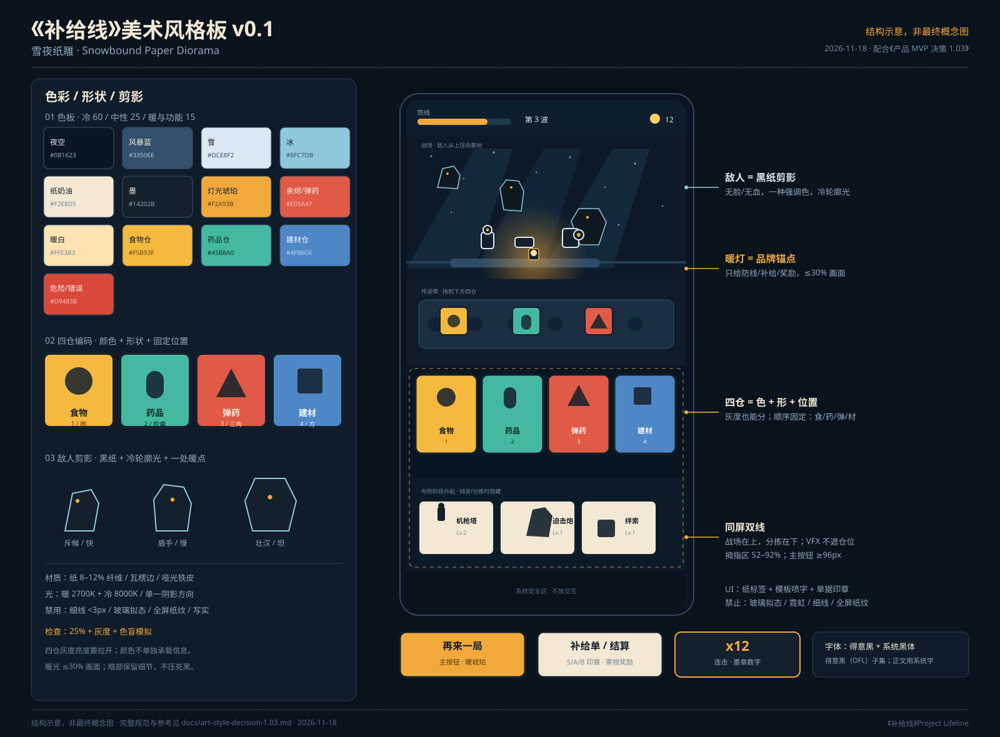

# 《补给线》美术风格决策 1.03：雪夜纸雕

> **这是什么**：1.03 的产品方向已经拍板（排序 + 轻塔防、竖屏、3 分钟一局、微信小游戏首发），本文件把「美术风格」也定下来：选一个方向、给出可执行的视觉规范、参考对标、资产与验证计划，作为 W1 风格板和后续量产的上游输入。
>
> **版本**：v1.0 · 2026-11-18  
> **输入**：1.03《产品 MVP 决策 1.03》（[PR #10](https://github.com/qiutanghongfeng/SuperPegasus/pull/10)）、[#11 定方向 1.03](https://github.com/qiutanghongfeng/SuperPegasus/issues/11)  
> **范围**：美术方向、视觉语言、参考、风格板交付、产能与验证。不替代玩法/数值/商业化决策，也不替代最终的商标、字体与素材版权审查。  
> **状态**：风格方向由本文件拍板；题材、敌人设定、图标与风格板需 owner 在 W1 签字；若题材变更，按第 8.3 节换皮，不重开风格。

## 0. 一页结论

**选 S1。** S2 只保留为回退方案，S3/S4/S5 不做。美术方向定为 **「雪夜纸雕」（Snowbound Paper Diorama）**：一座被暴风雪围住的纸雕哨站，暖灯照着补给与防线，雪幕里是逼近的黑色剪纸剪影。

**一句话画面**：**「暴风雪里的一盏暖灯。」** 玩家在暖光下把混乱的补给分拣成防线，抬头看见黑暗里的敌人一波波撞上来。

**为什么是它：**

- **可读性最好的一档。** 深冷底色上，暖色补给、四色仓位、黑色敌人剪影三类信息天然分层；分拣和防守同屏时，眼睛不会打架。这是排序 + 塔防杂交最怕的认知负担（1.03 风险 R2）。
- **和糖果/货物排序拉开差距。** 同类产品大多是明亮货架、写实 3D 货物、糖果色；「风雪哨站 + 暖灯 + 纸雕」在 3 秒素材里就能被记住，也天然适合「暖 vs 冷」的买量钩子。
- **产能可控。** 2D 矢量/位图 + 纸纹 + Spine 剪纸动画，不碰 3D/PBR；2 名美术 + AI 概念/变体即可覆盖 3 章、20 种补给、6 种敌人、3 类防御。纸雕的模块化程度高，章节靠换色板/换道具，不靠重画。
- **情绪和题材对得上。** 「补给 / 哨站 / 灾后救援」的核心情绪是「在寒冷里守住一点暖」，纸雕的手工感正好把「整理」的满足感做成触感。
- **可扩展。** 章节 = 纸雕舞台换景；皮肤 = 纸雕材料包；联动 = 纸艺/版画；不需要重做底层渲染。

**不做什么：**

- 不做 3D/PBR、写实渲染、电影感暗黑（成本、包体、团队与 1.03 的「明确不做 3D」冲突）。
- 不做二次元、糖果色、霓虹/玻璃拟态、AI 奇幻大场景。
- 不用纸纹当全屏滤镜，不用细线/小字/低对比去「显高级」。
- 不把「风格」当成 Gate 1 乐趣问题的解药：风格只负责看懂、记住、想点，不负责好玩。

### 0.1 已拍板的决定

| # | 决定 | 内容 | 复盘点 |
|---|---|---|---|
| D9 | 美术方向 | 选 S1「雪夜纸雕」：2.5D 等距纸雕舞台 + 暖冷对照 + 黑色剪纸敌人 | W1 风格板 / Gate 1 |
| D10 | 视觉编码 | 四仓 = 颜色 + 形状徽章 + 固定位置三重编码；敌人 = 剪影 + 单一强调色 | W1 可读性测试 |
| D11 | UI 语言 | 纸标签/模板喷字/单据印章；禁止玻璃拟态、霓虹、细线 | W1 UI 屏 |
| D12 | 生产方式 | 2D 2.5D；2 名美术 + AI 概念/变体；最终资产人工重绘/签字 | 每周资产复盘 |
| D13 | 参考边界 | 参考只用于学习，不复制；不把竞品截图直接喂给生成工具 | 每次资产评审 |

### 0.2 成功与失败长什么样

| | 成功（W1 风格板 + Gate 1） | 失败（触发回退/重做） |
|---|---|---|
| 看懂 | 5 秒内 ≥70% 能说出「分拣补给、守住防线」 | <60%，或把游戏说成纯排序/纯塔防 |
| 分仓 | 有颜色 ≥90%、灰度 ≥80% 能正确归类 8 种补给 | 灰度 <70%，或必须靠读字 |
| 记住 | ≥60% 目标用户能用「雪夜/暖灯/纸雕/剪影」描述画面 | 只记得「像个卡通塔防」 |
| 品质 | 风格统一、无 AI 瑕疵、无版权风险、有人签字 | 出现拼贴感/风格漂移/素材争议 |
| 买量 | 图标/主视觉在 3 个方案中有一个明显胜出 | 3 个方案都像同类竞品，或无点击理由 |

## 1. 背景与约束

### 1.1 已经定下的产品事实

来自 1.03，本文不重新讨论：

- **玩法**：排序供能 → 布防 → 挡波；3 分钟一局；竖屏、单手；微信小游戏首发。
- **用户**：18–35 岁泛休闲；女性用户是排序入口，塔防策略感扩大男性用户（待验证）。
- **内容**：3 章 × 10 关（最低 20 关）；约 20 种补给、6 种敌人、3 类防御、6 个永久升级；3 章场景。
- **团队**：7 人核心，其中技术美术/2D 美术 1 人、2D 美术/UI 1 人；音频/QA 外包。
- **周期**：W1 出美术风格板；W2 变体测试；W7–W11 纵向切片量产；W14 Gate 2。
- **硬约束**：2D/2.5D 等距、粗轮廓、清晰色块、每仓一个主色、雪/火光/金属质感；不做 3D；中端机 60fps、包体符合平台限制；玩家可见资产人工签字。

### 1.2 美术必须解决的 5 个问题

| # | 问题 | 如果没解决 | 美术要对答案 |
|---|---|---|---|
| P1 | 分拣要快，信息要一眼可读 | 玩家拖错、卡带、挫败，D1 掉 | 轮廓、色块、三重编码、动效层级 |
| P2 | 分拣和防守同屏，注意力会打架 | 玩家说不清玩法（Gate 1 <70%） | 上下分区、冷暖分层、VFX 不遮仓位 |
| P3 | 同类排序/塔防太多，3 秒记不住 | CPI 高、素材衰减快 | 雪夜纸雕的差异化母题 + 暖冷钩子 |
| P4 | 2 名美术 + 14 周，画不完 | 品质不稳、延期、AI 瑕疵 | 模块化、复用、AI 只做上游、砍清单 |
| P5 | 平台审核/版权/字体风险 | 上线延迟、下架、争议 | 无血腥、无真实徽记、OFL 字体、来源记录 |

### 1.3 设计约束

| 约束 | 具体要求 | 对美术的含义 |
|---|---|---|
| 竖屏 1080×1920 | 9:16；顶部微信胶囊、底部安全区 | 主操作放 52–92% 拇指区；HUD 靠左/中 |
| 3 分钟一局 | 前 5 秒必须看懂；每局有明确高潮 | 首屏即展示「补给 → 防线」；结算要快 |
| 单手 | 拖拽 + 点击；触控 ≥96×96 | 仓位大、间距大；不做需要双手的组合键 |
| 2D/2.5D | 固定 3/4 俯视；不旋转/不缩放 | 纸雕舞台一次搭好；靠层叠/光影做纵深 |
| 小包体/60fps | 图集、九宫格、Spine；少序列帧 | 不用全屏 Shader/模糊；VFX 池化；纹理可压 |
| AI 辅助 | 概念/变体/纹理可用；最终人工 | 风格指南 + 参考集 + 来源记录；不直出 |
| 审核友好 | 无血腥、无真实军队徽记、无恐怖 | 敌人剪影化；死亡=纸片皱缩/撕裂，不见血 |

## 2. 候选与选择

### 2.1 五个方向

以下用 **S1–S5**（Style）编号，避免与 1.03 的产品方向 A–D 混淆。

| 方向 | 一句话 | 直观参考 | 结论 |
|---|---|---|---|
| **S1 雪夜纸雕** | 2.5D 纸雕舞台，暖灯哨站，黑纸剪影敌人 | Lumino City、Tearaway、Yoshi's Crafted World | **选它** |
| S2 粗描边卡通 | 高饱和、粗黑边、夸张表情，像主流卡通塔防 | 保卫萝卜、Kingdom Rush | 回退方案 |
| S3 黏土/毛毡微缩 | 黏土/毛毡小人、暖光微缩、移轴 | 合成/装修类小游戏 | 不选 |
| S4 复古工业海报 | 2–3 色、模板喷字、构成主义海报 | WPA/苏联海报、Papers, Please | 借 UI，不做主风格 |
| S5 暗黑写实 | 冷峻写实、电影光、PBR | Frostpunk、This War of Mine | 不选 |

### 2.2 六维打分

| 方向 | 可读性 25% | 差异化 20% | 主题 15% | 产能/成本 20% | 平台/合规 10% | 扩展 10% | 加权 |
|---|---:|---:|---:|---:|---:|---:|---:|
| S1 雪夜纸雕 | 4.8 | 4.5 | 5.0 | 4.0 | 4.5 | 4.5 | **4.55** |
| S2 粗描边卡通 | 5.0 | 2.5 | 3.0 | 4.8 | 4.8 | 4.0 | 4.04 |
| S3 黏土/毛毡微缩 | 4.0 | 3.5 | 4.0 | 3.5 | 3.8 | 3.5 | 3.73 |
| S4 复古工业海报 | 3.5 | 4.2 | 3.8 | 4.6 | 4.2 | 3.0 | 3.93 |
| S5 暗黑写实 | 3.0 | 4.0 | 4.5 | 1.5 | 1.5 | 3.5 | 3.03 |

> 分数用于讨论，不是精确预测。S1 的产能分不是最高，但它把「可读性 + 差异化 + 主题」三项同时拿到高分；S2 是产能和可读性最稳的回退。

### 2.3 为什么是雪夜纸雕

1. **排序需要「触感」。** 纸、木箱、铁皮、印章让「把东西放进正确位置」有物理满足感；这比糖果色更接近 1.03 说的「整理强迫症的满足感」。
2. **塔防需要「剪影」。** 敌人如果是黑纸剪影，在雪幕里只需一个形状 + 一点暖色眼睛就能读懂；6 种敌人靠轮廓区分，不靠细节，产能和可读性双赢。
3. **暖冷是产品情绪，不是装饰。** 暖灯 = 玩家的防线/补给；风雪 = 压力。买量素材 3 秒就能讲「守住这点暖」，和同类产品区隔明显。
4. **纸雕是「舞台」，能把竖屏的局限变成优势。** 竖屏像看一个立起来的纸雕盒子：上面是战场，下面是补给台；镜头固定，玩家像在操作一个桌面微缩景。
5. **成本可控。** 不用 3D、不用 PBR、不用复杂粒子；纸纹/光影/剪影都能用 2D 图层和少量 Shader/叠加完成；章节靠换色板和道具。

### 2.4 为什么不选 S2/S3/S4/S5

- **S2 粗描边卡通**：可读性和产能最好，但太像市面上的卡通塔防，3 秒记不住；「暖冷对照」也很难成立。保留为回退，不浪费。
- **S3 黏土/毛毡微缩**：分拣侧很讨喜，但枪炮/爆炸/防线在黏土里会显得软；合成/装修类已经用得很重，AI 资产同质化风险高。
- **S4 复古工业海报**：很适合 UI/字体/买量，但作为主风格太扁，三条防线的纵深和敌人运动不好读；整体偏冷硬，可能把女性入口用户推远。**只借它的模板喷字、单据、印章。**
- **S5 暗黑写实**：成本、包体、团队、平台、受众五重不匹配；也违反 1.03「不做 3D」。

### 2.5 回退规则

- **触发**：W1 灰度分仓 <70%，或 5 秒看懂 <60%，或 owner 明确否决纸雕方向。
- **动作**：切到 S2「粗描边卡通 + 纸感纹理」，保留本文件的色板、四仓编码、UI 语言、敌人剪影和暖冷关系；只换材质与描边处理。
- **上限**：最多 2 次风格内迭代（加粗轮廓/提高对比/放大图标算迭代，不算换风格）；2 周内必须定稿，不进入 W3 量产。
- **不做什么**：不因为 Gate 1 乐趣分数低就重做美术；乐趣问题先回玩法/关卡。

## 3. 风格定义

### 3.1 一句话与三个支柱

**一句话**：**一个被风雪围住的纸雕哨站；暖灯下是补给和防线，雪幕里是黑色剪影。**

三个支柱：

1. **轮廓先行**：任何玩法对象在 25% 缩放 + 灰度下仍能被认出；先做剪影，再做细节。
2. **暖冷对峙**：冷色环境占大头，暖光只给「家/防线/奖励」；暖光是品牌，不是滤镜。
3. **手工触感**：纸纹、模切边、胶带、铆钉、印章；触感服务于「整理」的满足，不能变成噪声。

六条硬规则（每张图/每个资产都要过）：

- [ ] 25% + 灰度剪影可辨。
- [ ] 功能色只给功能：四仓、危险、奖励；环境不用高饱和装饰色。
- [ ] 颜色不单独承载信息：必须有形状/图标/位置/文字中的至少一项。
- [ ] 纸是材质，不是全屏滤镜；文字上不加纸纹。
- [ ] 暖光不超过画面 30%；暗部保留细节，不压成死黑。
- [ ] 60fps/包体优先：不用全屏模糊、重 Shader、逐帧序列。

### 3.2 视觉母题与主视觉

- **舞台**：深色桌面上的纸雕微缩景；边缘能看到层叠的纸/卡纸厚度，像把一页立体书立在桌上。
- **天气**：雪是纸屑/打孔纸片，风是方向一致的斜线；暴风雪用 3 层视差，不用真实体积雪。
- **暖源**：哨站的炉子/提灯/探照灯，是画面唯一的暖色大光源；灯罩、灯泡、火光都可以是纸雕。
- **敌人**：从雪幕里走出来的黑色剪影，只有眼睛/面罩/武器有一点暖色反光；不画脸、不见血。
- **主视觉**：前景暖灯下的补给箱与分拣台，中景传送带/防线，背景是风雪与逼近的剪影；1:1 裁切也要保住「暖灯 + 补给箱」。
- **品牌记忆点**：**一盏暖灯**。图标、加载页、章节页、结算页都围绕它，但不要每屏都放同一盏灯。

> 纸雕不是「复古手账」。不要做旧纸张、咖啡渍、胶带拼贴的怀旧感；我们要的是**干净的现代纸艺**：模切准确、颜色克制、光打得像舞台。

### 3.3 形状语言

- **模切感**：外轮廓 6–8px（1080 设计稿），圆角 8–16px；外轮廓深墨色，内部靠色块分层，不靠细线。
- **基本形**：
  - 圆/胶囊 = 补给、柔软、可拿取；
  - 三角 = 快速、危险、指向；
  - 方/梯形 = 稳定、防御、建筑；
  - 胶囊/十字 = 医疗（用胶囊，不用红十字）。
- **敌人剪影**：用「圆肩/方盾/瘦高/宽壮/前倾」区分职能；不要靠装备小零件区分。
- **图标**：2 色 + 外轮廓，96×96 网格，一个图标只说一件事；不放文字。
- **禁用**：细于 3px 的线、密集排线、写实材质纹理、渐变色描边、发光描边。

**剪影测试**：把图缩到 25%、去色、模糊 4px，仍能分出「补给/仓位/防御/敌人/UI」才算过。

### 3.4 色彩系统

#### 基础色板

| Token | Hex | 用途 |
|---|---|---|
| `--sky-night` | `#0B1623` | 夜空/最暗背景 |
| `--storm-blue` | `#33506E` | 风雪中景、阴影 |
| `--snow` | `#DCE8F2` | 雪、纸张高光 |
| `--ice` | `#8FC7DB` | 冰、冷光边缘 |
| `--paper-cream` | `#F2E8D5` | UI 纸面、标签 |
| `--ink` | `#14202B` | 描边、文字、剪影 |
| `--lamp-amber` | `#F2A93B` | 暖灯、主按钮、食物 |
| `--ember` | `#E05A47` | 弹药、危险、爆炸 |
| `--warm-white` | `#FFE3B3` | 灯光核心、奖励高光 |
| `--bin-food` | `#F5B93F` | 食物仓 |
| `--bin-med` | `#45B8A0` | 药品仓 |
| `--bin-ammo` | `#E05A47` | 弹药仓 |
| `--bin-build` | `#4F86C6` | 建材仓 |

#### 色彩规则

- **60-25-15**：约 60% 冷色环境、25% 中性纸/木/铁、15% 暖光与功能色；单屏暖色不超过 30%。
- **功能色只给功能**：四仓、危险、奖励、治疗；环境装饰不用高饱和红/黄/绿。
- **红色语义**：弹药仓 = 朱砂红；危险/错误 = 更深的 `#D9483B`；两者靠形状/上下文区分，不单靠红。
- **蓝色语义**：建材仓 = 钢蓝；夜色 = 深蓝；不要把 UI 主按钮做成蓝色（主按钮用暖琥珀）。
- **灰度检查**：四仓在灰度下亮度要有差距；不够就加深/提亮仓板，不能只靠色相。
- **色盲检查**：用 Deuteranopia/Protanopia 模拟；红/绿仓必须靠形状 + 位置 + 图标区分；固定顺序：食物 → 药品 → 弹药 → 建材（从左到右）。
- **对比度**：文字 ≥4.5:1，大字号 ≥3:1；不在雪/纸纹上直接压小字，必须加纸标签底。

#### 章节色板

| 章节 | 天空 | 中景 | 地面/雪 | 暖源 | 点缀 | 情绪 |
|---|---|---|---|---|---|---|
| 1 风雪哨站 | `#0B1623` | `#33506E` | `#DCE8F2` | `#F2A93B` | `#E05A47` | 孤独但温暖 |
| 2 灾后城区 | `#151A1E` | `#4A5A5C` | `#B9C2BE` | `#E8842C` | `#45B8A0` | 废墟里的临时秩序 |
| 3 极夜补给 | `#0A0F24` | `#2B3A5A` | `#A8D8E8` | `#FFB347` | `#E05A47` | 最后一战、极光 |

> 三章共用同一套 UI 暖色和四仓色；只换环境/道具/天气强度。章节不是换游戏，是换舞台。

### 3.5 材质与光

**材质：**

- **纸**：哑光、200–300g 手感；可见纤维 8–12%；模切边干净；不做做旧、不做咖啡渍。
- **瓦楞纸/木箱**：瓦楞边、牛皮纸色、模板喷字；补给箱是主要「手工感」载体。
- **铁皮**：哑光喷漆、掉漆边、铆钉；不做镜面铬。
- **布/绳**：帆布、麻绳；用于旗帜、绑带、沙袋。
- **玻璃**：只给灯罩/温度计/药瓶；简单高光，不做折射。

**光：**

- **主光**：暖色点光（约 2700K）来自炉子/提灯/探照灯；只照暖区和前景。
- **环境**：冷色月光/暴风雪（约 7500–9000K）；压暗背景，保留剪影边缘的冷光。
- **轮廓光**：敌人和防御边缘一条冷色描边，保证在黑底/雪幕上不糊。
- **阴影**：单一方向；硬边轮廓，落地阴影 8–12px 模糊；不用多光源阴影。
- **发光**：局部 glow 精灵，不用全屏 Bloom；暖光核心可以过曝一点，但范围小。
- **雪**：3 层视差纸屑；前景大而虚、中景清晰、远景密而小；风向一致；暴风雪时提高密度/速度，不是全屏白闪。

> 光的方向和色温在每个场景是固定的；不要为了「好看」在同一个画面里放两个暖源。

### 3.6 相机、屏幕与构图

- **相机**：固定 2.5D 3/4 俯视（约 30°），近似正交；不旋转、不缩放；只有 Boss/爆炸用 0.2–0.3s 慢动作，不移动镜头。
- **设计分辨率**：1080×1920；按 9:16 适配，左右留安全边；不假设刘海/挖孔。
- **屏幕分区**（从上到下）：

| 区域 | 占比 | 内容 | 美术要求 |
|---|---:|---|---|
| HUD | 0–7% | 基地耐久、波次、补给券、电能 | 靠左/中；右上预留微信胶囊（约 220×100） |
| 战场 | 7–35% | 3 条防线、敌人、防御、基地核心 | 剪影清晰；VFX 不越界遮住下方 |
| 传送带 | 35–52% | 补给、空投、卡带 | 物品 120–160px；拖拽目标明确 |
| 四仓 | 52–74% | 食物/药品/弹药/建材 | 230×260 级大仓；色 + 形 + 位置 |
| 布防托盘 | 74–92% | 3 张防御卡、费用、升级 | 布防阶段升起；挡波/分拣时隐藏 |
| 安全区 | 92–100% | 系统手势/Home 条 | 不放交互 |

- **拇指区**：主操作在 52–92%；四仓和布防卡必须在拇指自然覆盖区；不把关键按钮放顶部。
- **同屏原则**：战场在上、分拣在下；传送带是「缝」。挡波时玩家仍要分拣空投，所以战场 VFX 不能盖住四仓，四仓的印章/连击不能盖住战场。
- **动效层级**：分拣反馈（前景，最快最亮）> 防线开火（中景）> 风雪/环境（背景，最慢最暗）。
- **布防转场**：四仓下滑/淡出、托盘升起、传送带降亮，200–300ms；不要弹窗遮挡战场。
- **单局信息**：同屏不超过 1 个弹窗、2 个浮动数字组、3 个高亮；新手引导只高亮一个目标。

### 3.7 敌人与角色

**阵营（默认）**：风暴掠夺者。灾后/风雪中争夺补给的人，戴面罩/护目镜，不露脸、无真实徽记、无血腥。  
**备选**：寒潮异兽（若 owner 希望更家庭友好/更奇幻）。两套共用下面的职能与剪影规则，只换「人形/兽形」的形库。

| 职能 | 剪影 | 高度 | 速度 | 强调色 | 动画 |
|---|---|---|---:|---|---|
| 斥候 | 小、前倾、三角 | 80–100px | 快 | 护目镜暖点 | 8 帧跑 |
| 盾手 | 方盾、宽、低重心 | 110–130px | 慢 | 盾缘冷光 | 8 帧走 |
| 壮汉 | 宽肩、圆背、大拳 | 150–170px | 慢 | 眼睛/胸口 | 10 帧走 |
| 投掷者 | 瘦高、单臂抬起 | 100–120px | 中 | 手中物 | 8 帧走 + 投掷 |
| 破门者 | 背/抱破门锤、前倾 | 130–150px | 中 | 锤头暖点 | 10 帧走 |
| Boss 破城车 | 多部件、履带/巨轮 | 240–280px | 慢 | 炉火/探照灯 | 2 阶段 |

**规则：**

- **剪影优先**：每个敌人先画 3 个黑色形状方案，选最能区分职能的；细节只加 1–2 处。
- **无脸/无血**：面罩、护目镜、兜帽；死亡 = 纸片皱缩/撕裂/被雪吞没，不做血迹、断肢。
- **一个强调色**：眼睛/面罩/武器，最多 1 处暖色；Boss 可以 2 处（炉火 + 探照灯）。
- **轮廓光**：所有敌人外缘一条冷色 `--ice` 细边，保证在雪/黑背景上不糊。
- **动画**：Spine 剪纸骨架 8–12 骨；主运动 60fps，次级飘带/布料 12fps 的「定格感」；同屏最多 6 个敌人。
- **章节变体**：换披风/护甲/颜色，不换骨架；Boss 每章 1 个，独立骨架。
- **不做**：僵尸、骷髅、血腥、真实军装/国旗/警察徽记、恐怖人脸。

### 3.8 补给与仓位

**四仓三重编码：**

| 仓位 | 颜色 | 形状徽章 | 图标 | 固定位置 |
|---|---|---|---|---|
| 食物 | `#F5B93F` 琥珀 | 圆 | 罐头/面包 | 1 |
| 药品 | `#45B8A0` 青绿 | 胶囊 | 药瓶/胶囊 | 2 |
| 弹药 | `#E05A47` 朱砂 | 三角 | 弹壳/弹匣 | 3 |
| 建材 | `#4F86C6` 钢蓝 | 方 | 木板/钉子 | 4 |

- **仓体**：纸箱/木箱造型，正面一块大色板 + 形状徽章 + 图标 + 文字标签；色板外有一圈纸奶油色描边，保证在深色背景上不糊。
- **状态**：空/待命、接收（弹跳/盖章）、错误（红章 + 卡带）、满/连击（暖光亮边）；不做复杂填充动画。
- **补给**：20 种，5 种/类；每个补给 1 个主剪影 + 类别色小徽章 + 1 个识别细节；拖拽时抬起 + 投影 + 放大 5%。
- **歧义处理**：一个东西只能进一个仓；有歧义的物品（如燃料罐）不做，或加第二识别标记；测试时若 >10% 分错，改图标而不是加文字。
- **标签**：文字走运行时文本，不烘进图；为本地化留 30% 宽度。

**20 种补给（建议清单）：**

| 类别 | 物品 | 识别点 |
|---|---|---|
| 食物 | 罐头、面包、水瓶、压缩饼干、奶粉罐 | 圆柱/椭圆/瓶形/方包/铁罐 |
| 药品 | 医疗箱、药瓶、绷带卷、消毒喷雾、注射器 | 方箱+胶囊、瓶+药片、卷状、喷头、针筒 |
| 弹药 | 弹匣、炮弹、信号弹、子弹盒、手雷 | 直匣、锥形、细管+红头、扁盒、圆+拉环 |
| 建材 | 木板、工具箱、水泥袋、电池、绳索 | 长板、提手箱、鼓袋、方电池、盘绳 |

> 以上是美术清单，不是最终关卡配置；玩法可以按难度替换同类物品，但保持「类别 → 剪影 → 颜色」的一致性。

### 3.9 防御与升级

| 防御 | 剪影 | 1 级 | 2 级 | 3 级 | 开火/反馈 |
|---|---|---|---|---|---|
| 机枪塔 | 立柱 + 旋转枪管 | 沙袋底座 | 铁皮护盾 | 双管 + 弹链 | 短促枪口焰、弹壳、命中纸屑 |
| 迫击炮 | 斜管 + 圆底座 | 木箱底座 | 沙袋环 | 加固钢板 | 抛物线、落点纸片爆开、慢 0.1s |
| 绊索陷阱 | 低矮、横向细线 | 木桩+绳 | 铁刺 | 双索+警示灯 | 绊索弹起、减速图标、雪雾 |

- **升级不重画**：1 级基础件 + 2/3 级叠加件（沙袋、钢板、弹链、警示灯）；最多 3 层，控制图集。3 级是视觉分级，玩法等级/数值以 1.03 和关卡设计为准。
- **放置**：半透明纸蓝图 ghost；可放 = 暖色边，不可放 = 红章 + 抖动；范围用墨线虚线圆，不用发光圈。
- **状态**：待命、开火、过热/换弹、受损、摧毁（纸片皱缩）；受损用贴纸/裂纹，不用血条常驻。
- **视觉权重**：防御是「中景」，不能比补给/四仓更亮；开火闪光只占局部，不盖住战场剪影。

### 3.10 UI 与字体

**UI 语言**：纸标签 + 模板喷字 + 单据/印章；像哨站的补给台账，不是科幻 HUD。

- **形状**：纸卡、模切边、胶带、铆钉、打孔；硬阴影 4–8px；按钮按下下沉 2px。
- **禁止**：玻璃拟态、霓虹发光、细线科技框、渐变金属、圆角过大的「糖果按钮」。
- **HUD**：左上基地耐久（铆钉条），中上波次（印章），右上补给券/电能（票据/电池）；不超过 4 个常驻元素。
- **布防托盘**：3 张「木箱标签」卡，含防御剪影、费用、等级；拖到槽位；升级用铆钉/箭头，不用加号堆叠。
- **结算**：补给单/收据，S/A/B 用印章，奖励用票根；「再来一局」暖琥珀大按钮；分享/复活放次级。
- **商店/IAP**：木箱、货架、提货单；不做老虎机/宝箱抽奖的赌场感。
- **新手引导**：纸板箭头 + 胶带便签 + 手势；一句话，不超过 12 字；不使用手写体（本地化成本）。
- **字体**：
  - 展示/数字：得意黑（Smiley Sans，SIL OFL 1.1，含保留字体名；商用/子集/嵌入按官方许可执行），子集化，只保留用到的字。
  - 正文：思源黑体 / 系统黑体（PingFang/Noto）；不额外增加包体。
  - 字号（1080 设计稿）：标题 64–96；HUD 36–44；正文 32–36；按钮 40–48；连击数字 96–160；最小 28。
  - 字重：标题 Heavy/Black，正文 Medium；不用细体。
- **可访问性**：文字对比 ≥4.5:1；提供「减少震动/闪光」开关；关键按钮 ≥96 高；不把信息只放在颜色上。

### 3.11 动效、VFX 与音频

**反馈层级**（从高到低）：

| 事件 | 视觉 | 音频 | 触感 | 时长/预算 |
|---|---|---|---|---|
| 正确分拣 | 仓口纸屑 6–10 片、盖章、+1 浮字、连击微亮 | 咔哒 + 音高上行 | 轻 | 80–120ms |
| 连击 5/10 | 墨章数字、仓体暖光、边缘微光 | 叮 + 和弦 | 中 | 150–250ms |
| 错误 | 红章、纸皱、卡带 2s、轻震 | 撕纸 + 低频 | 重 | 200ms + 2s 卡带 |
| 防御开火 | 枪口焰 2–3 帧、弹壳、命中纸屑 | 砰/哒哒 | 轻 | 每发 ≤3 帧 |
| 爆炸/迫击炮 | 撕纸爆开 + 火星 + 0.2–0.3s 慢动作 + 8px 震屏 | 轰 + 低频 | 重 | 每 2s 最多 1 次 |
| 奖励/过关 | 印章、票根、暖光 | 叮 + 短旋律 | 中 | 0.5–1s |

- **纸的 VFX 语汇**：纸屑、模切碎片、墨章、胶带、折痕、撕边；爆炸 = 撕纸 + 火星 + 冲击波，不是写实火焰。
- **限制**：同屏粒子 ≤200；屏幕震动 ≤8px/150ms；全屏白闪禁止；慢动作每局 ≤3 次。
- **动画节奏**：主玩法 60fps；次级旗帜/布料/雪 12fps 的定格感；UI 150–250ms ease-out；不做全界面弹性乱跳。
- **音频**：分拣「咔哒」、盖章「咚」、错误「撕」、机枪「砰」、迫击炮「轰」、奖励「叮」；环境风声 + 稀疏暖色乐器（手风琴/木吉他/低频弦）；音频是爽感的一半，不能省。
- **风雪**：3 层视差，60–120 个粒子；风向一致；章节 3 加强风暴，但不遮 UI/仓位。

### 3.12 三章世界观与色板

| 章节 | 场景 | 环境叙事 | 敌人侧重 | 新增道具 |
|---|---|---|---|---|
| 1 风雪哨站 | 孤立的补给站、铁丝网、探照灯、雪堆 | 被雪埋的路、废弃车辆、最后一盏灯 | 斥候、盾手 | 木箱、油桶、警示牌 |
| 2 灾后城区 | 塌楼、临时帐篷、断裂道路、应急灯 | 救援标记、丢弃的行李、广播 | 投掷者、破门者 | 瓦砾、帆布、路障 |
| 3 极夜补给 | 冰原、极光、冻住的运输队、信号弹 | 最后一车补给、烧掉的清单、无线电 | 壮汉、Boss | 冰柱、信号弹、冻箱 |

- **叙事方式**：环境 + 三张章节卡（纸雕+一句话），不做剧情演出/配音；每章首关用 3 秒展示新色调/新敌人。
- **进度感**：第 1 章「守住」、第 2 章「夺回」、第 3 章「送出去」；UI 的暖光从一小盏变成整排灯。
- **成本控制**：章节 2/3 复用 60% 基础件（雪地、箱子、围栏、灯），只换色板/道具/天气；章节 3 可砍道具，不砍 Boss。

### 3.13 品牌、图标与买量素材

**App 图标（3 个方向，64px 可读）：**

1. **暖灯箱**：一只打开的补给箱，里面一盏暖灯，雪落在箱沿；背景深蓝。
2. **剪影防线**：黑色敌人剪影前，一座小炮塔/暖灯；强对比。
3. **手与仓**：一只手把发光补给放进四色仓；突出分拣。

- 规则：无文字、无小细节、中心一个主体、暖冷对比；64px 下仍能看出「暖光 + 箱子/炮塔」。
- 测试：3 个方案各做 64/128/256；小样本点击意向 + 5 秒记忆。

**主视觉/key art：**

- 9:16 与 1:1 两个构图；前景暖灯补给箱、中景传送带/防线、背景风雪剪影。
- 不画假玩法、不画游戏里不存在的兵种/奖励；不堆满角色。
- 色彩：暖光占 20–30%，冷色 60%，中性 10–20%。

**买量素材（30–50 条）的三个钩子：**

1. **「分错一箱，防线就塌」**：真实分拣失误 → 防线被突破的因果；3 秒内可懂。
2. **「3 分钟，把混乱变成防线」**：ASMR 式分拣 + 连击 + 开火；强调爽感与短局。
3. **「最后一箱弹药」**：残血翻盘/最后一秒；强调情绪与「再来一局」。

- 只拍真实玩法/真实 UI；不做假失败、假奖励、假角色；不使用血腥/恐怖/真实徽记。
- 素材比例：9:16 主，1:1/16:9 裁切；前 3 秒出现暖灯/分拣/敌人剪影中的至少两个。

## 4. 参考：学什么、不学什么

> 以下仅文字引用与链接，不复制任何素材；参考图由美术自行收集到内部 moodboard，不作为资产直接使用。

### 4.1 玩法与可读性

| 参考 | 类型 | 学什么 | 不学什么 | 链接 |
|---|---|---|---|---|
| Goods Sort 3D | 排序 | 物品即主角；大件、清晰轮廓；拖拽/归位的即时反馈；3 秒看懂 | 写实 3D 货物、糖果色、没有防线层 | [App Store](https://apps.apple.com/us/app/goods-sort-3d-sorting-games/id6475962301) |
| Sort It 3D | 排序/超休闲 | 极简 UI；「问题→操作→爽感」的 3 秒结构；单手 | 纯超休闲的扁平背景和一次性体验 | [App Store](https://apps.apple.com/us/app/sort-it-3d/id1493125671) |
| 保卫萝卜4 | 轻塔防 | 粗轮廓、萌系敌人剪影、防线/怪物可读性、国内休闲用户 | 过软的萌系调性、幻想塔防设定；我们要更冷更硬 | [官网](https://luobo4.737.com/) |
| 向僵尸开炮 | 小游戏塔防 | 命中/爆炸反馈层级、波次节奏、买量友好瞬间 | 写实阴郁、僵尸/军事、满屏特效 | [TapTap](https://www.taptap.cn/app/583688) |
| Kingdom Rush | 塔防 | 三路可读性、敌人职能剪影、防御塔识别 | Flash 时代的细线密度、奇幻设定 | [官网](https://www.kingdomrush.com/) |

### 4.2 纸雕/手工艺与 2.5D

| 参考 | 类型 | 学什么 | 不学什么 | 链接 |
|---|---|---|---|---|
| Lumino City | 纸雕/手工 | 纸/卡纸的真实材质、暖色实景灯、层叠纵深 | 解谜冒险节奏、照片级微缩复杂度（成本高） | [Steam](https://store.steampowered.com/app/261600/Lumino_City/) |
| Tearaway | 纸艺 | 模切边、纸的触感、纸的变形趣味 | 主机 3D 规模、IP 角色 | [PlayStation](https://www.playstation.com/en-us/games/tearaway-unfolded/) |
| Yoshi's Crafted World | 手工艺/立体书 | 纸板/立体书的层叠、正反面纵深、可爱手工艺 | 任天堂 IP、全柔和粉彩；我们需要冷暖对比 | [Nintendo](https://www.nintendo.com/us/store/products/yoshis-crafted-world-switch/) |
| Paper Mario | 纸片 | 纸作为机制/笑点；扁平角色的可读性 | RPG UI 复杂度、文本量 | [Nintendo](https://www.nintendo.com/us/store/products/paper-mario-the-origami-king-switch/) |
| Fallout Shelter | 2.5D 等距 | 等距剖面、房间/角色可读性、厚重 UI | 复古未来避难所、黑色幽默 | [Steam](https://store.steampowered.com/app/588430/Fallout_Shelter/) |
| Township | 2.5D 休闲 | 等距休闲的完成度、饱和但受控的色板、模块化资产复用 | 农场/甜美题材、密集装饰 | [Playrix](https://playrix.com/township) |

### 4.3 冷暖氛围与买量

| 参考 | 类型 | 学什么 | 不学什么 | 链接 |
|---|---|---|---|---|
| Frostpunk | 冷暖/氛围 | 暖炉作为情绪锚点、冷/暖对比、UI 与世界观一体 | 阴郁写实、复杂社会模拟、昂贵 3D | [Steam](https://store.steampowered.com/app/323190/Frostpunk/) |
| Whiteout Survival | 雪原/买量 | 暴风雪视觉钩子、雪原题材的素材语言 | 3D SLG 管线、「寒霜」写实 | [官网](https://www.whiteoutsurvival.com/) |
| 60 Seconds! | 补给/黑色幽默 | 有限色板、补给即角色、避难所叙事 | 复古卡通喜剧、家庭情景剧 | [Steam](https://store.steampowered.com/app/368360/60_Seconds/) |

**参考图不是抄图。** 我们学的是「材质怎么打光、剪影怎么分层、暖冷怎么配比、UI 怎么像物件」，不是某个具体角色/场景/构图。

**如果只看 3 个**：Lumino City（材质/光）、保卫萝卜4（可读性/受众）、Goods Sort 3D（排序手感）；Frostpunk 只学冷暖关系，不学写实。

**明确不作为参考**：糖果色/写实 3D 货物排序、二次元、暗黑写实、霓虹超休闲、AI 奇幻大场景。

### 4.4 参考图收集清单（给美术）

**英文关键词：**

- paper diorama, cut paper illustration, papercraft isometric, layered paper art
- tilt-shift miniature, tabletop diorama, snow globe diorama
- letterpress texture, screen print texture, WPA poster, stencil typography
- snowstorm illustration, warm lantern in snow, stop-motion paper

**中文关键词：**

- 纸雕场景、纸雕插画、立体纸艺、微缩雪景、暖光雪夜
- 版画质感、模板喷字、工业海报、补给箱/军用木箱（只参考结构，不用徽记）

**收集方式：**

- 在 Behance / ArtStation / Pinterest / 站酷 / 花瓣 建一个私有 moodboard，目标 30–50 张；按「材质 / 光 / 布局 / UI」四类打标签。
- 每个方向选 3 张「最像」和 3 张「最不想像」，在 W1 评审时说明为什么。
- **不把竞品截图/受版权保护的图直接喂给生成工具**；参考只用于人工学习，生成物料记录来源。

### 4.5 参考使用边界

- 不描图、不复制角色/场景/UI 构图、不使用对方商标/角色/字体。
- 不把「参考」做成拼贴；最终资产必须能追溯到我们自己的设计稿。
- 字体、纹理、音效必须有许可记录；AI 生成资产记录工具/日期/修改人。
- 对外发布（商店页/买量）不得暗示与参考作品有关联。

## 5. 资产、产能与管线

### 5.1 资产清单

| 类别 | 首章/最小 | 全量 | 说明 |
|---|---:|---:|---|
| 四仓 | 4 | 4 | 4 状态：待命/接收/错误/连击 |
| 补给 | 12 | 20 | 5 种/类；图标 + 传送带小图 |
| 敌人 | 4 | 6 种 + 3 个 Boss 变体 | Spine 剪纸骨架；章节换色 |
| 防御 | 3 | 3 × 3 级视觉 | 基础件 + 叠加件；等级以玩法最终稿为准 |
| 章节场景 | 1 | 3 | 雪地/废墟/极夜；60% 复用 |
| UI | 30 | 50 | HUD/托盘/结算/商店/设置/引导 |
| VFX | 12 | 20 | 分拣/连击/错误/开火/爆炸/奖励/天气 |
| 字体 | 2 | 2 | 得意黑子集 + 系统黑体 |
| 图标/主视觉 | 3 + 1 | 3 + 3 | 图标 3 方案；key art 9:16/1:1 |
| 音频 | 30 | 60–80 | 外包；SFX + 环境 + 短音乐 |

> 首章最小集优先：先做「能玩一关」的 60% 资产，W3–W6 验证；W7 起再补章节 2/3。

### 5.2 W1 风格板交付与验收

W1 结束前**至少**交 1/2/3/5/6/10；4/7/8/9 可在 W2 前半周补齐（不晚于变体测试评审）：

1. 1 张 1080×1920 的「分拣 + 战斗同屏」mock（带真实 UI 比例）。
2. 4 个仓位 + 8 种补给（含正确/错误状态）。
3. 3 种敌人剪影 + 1 个 Boss 草图。
4. 1 座 3 级机枪塔 + 1 个命中/爆炸 VFX 条。
5. HUD、布防托盘、结算单 3 个 UI 屏。
6. 3 章各 1 张 5 分钟色稿。
7. 1 段 5 秒核心反馈（正确/连击/错误/开火/爆炸）。
8. 3 个 App 图标（64/128/256）。
9. 1 张 key art（9:16 + 1:1 裁切）。
10. 1 页风格规范（线宽、色板、字体、阴影、纹理、禁用项）。

**验收标准：**

- 25% + 灰度剪影测试通过；四仓在灰度下可区分（配合形状/位置）。
- 5 秒看懂 ≥70%（15–20 人小样本；见第 6 节）。
- 风格统一：3 章色稿放在一起像同一个游戏；无明显 AI 拼接/漂移。
- 资产可生产：每个元素能说清「怎么做、复用谁、多少图集」。
- 有人签字：美术负责人 + 设计 + 制作人；owner 确认题材/敌人设定。

### 5.3 生产管线

1. **概念**：moodboard → 3 个剪影/色板方案 → 选 1 个 → 灰度/色盲/25% 测试。
2. **绘制**：Figma/Photoshop；矢量/位图混合；统一线宽/色板/光源；2x 导出。
3. **纹理**：纸纹/噪点作为叠加层（8–12%），不烘进所有资产；UI 不加纹理。
4. **动画**：Spine 剪纸骨架；敌人 8–12 骨；防御旋转/后坐；UI 用缓动/位移。
5. **图集**：TexturePacker/Cocos 自动图集；2048 上限；UI 九宫格；公共件独立图集。
6. **进引擎**：Cocos Creator 3.x（按 1.03 技术选型）；命名规范；占位/正式资产分离。
7. **评审**：每周资产评审；风格一致性/可读性/性能/版权四项检查；问题回滚。
8. **签字**：玩家可见资产由美术负责人签字；里程碑由制作人签字。

**命名建议**：`ch1_env_snow_a`、`ui_bin_food`、`char_enemy_runner`、`vfx_sort_ok`、`icon_item_can`；版本 `_v01`；来源记录在资产表。

### 5.4 AI 使用边界

- **可以用**：概念草图、风格变体、材质/纹理探索、图标/主视觉变体、买量素材变体、占位图。
- **不可以**：直接发布未审核 AI 图；用 AI 图冒充手绘最终资产；把竞品截图/受版权图喂给模型；生成真实徽记/血腥/恐怖。
- **必须做**：人工重绘/修型/统一线宽/统一光；风格指南 + 参考集；记录工具/日期/修改人；抽查版权与瑕疵。
- **验收**：放大 200% 无 AI 瑕疵（多余手指/断裂线/错误文字/糊边）；风格与手绘资产一致；玩家可见资产有人签字。

### 5.5 排期与成本

| 阶段 | 周 | 美术交付 | 人力 |
|---|---|---|---|
| 前置 | W0 | 风格指南初稿、moodboard、工具/字体许可 | 技术美术 |
| 风格板 | W1 | 第 5.2 节 W1 必交项；15–20 人测试；其余 W2 补齐 | 2 美术 + 设计 |
| 核心原型 | W2–W6 | 首章 60% 资产、分拣/防御/敌人、UI 框架 | 2 美术 |
| 纵向切片 | W7–W11 | 3 章、20 关资产、结算/商店、买量物料 | 2 美术 + 外包音频 |
| 打磨 | W12–W14 | 性能/包体/瑕疵修复、商店图/视频 | 2 美术 |

- **成本目标**：不新增美术编制；用模块化 + 复用 + AI 上游把单关成本压到 1.03 的目标（≤0.5 人日/关，管线稳定后）。
- **砍清单**：章节 3 道具 → 章节 2 变体 → 商店皮肤 → 图标第 3 方案；不砍四仓/补给/敌人/UI 可读性。
- **超支信号**：W7 单关美术 >1 人日、图集超预算、风格返工 >2 次 → 先砍范围/复用，不加人。

### 5.6 性能与包体

| 项 | 目标 | 验证 |
|---|---|---|
| 帧率 | 中端机 60fps | W10 真机（iOS/Android 各 2 台） |
| Draw call | ≤80（战斗+UI） | Cocos profiler；图集合并 |
| 纹理内存 | ≤64MB | 真机；压缩纹理 ETC2/ASTC（按平台） |
| 首包 | 首章 + 代码 + UI 尽量小；章节走分包 | W0 技术 spike；按微信当期规则 |
| 图集 | ≤2048×2048 | 公共/章节/UI 分离 |
| 粒子 | 同屏 ≤200 | VFX 池化；低端机降级 |
| 动画 | 敌人 ≤6；Spine 骨 ≤20/个 | 真机压力测试 |

> 包体/平台限制以 W0 技术 spike 和微信当期规则为准；本文给的是设计目标，不是平台承诺。

## 6. 验证与门

### 6.1 W1 风格测试（15–20 人）

- **对象**：18–35 岁泛休闲用户；尽量覆盖女性排序用户与男性塔防用户；微信小游戏习惯者优先。
- **方法**：5 秒看 mock → 复述「在干什么」；8 种补给分仓（彩色/灰度各一轮）；3 个 icon 选择；3 个风格方向偏好（S1 vs S2 vs 通用卡通）；情绪词（暖/紧张/想试/廉价）。
- **记录**：能说清、分对率、偏好理由、误解点；不要只问「好不好看」。
- **样本限制**：小样本只作方向判断，不当作统计显著；与 1.03 的 W1–W2 变体测试同场次/共用样本，避免重复招募；风格问题单独记录，W4–W6 playtest 复核。

### 6.2 Gate 1 风格验收（W6）

| 项 | 目标 | 失败信号 |
|---|---|---|
| 5 秒看懂 | ≥70% 说出「分拣补给/守住防线」 | <60% |
| 灰度分仓 | ≥80% | <70% |
| 风格一致性 | 3 章像同一游戏；无 AI 瑕疵 | 明显拼贴/漂移 |
| 资产签字 | 100% 玩家可见资产有人签字 | 有未审 AI 图 |
| 版权/合规 | 无争议素材/字体/徽记 | 任一争议 |
| 与玩法匹配 | 不做「风格抢戏」；VFX 不遮仓位 | 玩家反馈看不清 |

> 风格不是 Gate 1 的唯一指标；Gate 1 仍以 1.03 的乐趣/清晰度为准。风格验收只回答「看不看得懂、记不记得住、有没有品质/版权问题」。

### 6.3 指标与失败信号

| 指标 | 目标 | 说明 |
|---|---:|---|
| 5 秒看懂 | ≥70% | 开放复述，不提示 |
| 彩色分仓 | ≥90% | 8 种补给 |
| 灰度分仓 | ≥80% | 去色后仍能靠形状/位置 |
| 风格独特性 | ≥60% | 能说出「雪夜/暖灯/纸雕/剪影」之一 |
| 图标记忆 | 3 方案中 1 个明显胜出 | 64px；不追绝对 CTR |
| 情绪 | 「暖/想试」≥60% | 语义量表；不诱导 |
| AI 瑕疵 | 0 个玩家可见 | 200% 放大检查 |

### 6.4 Pivot/Kill

- **可读性不达标**（灰度 <70%）：加粗轮廓、放大图标/仓位、提高对比/明度差；1 次迭代。
- **太冷/太廉价**（情绪词负面）：提高暖光比例、加纸纹/光影、优化 key art；1 次迭代。
- **仍不达标**：切 S2「粗描边卡通 + 纸感纹理」，保留色板/编码/UI/剪影；2 周内定稿。
- **买量/图标弱**：换 3 个 icon/key art 方案，不改核心风格；不追单个素材的偶然数据。
- **Gate 1 乐趣失败**：先回玩法/关卡，不重做美术；风格不背玩法的锅。

## 7. 风险

| # | 风险 | 概率 | 影响 | 触发信号 | 缓解 | Owner |
|---|---|---|---|---|---|---|
| R1 | 纸雕看起来「廉价/儿童手工」 | 中 | 高 | 测试出现「像手工课/像幼儿园」 | 打光/材质/现代纸艺参考；key art 先行；人工修型 | 美术 |
| R2 | 冷色底 + 小屏可读性差 | 高 | 中 | 灰度分仓 <70%；玩家看不清仓位 | 暖色仓位/奶油描边；形状+位置；真机最小字号 | 美术/设计 |
| R3 | 分拣与战斗同屏注意力打架 | 高 | 高 | 玩家漏看防线/漏分拣 | 上下分区；VFX 层级；声音提示；布防转场 | 设计/美术 |
| R4 | 塔防打击感在纸雕里不够 | 中 | 高 | 开火/爆炸「软」、不爽 | 撕纸+火星+慢动作+低频；W4 先做 5 秒反馈条 | 美术/音频 |
| R5 | AI 风格漂移/版权瑕疵 | 高 | 中 | 资产不一致、来源不清 | 风格指南/参考集/人工重绘/来源记录/抽检 | 美术 |
| R6 | 2 名美术产能不够 | 中 | 高 | W7 单关 >1 人日；图集超 | 模块化/复用/砍清单；先做首章 60% | 制作人 |
| R7 | 平台审核/题材敏感 | 低 | 中 | 血腥/徽记/恐怖元素 | 剪影化/无脸/无血/无真实徽记；预审清单 | 美术/法务 |
| R8 | 题材变更（1.03 第 8.3 节第 4 项未最终确认） | 中 | 中 | owner 换题材 | 保持风格支柱，换材料/色板/道具；2 周换皮（估算） | 总监 |
| R9 | 字体/素材授权 | 低 | 低 | 商用许可不清 | OFL/系统字体；许可文件；不用来路不明素材 | 美术 |
| R10 | 买量素材同质化 | 中 | 中 | 30 条素材无低成本角度 | 3 个钩子；真实玩法；暖冷对比；图标/主视觉 A/B | 运营/美术 |

## 8. 待确认与对 1.03 的影响

### 8.1 owner 需确认

1. **题材**：继续「风雪哨站/灾后救援」，还是换题材？（1.03 第 8.3 节第 4 项；本文件默认前者。）
2. **敌人设定**：默认「风暴掠夺者」（人形剪影、无脸、无血）还是「寒潮异兽」（兽形、更家庭友好）？两套都能落本风格，但影响剪影/审核/受众。
3. **风格板签字**：W1 结束时看第 5.2 节 10 项，确认方向/品质/成本。
4. **图标/主视觉**：3 个 icon 中选 1 个；key art 9:16/1:1 各 1 张。
5. **字体/素材许可**：确认得意黑（OFL）/思源黑体（OFL）可用；如需品牌字体，W2 前提供。

> 以上只影响「内容」，不影响「风格支柱」；风格方向已由本文件拍板，除非 W1 测试触发回退。

### 8.2 对 1.03 的影响

- **不改**玩法、范围、14 周排期、预算、Gate 1/2 门槛。
- **细化** 1.03 第 3.8 节：把「2D/2.5D 等距，粗轮廓、清晰色块」展开成本文件的规范。
- **新增** W1 交付：第 5.2 节 W1 必交项（其余 W2 补齐）；W1 测试 15–20 人。
- **资产预算**：在 2 名美术编制内完成；不新增岗位；音频外包不变。
- **风险登记**：把 R1–R4 并入 1.03 风险册，Owner 为美术/设计。

### 8.3 题材变更时的换皮规则

如果 owner 换掉「风雪哨站」（例如换沙漠、太空、厨房），不重开风格，按以下顺序换：

1. **保留**：剪影先行、暖冷对峙、手工触感、四仓三重编码、UI 纸/标签/印章、VFX 纸片语汇。
2. **替换**：环境色板、天气/材质（雪→沙/尘/雨）、道具/场景、敌人形库（人形→兽形/机械）。
3. **重做**：key art、图标、章节卡、买量素材；角色/场景资产。
4. **工期（估算）**：W1 前换 = 1 周；W1 后换 = 2 周换皮；不重做核心 UI/四仓/防御骨架。
5. **判断**：如果新题材连「暖冷对照」都不成立（例如全明亮厨房），回到第 2 节重新选风格，不在旧风格上硬套。
6. **命名**：若题材不再是风雪，对外名称改为「暖光纸雕」，支柱与规范不变。

## 9. 决策记录

| # | 日期 | 决策 | 理由 | Owner | 复盘 |
|---|---|---|---|---|---|
| D9 | 2026-11-18 | 美术方向选 S1「雪夜纸雕」 | 可读性/差异化/主题/产能综合最优 | 总监/美术 | W1 / Gate 1 |
| D10 | 2026-11-18 | 四仓三重编码 + 敌人剪影 | 降认知负担、色盲/小屏可用 | 美术/设计 | W1 测试 |
| D11 | 2026-11-18 | UI = 纸标签/模板喷字/单据印章 | 和世界观一致、便宜、可读 | 美术 | W1 UI 屏 |
| D12 | 2026-11-18 | 2D 2.5D，2 美术 + AI 上游 | 不碰 3D，产能可控 | 制作人 | 每周 |
| D13 | 2026-11-18 | 参考只学不抄；不喂竞品图 | 版权/风格安全 | 美术/法务 | 每次评审 |

## 附录 A：风格板（结构示意）



> 上图是**结构示意，不是最终概念图**：用于对齐色板、四仓编码、屏幕分区、UI 语汇和敌人剪影；最终资产以 W1 风格板和第 5.2 节交付为准。源文件：[`docs/assets/art-style-board-1.03.svg`](assets/art-style-board-1.03.svg)。

## 附录 B：色板 Token

```css
:root {
  /* environment */
  --sky-night: #0B1623;
  --storm-blue: #33506E;
  --snow: #DCE8F2;
  --ice: #8FC7DB;
  --paper-cream: #F2E8D5;
  --ink: #14202B;

  /* warm */
  --lamp-amber: #F2A93B;
  --ember: #E05A47;
  --warm-white: #FFE3B3;

  /* function */
  --bin-food: #F5B93F;
  --bin-med: #45B8A0;
  --bin-ammo: #E05A47;
  --bin-build: #4F86C6;
  --danger: #D9483B;
  --success: #6FBF73;
  --reward: #FFD166;
}
```

## 附录 C：参考链接（访问日期 2026-11-18）

- 排序：[Goods Sort 3D](https://apps.apple.com/us/app/goods-sort-3d-sorting-games/id6475962301)、[Sort It 3D](https://apps.apple.com/us/app/sort-it-3d/id1493125671)
- 塔防：[保卫萝卜4](https://luobo4.737.com/)、[向僵尸开炮](https://www.taptap.cn/app/583688)、[Kingdom Rush](https://www.kingdomrush.com/)
- 纸雕/2.5D：[Lumino City](https://store.steampowered.com/app/261600/Lumino_City/)、[Tearaway Unfolded](https://www.playstation.com/en-us/games/tearaway-unfolded/)、[Yoshi's Crafted World](https://www.nintendo.com/us/store/products/yoshis-crafted-world-switch/)、[Paper Mario: The Origami King](https://www.nintendo.com/us/store/products/paper-mario-the-origami-king-switch/)、[Fallout Shelter](https://store.steampowered.com/app/588430/Fallout_Shelter/)、[Township](https://playrix.com/township)
- 冷暖/买量：[Frostpunk](https://store.steampowered.com/app/323190/Frostpunk/)、[Whiteout Survival](https://www.whiteoutsurvival.com/)、[60 Seconds!](https://store.steampowered.com/app/368360/60_Seconds/)

## 附录 D：限制与更新记录

**限制：**

- 本文是方向决策，不是最终概念图；W1 风格板与 15–20 人测试才是第一道实证。
- 未做 playtest、买量实测、真机性能测试；所有指标是起步门槛，需按团队/地区/品类校准。
- 参考游戏只做文字/链接引用，未复制素材；各作品版权归原权利人。
- 字体许可以官方页面为准；平台包体/审核规则以 W0 技术 spike 和当期规则为准。
- 不构成财务、法律或投资建议。

**更新记录：**

| 日期 | 版本 | 变更 |
|---|---|---|
| 2026-11-18 | v1.0 | 初稿：方向选择、视觉规范、参考、资产/产能、W1 验证与风险 |
