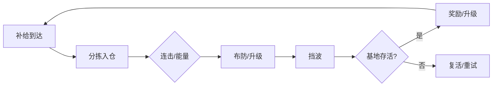

# 产品 MVP 决策 1.03：先做「排序 + 轻塔防」小游戏，14 周验证

> **这是什么**：1.03 的决策文件。它不再扩大行业研究，而是把 1.0 的组织样板和 1.02 的品类研判收敛成一个可执行的产品 MVP、时间表、验证门槛与止损规则。
>
> **版本**：v1.0 · 2026-11-17  
> **输入**：1.0《智能组织新项目样板 1.0》（[PR #4](https://github.com/qiutanghongfeng/SuperPegasus/pull/4)）、1.02《2026H2–2027H1 游戏品类机会研判》（[PR #8](https://github.com/qiutanghongfeng/SuperPegasus/pull/8)）  
> **范围**：产品方向、MVP 定义、14 周执行与验证计划、资源与风险。不替代公司财务、法务与发行意见。  
> **状态**：方向、产品概念与验证门槛由本文件拍板；编制、预算和资质由项目 owner 按第 8.3 节确认后进入执行。

## 0. 一页结论

**做 B，不做 A/C/D。** 首款 MVP 是《补给线》（代号）：一款 **3 分钟一局、竖屏、排序 + 轻塔防** 的微信小游戏。玩家在 60–90 秒内把传送带上的补给分拣到正确仓位，用分拣产生的能量布置/升级防线，再挡住一波进攻。

**为什么是现在、为什么是它：**

- 1.0 给出了组织样板，1.01 讨论了岗位与角色如何进入同一套样板；1.02 回答了「哪些品类有机会」。下一步的瓶颈不再是信息，而是**没被验证过的乐趣、留存和买量经济性**。
- B 是四个方向里唯一能在 **14 周、7 人、小预算** 内跑出真实市场数据的方向；A 需要 6–9 个月和 15–30 人，C 需要 30–60 人，D 依赖内容与运营积累。
- 排序是 2026 年增速最快的细分之一（海外排序解谜 +137%），轻塔防提供长线 meta；小游戏大盘 +36%，但纯跟榜会被买量成本拖死，**必须用「杂交品类 + 强反馈 + 短局」做出差异化**，并用小预算买量验证，而不是赌一年。

**不做什么：** 4X/SLG、二次元大世界、硬核 PvP 搜打撤、PC/主机买断制、纯叙事大项目、首日多端/出海。

**14 周怎么走：**

- W0：立项、资质、技术与素材前置；W1–W2 用纸面/灰盒做 3 个核心循环变体测试。
- W2–W6：可玩原型；W6 末 **Gate 1**（乐趣/清晰度）。
- W7–W11：30 关纵向切片 + 数据/买量物料；W12–W14 内测 + 小规模买量测试。
- W14 末 **Gate 2**（留存/CPI/ROAS/内容成本）：过门进入 8–12 周生产与多端评估；不过门止损，保留团队与管线，再评估 A/D，不「再改一版」。

### 0.1 已拍板的决定

| # | 决定 | 内容 | 复盘点 |
|---|---|---|---|
| D1 | 产品方向 | 选方向 B：排序/塔防 + 轻策略 meta，小游戏/多端 | Gate 2 |
| D2 | 产品概念 | 《补给线》：排序供能 → 布防 → 挡波，3 分钟一局，竖屏 | Gate 1 |
| D3 | 首发平台 | 微信小游戏首发；抖音小游戏第二；APP/海外在 Gate 2 后评估 | Gate 2 |
| D4 | 团队 | 7 人核心小队（2 个成果小队 + 共享评测/数据），外包补音频/QA | Gate 1 |
| D5 | 周期与预算 | 14 周执行（另加 1 周前置）；预算 = 7 人 × 3.5 个月全成本 + 外包 + 首轮买量 ≤6 万元 | 每周成本复盘 |
| D6 | 验证门槛 | Gate 1 看乐趣/清晰度；Gate 2 看 D1/D7/CPI/ROAS/内容成本 | 每道门 |
| D7 | 失败规则 | 触发 Kill 条件即止损，不追加「再改一版」预算 | Gate 2 |
| D8 | 第二曲线 | A（合成 + 叙事/装修）作为 Gate 2 后的候选，不在本轮并行 | Gate 2 |

### 0.2 成功与失败长什么样

| | 成功（Gate 2 过门） | 失败（Gate 2 止损） |
|---|---|---|
| 玩家 | D1 ≥35%、D7 ≥12%；玩家说「再来一局」 | D1 <28% 或 D7 <8%，或玩家说不清玩法 |
| 买量 | CPI ≤5 元、7 日 ROAS ≥50%（目标 70%），至少 2 条素材进入低成本区间 | CPI >8 元或 7 日 ROAS <50%，30+ 条素材仍找不到角度 |
| 内容 | 单关成本按管线收敛，20–30 关可复制 | 单关仍 >1 人日，或品质不可控 |
| 组织 | 7 人小队端到端交付，AI 杠杆可度量 | 依赖加班/临时支援，AI 只停留在演示 |
| 决策 | 加码 B，进入 8–12 周生产 | 止损，保留团队与管线，评估 A/D |

## 1. 为什么现在必须收敛

1. **研究已经足够支撑一次下注。** 1.02 给出了方向、证据、KPI 和 8–12 周验证框架；再写一份行业报告，边际信息很低。
2. **剩下的关键问题都是经验问题，不是资料问题。** 排序 + 塔防的杂交好不好玩？3 分钟短局能不能撑住 D1/D7？CPI 能不能压到 5 元以内？AI 把内容成本降到什么程度？这些只能通过可玩版本和真实买量回答。
3. **AI 原生组织的价值需要用产品证明。** 1.0 的样板再完整，没有一次端到端交付，就无法验证「小团队 + 代理栈」是否真的更快、更省、质量可接受。
4. **窗口有时限。** 小游戏大盘仍在增长（2026H1 +36%），但买量成本、素材衰减和同质化都在加速；晚上半年，进入成本更高。
5. **「不决定」也是一种决定。** 继续并行研究 A/B/C/D，等于把预算摊薄在四个方向上，最后没有一个能过门。

## 2. 选项、打分与取舍

### 2.1 四个候选（来自 1.02）

| 方向 | 一句话 | 团队/周期 | 关键证据 | 结论 |
|---|---|---|---|---|
| A 合成 + 叙事/装修 | 合成板 + 订单 + 装修/剧情 | 15–30 人 / 6–9 个月 MVP | 合成 H1 >21 亿美元、Q2 +70%；头部《Gossip Harbor》Q3 +69% | 第二曲线，本轮不做 |
| B 排序/塔防 + 轻策略 | 3 分钟一局 + 强反馈 + 长线 meta | 8–20 人 / 3–4 个月原型 | 排序 +137%、塔防 +17%、小游戏 +36% | **本轮选择** |
| C 低惩罚合作 PvE | 2–4 人合作搜打撤/生存 | 30–60 人 / 12–18 个月 | Steam 4350 万、买断制 +5%；ARC 峰值回落约 90% | 不做 |
| D 女性向情感/陪伴 | 轻互动 + 强叙事 + 小游戏 | 10–25 人 / 3–6 个月 | 女性向小游戏曝光 60%；TAM/内容成本/合规风险 | 不做 |

> **数据口径提醒**：+137% 是海外排序解谜的收入增速，+36% 是中国小游戏大盘，两者市场/口径不同，不能直接相加或外推。国内小游戏当前 Top 10 以 SLG、模拟经营、合并消除、塔防为主，**排序玩法在国内的接受度本身是待验证假设**，由 W1–W2 变体测试和 W12–W14 买量回答。

### 2.2 五维打分（沿用 1.02 的框架）

| 维度 | 权重 | A | B | C | D |
|---|---:|---:|---:|---:|---:|
| 市场吸引力 | 30% | 4.5 | 4.0 | 3.5 | 2.5 |
| 团队匹配 | 25% | 2.5 | 4.0 | 2.0 | 2.0 |
| 竞争格局 | 20% | 2.0 | 3.0 | 3.0 | 2.0 |
| 变现效率 | 15% | 5.0 | 3.0 | 4.0 | 3.0 |
| 平台红利 | 10% | 2.0 | 5.0 | 2.0 | 4.0 |
| **加权总分** | **100%** | **3.33** | **3.75** | **2.95** | **2.50** |

**口径与前提：**

- 按 7 人 AI 原生小队、有 1 名买量/数据负责人（或发行伙伴）估算。
- **B 的团队匹配给 4 分，前提是 W2 前确认买量/发行路径。** 若完全没有买量能力，团队匹配降到 2.5 分，总分 3.4，按 1.02 的规则不直接做原型，先做 4 周素材/渠道验证。
- 分数用于讨论，不是精确预测；真正的判断看第 7 节的验证结果。

### 2.3 为什么不是 A（最接近的竞争者）

- A 的单位经济性最好，但它是「内容 + 叙事 + 长线运营」的复合能力，15–30 人、6–9 个月才能做出可测版本；用 14 周只能做出一个不完整的合成原型，测不出真实留存。
- A 的头部壁垒已经形成（《Gossip Harbor》《Tasty Travels》等），新团队需要强叙事/IP/本地化差异化；这不是 AI 一上来就能补的。
- A 更适合作为 Gate 2 之后的「第二曲线」：如果 B 证明了小队的端到端交付、AI 内容管线和买量能力，再用同一套组织做 A，成功率和资金效率更高。
- 如果 owner 的战略是「只做高 LTV、不做短生命周期小游戏」，那应该直接选 A，并把周期改为 9–12 个月；本文件不假装 14 周能验证 A。

> **期望值 vs 学习成本**：B 的天花板不一定比 A 高；B 是**单位学习成本最低**的下注，用来先证明组织、管线和买量能力。A 的天花板更高，等 B 过门后再用同一套能力去拿。

### 2.4 为什么不是 C/D

- **C**：30–60 人、12–18 个月、主机/PC 发行与联机能力，超出当前组织与预算；GTA VI 窗口（2026-11-19）还会吸走注意力。
- **D**：TAM 较小、内容/配音/编剧成本高、合规与舆情风险高；没有女性向内容积累的团队不应把它当第一枪。

### 2.5 决策规则（避免「再想想」）

- **Gate 1 通过** → 进入切片；不通过 → 在 B 内 pivot（纯排序 / 纯塔防 / 换题材），最多 2 次。
- **Gate 2 通过** → 加码 B：8–12 周生产、APP/抖音/海外评估、团队扩到 12–15 人。
- **Gate 2 不过** → Kill B；保留团队与管线，用 2 周概念冲刺评估 A/D；**不追加 B 的「再改一版」预算**。
- **W2 前无法确认买量/发行路径** → 不进入 14 周原型，先做 4 周素材/渠道验证（见 2.2 注）。

## 3. 产品定义：《补给线》

### 3.1 一句话

**「把混乱的补给整理成防线，然后看着它替你挡住一波进攻。」**

### 3.2 玩家幻想与情绪

- **幻想**：我是风雪哨站的补给官，我的整理速度决定防线强度。
- **情绪**：整理强迫症的满足感 → 布防的策略感 → 挡住一波的爽感 → 「再来一局」。
- **关键词**：短、爽、可展示、低挫败。

### 3.3 目标玩家

- 18–35 岁泛休闲用户；微信小游戏为主。
- 喜欢整理/收纳、短局解谜、轻塔防；女性用户为入口，塔防的策略感扩大男性用户（假设，待变体测试验证）。
- 不服务：硬核塔防、深度 SLG、竞技 PvP 玩家。

### 3.4 核心循环

1. **分拣（60–90 秒）**：传送带送来补给（食物/药品/弹药/建材），玩家把物品拖入对应仓位；正确 = 连击 + 能量，错误 = 卡带 2 秒 + 断连击。
2. **布防（20–30 秒）**：用能量在 3 条防线上放置/升级 3 类防御（机枪/迫击炮/减速），位置和优先级是轻策略。
3. **防守（30–45 秒）**：敌人自动进攻，防御自动开火；玩家可继续分拣空投补给来修复/补弹。
4. **结算**：基地血量 >0 即胜利；奖励金币/星星；失败可看广告复活一次。
5. **成长**：章节地图（3 章 × 10 关）→ 永久升级（传送带速度、仓位容量、连击倍率、初始能量、防御伤害）→ 每日挑战 → 收集「补给卡」。

### 3.5 单局节奏

| 时间 | 环节 | 玩家在做什么 | 设计目的 |
|---|---|---|---|
| 0–5 秒 | 预告 | 看本关目标/新机制 | 降低理解成本 |
| 5–75 秒 | 分拣 | 拖拽补给到仓位，追连击 | 即时满足、可展示 |
| 75–105 秒 | 布防 | 花能量放置/升级防御 | 轻策略、做取舍 |
| 105–150 秒 | 挡波 | 看防线开火，补空投 | payoff、紧张感 |
| 150–170 秒 | 结算 | 看奖励、升级、下一关 | 形成「再来一局」 |

### 3.6 差异化

- **品类杂交，不是换皮**：分拣直接决定防线强度；不是「分拣 + 独立塔防小游戏」。
- **强反馈**：每个正确分拣有音效/粒子/连击数字；错误有卡带震动；挡波有爆炸/慢动作。
- **短局 + 竖屏 + 单手**：等车/午休可玩；一局 3 分钟，3–5 局一个 session。
- **轻策略而非重塔防**：3 类防御、3 条线、6 个升级节点；不做法术/英雄/装备大系统。
- **题材新鲜**：风雪哨站/灾后救援，暖色灯光 + 冷色风雪，和糖果/货物排序区分开。
- **AI 内容速度**：关卡/波次/素材的变体生产，但玩家可见内容必须人工策展。

### 3.7 平台与商业化

- **首发**：微信小游戏（竖屏、单手、分享/排行榜、广告）。
- **第二**：抖音小游戏（同一玩法，换 SDK/素材）。
- **Gate 2 后**：APP（iOS/Android）、海外 TikTok Minis/Google Play。
- **商业化**：IAA（复活、双倍奖励、额外体力）+ IAP（去广告、starter pack、基地皮肤）；**先验证留存，再优化付费**。
- **资质**：内购/正式商业化按微信小游戏最新版号/备案要求执行；W0 启动版号/发行合作评估，首测版本不依赖内购。**不把 14 周验证绑在资质周期上。**

### 3.8 美术与音频

- **美术**：2D/2.5D 等距，粗轮廓、清晰色块；每个仓位一个主色；雪/火光/金属质感。
- **资产量**：3 章场景、约 20 种补给、6 种敌人、3 类防御、UI 套件；用 AI 做概念/变体，人工定稿。
- **音频**：分拣「咔哒」、连击音高上升、卡带低频、挡波爆炸；音频是「爽感」的一半，不能省。

### 3.9 命名

- 代号《补给线》（Project Lifeline）；候选名《风雪补给站》《最后一箱》。
- 上线前做商标/平台重名检索；本文件不锁定最终名称。

### 3.10 对标与学习对象

| 类型 | 参考 | 学什么 | 不学什么 |
|---|---|---|---|
| 排序手感 | 《Goods Sort 3D》《Sort It 3D》 | 拖拽/归位的即时反馈、关卡节奏 | 纯换皮、无 meta |
| 塔防 | 《保卫萝卜》《向僵尸开炮》 | 防线/怪物/关卡压力曲线 | 重塔防、英雄/装备大系统 |
| 小游戏变现 | 微信畅销榜 Top 100 的塔防/合并消除 | 广告频控、活动、分享 | 纯买量、无留存的产品 |
| 叙事/长线 | 《Gossip Harbor》 | 内容更新与情绪价值（第二曲线） | 本轮不做重叙事 |

## 4. MVP 范围

### 4.1 范围表

| 类别 | 内容 |
|---|---|
| **必须有（MVP）** | 核心杂交循环（分拣→布防→挡波→结算）；30 关（3 章 × 10，含 3 个 Boss 关）；3 类防御、6 个永久升级、1 个每日挑战；新手引导（≤90 秒）；微信登录/分享/异步排行榜；广告位（复活/双倍）与支付占位；关卡漏斗/时长/失败点/广告/分享埋点；中端机 60fps、包体符合平台限制、崩溃率 <0.5% |
| **后续（Gate 2 后）** | 60–100 关、赛季、收集卡、皮肤商店、IAP 正式化；抖音小游戏、APP、海外、本地化；社交/公会/PvP/UGC |
| **明确不做** | 3D、实时联机、剧情演出、开放世界、英雄养成、装备随机词条 |

> **砍清单（按顺序）**：每日挑战 → 排行榜/分享 → 支付占位 → 章节 3（保留 20 关）；不砍核心循环、埋点、playtest、买量测试。

### 4.2 内容与品质门槛

- **关卡**：30 关，每关 2.5–3.5 分钟；前 5 关必须在 30 秒内教会「分拣影响防线」。最低可测版本 20 关；不足 20 关不进入买量测试。
- **节奏**：新机制引入 → 组合 → 压力 → Boss；每 10 关一个章节变化。
- **品质**：风格统一、无 AI 瑕疵、无版权风险；所有玩家可见资产有人签字。
- **技术**：冷启动 <3 秒（4G/中端机）、崩溃率 <0.5%、无严重卡顿。

### 4.3 MVP Definition of Done

- [ ] 20–30 关可从头玩到尾，无阻断性 bug。
- [ ] 新手引导完成率 ≥85%（20 人测试样本）。
- [ ] 3 类防御/6 个升级的数值可调，且有配置表。
- [ ] 埋点可回答第 7 节的 Gate 1/Gate 2 指标。
- [ ] 微信小游戏真机（iOS/Android 各 2 台）跑通登录、分享、广告。
- [ ] 买量素材 ≥30 条，落地页/小游戏入口可追踪。
- [ ] 决策日志、风险册、成本看板可用。

## 5. AI 原生生产方案

### 5.1 分工表

| 环节 | AI 做什么 | 人做什么 | 评测 |
|---|---|---|---|
| 关卡/波次 | 生成关卡草稿、难度曲线、波次组合 | 定乐趣目标、改关卡、拍板 | 可玩性、多样性、崩溃率、人工抽检 |
| 美术 | 概念图、道具/场景变体、UI 草图 | 定风格、策展、最终资产 | 风格一致性、版权、最终品质 |
| 代码/QA | 原型代码、测试用例、日志分析 | 架构、评审、真机验证 | 缺陷率、回归通过率 |
| 买量素材 | 30–50 条脚本/变体、本地化文案 | 定卖点、审品牌安全、投放 | CTR/CVR/CPI、素材衰减 |
| 运营 | 活动变体、客服话术 | 定价/合规/玩家沟通 | 事故率、申诉率 |

### 5.2 三个试点

1. **关卡/波次生成**：输入难度曲线和机制，输出关卡草稿；评测看可玩性、多样性、崩溃率。
2. **美术概念/变体**：风格板、道具变体、UI 草图；评测看风格一致性、版权、最终品质。
3. **买量素材**：30–50 条脚本/变体；评测看 CTR/CVR/品牌安全。

### 5.3 目标杠杆（用单位成本，不用「用了多少 AI」）

- 单关内容成本（人日/关）比同规模传统管线基线下降 ≥30%（目标，不是承诺）。
- 素材变体产能 ≥20 条/周。
- 原型迭代周期 ≤2 周/次。

### 5.4 护栏

- 玩家可见的最终资产必须人工策展/签字；不直接发布未审核 AI 内容。
- 版权/来源检查；角色/题材不侵权；按平台要求披露。
- 评测卡 + 回归集；AI 出错可回滚。
- 不用 AI 替人做「好不好玩」和「要不要继续」的判断。

## 6. 14 周执行计划

### 6.1 阶段与门

| 阶段 | 周 | 目标 | 交付 | 门 |
|---|---|---|---|---|
| 立项/前置 | W0 | 团队、资质、数据、技术、素材就位 | 项目画布、章程、埋点方案、技术 spike | Gate 0 |
| 变体测试 | W1–W2 | 确认「分拣 + 防守」是否成立 | 3 个纸面/灰盒变体 + 15–20 人测试 | 变体决策 |
| 可玩原型 | W2–W6 | 证明核心乐趣 | 5–10 分钟 demo、评测集、Playtest 报告 | **Gate 1** |
| 纵向切片 | W7–W11 | 证明可做出目标品质与 30 关产能 | 30 关、美术/音频、埋点、买量物料 | Gate 2 准备 |
| 小规模测试 | W12–W14 | 用真实数据决定加码/止损 | 5,000–10,000 安装、CPI/留存/ROAS 报告 | **Gate 2** |

> 周次口径：W1–W14 为 14 周执行；W0 是启动前置周（审批、组队、资质），不计入 14 周，但计入预算与排期。
>
> 门径口径：本文的 Gate 1/2 是 14 周 MVP 的决策门，不等同于 1.0 样板的 Gate 1–6；Gate 2 通过后，生产阶段再按 1.0 的 Gate 2/3 对齐。

### 6.2 周计划

| 周 | 关键动作 | 交付 | Owner |
|---|---|---|---|
| W0 | 批预算/编制；任命总监；建项目 OS；启动版号/发行评估 | 项目画布、章程、预算表 | 总监 |
| W1 | 3 个变体纸面/灰盒；技术 spike；埋点方案；美术风格板 | 变体 demo、技术结论、埋点表 | 设计/技术 |
| W2 | 15–20 人变体测试；定 V3 主方案；买量/发行路径确认 | 变体报告、方向确认、UA 方案 | 总监/运营 |
| W3 | 核心分拣手感；UI 框架；关卡编辑器 | 可玩分拣 loop | 玩法小队 |
| W4 | 布防/挡波；前 10 关；第一次 20 人 playtest | 10 关 + 测试报告 | 玩法/内容 |
| W5 | 连击/音效/反馈；经济与升级；埋点接入 | 核心循环 v1、数据看板 | 全队 |
| W6 | 20–30 人 playtest；Gate 1 评审 | Gate 1 备忘录、Go/Pivot/Kill | 总监 |
| W7 | 30 关内容计划；美术量产；音频外包 | 内容计划、资产清单 | 内容小队 |
| W8 | 20 关；每日挑战；排行榜/分享 | 20 关可玩版 | 全队 |
| W9 | 30 关；Boss；商业化占位；性能优化 | 30 关 RC | 全队 |
| W10 | 真机测试；崩溃/包体；埋点校验 | 技术验收报告 | 技术 |
| W11 | 30–50 条买量素材；落地页；A/B 方案 | 素材库、投放计划 | 运营/美术 |
| W12 | 内测 200–500 人；首轮买量 5,000 安装；修阻断问题 | 内测报告、首轮投放 | 全队/运营 |
| W13 | 看 D1/D3/CPI；迭代素材；扩到 10,000（CPI >5 元则停在 5,000） | 投放报告、素材迭代 | 运营 |
| W14 | 看 W12 队列的 D7/ROAS；Gate 2 决策 | Gate 2 备忘录、下一阶段计划 | 总监 |

### 6.3 团队（7 人核心 + 外包）

| 角色 | 人数 | 主要职责 | 所属 |
|---|---:|---|---|
| 项目总监/制作人 | 1 | 结果、预算、节奏、对外；兼主设计 | 核心 |
| 主策划/关卡与经济 | 1 | 关卡、数值、meta、playtest | 核心循环小队 |
| 客户端 A（核心玩法/UI） | 1 | 分拣/布防/挡波、UI、性能 | 核心循环小队 |
| 客户端 B（平台/工具） | 1 | 关卡工具、分享/排行榜、SDK、云服务 | 内容与平台小队 |
| 技术美术/2D 美术 | 1 | 风格、资产管线、AI 策展 | 内容与平台小队 |
| 2D 美术/UI | 1 | 场景、道具、UI 资产 | 内容与平台小队 |
| 运营/UA/数据 | 1 | 买量、素材、数据、社区 | 内容与平台小队 |
| 音频/QA/本地化 | 外包 | 音效、测试、文本 | 外包 |

> 组织口径沿用 1.0 的「小团队精简版」：2 个成果小队 + 总监兼制作/编排 + 共享评测/数据；砍掉专职工艺教练，用外部顾问补。服务端用微信云开发/托管服务，不设专职后端。7 人低于 1.02 的 8–20 人下限，靠 AI 代理与外包补产能；若 W4 前产能不足，**先减关卡到 20 关，不先加人**。

### 6.4 运营节奏

- **每日**：15 分钟站会（阻塞/数据/风险）。
- **每周五**：30 分钟 Demo，必须可玩，不看 PPT。
- **每两周**：10–20 人 playtest；记录完成率、卡点、乐趣评分。
- **每道门**：90 分钟 Gate 评审，输出 Go/Pivot/Kill 与预算调整。
- **每周**：决策日志、风险册、成本看板更新。
- **小队**：核心循环（3：设计、客户端 A、总监）、内容与平台（4：客户端 B、技术美术、2D 美术、运营）。

### 6.5 前置条件

- 微信小游戏账号/主体资质；版号/备案/发行合作评估。
- 数据分析方案（事件表、漏斗、归因限制）。
- 买量/发行路径（自投 or 合作）。
- 技术选型（Cocos Creator 3.x 优先；Unity WebGL 备选）与真机测试机。
- 美术管线与 AI 工具账号/版权策略。

## 7. 验证设计

### 7.1 五个假设

| # | 假设 | 如果错了会怎样 | 验证方式 |
|---|---|---|---|
| H1 | 分拣 + 防守的杂交在 3 分钟内成立且好玩 | 产品不成立 | 变体测试 + Gate 1 |
| H2 | 短局能撑住 D1 ≥35%、D7 ≥12% | 留存不够，买量越买越亏 | 内测 + 小规模买量 |
| H3 | CPI 能压到 ≤5 元，且有 2 条以上素材角度 | 无法规模化 | 30–50 条素材 + 投放 |
| H4 | AI 把单关成本降到可接受区间 | 内容供给跟不上 | 管线试跑 + 成本核算 |
| H5 | 微信小游戏技术/包体/性能可达标 | 上线延迟或体验差 | 技术 spike + 真机 |

### 7.2 Gate 1（W6，乐趣与清晰度）

| 指标 | 目标 | 失败信号 |
|---|---|---|
| 新手引导完成率 | ≥85% | <70% |
| 3 关完成率 | ≥60% | <40% |
| 乐趣评分（5 分制） | ≥4.0 | <3.5 |
| 「还想再来一局」 | ≥50% | <35% |
| 能一句话说清玩法 | ≥70% | <50% |
| 崩溃率 | <0.5% | >2% |

### 7.3 Gate 2（W14，留存与买量）

| 指标 | 目标 | No-Go |
|---|---|---|
| D1 留存 | ≥35%（目标 40%） | <28% |
| D7 留存 | ≥12%（目标 15%） | <8% |
| 单次时长 | ≥8 分钟 | <5 分钟 |
| 前 5 关完成率 | ≥70% | <55% |
| CPI | ≤5 元 | >8 元 |
| 7 日 ROAS | 目标 ≥70%；生死线 ≥50% | <50% |
| 素材 | 30+ 条，至少 2 条进入低成本区间 | 30+ 条仍无角度 |
| 单关内容成本 | 目标 ≤0.5 人日/关（管线稳定后） | >1 人日/关 |
| 崩溃率 | <0.5% | >2% |

> **口径**：CPI 沿用 1.02 方向 B；D7 参考 1.02 的中核休闲基准（小游戏短局略低）；ROAS 以 50% 为生死线、70% 为放量目标，D30 数据才是大预算依据。单关内容成本是内部目标，不是行业基准。小样本下 D7 只作方向判断，不做过细拆分。
>
> **无内购版本的处理**：若首测因资质只能用广告变现，ROAS 以「广告 ARPDAU + 内购预估值」作方向判断，**不因缺少内购单独判死付费模型**；正式 ROAS 门槛在内购版本上复测。

### 7.4 测试方法

- **变体测试（W1–W2）**：V1 纯分拣、V2 分拣 + 自动防御、V3 分拣中防守；每个 10–15 人，纸面/灰盒；看「能不能一句话说清」和「还想再来一局」。
- **Playtest（W4–W6）**：20–30 人目标用户；任务完成、乐趣评分、卡点。
- **内测（W12）**：200–500 人；看崩溃、漏斗、时长。
- **小规模买量（W12–W14）**：5,000–10,000 安装；30–50 条素材；测 CPI/D1/D7/ROAS；预算 ≤6 万元。
- **数据限制**：小样本、平台归因限制；D7 只作方向判断；所有指标预先定义，避免事后挑指标。
- **口径交叉**：+137% 为海外排序解谜收入增速，国内小游戏 Top 10 以塔防/合并消除/模拟经营为主；国内排序需求由变体测试和买量验证，不直接外推。

### 7.5 Kill/Pivot 规则

- 变体测试后，V3 的「能说清 + 想再玩」显著低于 V1/V2 → 退回纯分拣 + 轻 meta，不硬做杂交。
- Gate 1 连续 2 次不达标 → Kill 或换题材；不进入切片。
- Gate 2：D1 <28%、D7 <8% 或 7 日 ROAS <50% → Kill；CPI >2 倍目标且 30+ 条素材无解 → 停买量、重估。
- 单关成本不收敛（>1 人日/关）→ 先修管线，不扩内容。
- 资质/版号路径 W8 前仍不明确 → 只做无内购测试或找发行合作；两者都不可行 → 停止商业化测试，保留原型资产。

### 7.6 通过后（W15–W26）

- W15 起用 Gate 2 批准的有限预算进入 8–12 周生产：60–100 关、赛季、IAP、抖音、APP/海外评估；团队 12–15 人。
- 不自动加码；D30 留存/ROAS 在 W18 左右出来后再决定是否放大预算。

## 8. 预算与资源

### 8.1 预算口径

- **人力**：7 人 × 约 3.5 个月（含 W0，约 24.5 人月）+ 外包（音频/QA/本地化，按 10–20%）+ 预备金 10–15%。
- **工具/算力**：按公司口径，不在公开文档写具体薪资。
- **首轮 UA**：5,000–10,000 安装 × CPI 上限 5 元 × 1.2 缓冲 = **3–6 万元**；素材制作计入人力/AI 工具。
- **总预算**：不超过「7 人 × 3.5 个月全成本 + 外包 + 6 万元测试费」；具体数字由财务口径填。

### 8.2 成本护栏

- 超预算 10% 解释，20% 调整；每道门重新分配。
- 不为「再改一版」追加预算；不提前做 APP/海外/赛季。

### 8.3 owner 需确认

1. 7 人 × 14 周（另加 W0 前置）的编制与预算。
2. 买量路径：自投 or 发行合作（W2 前）。
3. 版号/备案/发行合作路径（W2 前）。
4. 题材默认「风雪哨站」是否接受；如否，W1 内定替代题材。
5. 若最终编制 <5 人：砍到 20 关、去掉每日挑战/排行榜，周期放长到 18 周；Gate 1/2 门槛不变。

## 9. 风险登记

| # | 风险 | 概率 | 影响 | 触发信号 | 缓解 | Owner |
|---|---|---|---|---|---|---|
| R1 | 买量成本/素材衰减，ROI 打不正 | 高 | 高 | CPI 连续 2 周 >8 元 | 发行合作、素材工业化、设测试预算上限、先测再放量 | 运营 |
| R2 | 杂交玩法认知负担高，玩家说不清 | 中 | 高 | 变体测试「能说清」<50% | 3 变体测试、90 秒引导、强视觉语言、退回纯分拣 | 设计 |
| R3 | 小游戏平台依赖/政策变化 | 中 | 高 | 平台规则/分成/审核变化 | 玩法与 SDK 解耦、抖音第二、APP 后置 | 技术 |
| R4 | 版号/备案/资质周期 | 高 | 中 | W8 仍无明确路径 | W1 启动、无内购测试、发行合作 | 总监 |
| R5 | 被快速换皮/抄袭 | 高 | 中 | 榜单出现同类 | 速度、题材、内容更新；接受无长期壁垒 | 总监 |
| R6 | AI 质量/版权问题 | 中 | 中 | 玩家可见资产出现瑕疵/争议 | 评测卡、人工签字、版权审查、披露 | 美术/法务 |
| R7 | 团队带宽/范围蔓延 | 中 | 高 | 连续 2 周延期 | 固定 20–30 关范围、砍清单、每周 Demo、Gate 止损 | 总监 |
| R8 | 小样本/归因误差导致误判 | 高 | 中 | D7 波动大、渠道数据对不上 | 预先定义指标、扩大样本、看趋势不看单点 | 数据 |
| R9 | 商业化过早伤害留存 | 中 | 中 | 广告频次高、D1 下滑 | 先留存后付费、广告频控、A/B | 运营 |
| R10 | 题材不共鸣 | 中 | 中 | 素材 CTR 低、玩家评论偏负面 | 2 套题材素材测试、W1 定替代 | 美术/运营 |

## 10. 下一步 7 天

| 天 | 动作 | 产出 | Owner |
|---|---|---|---|
| D1 | 批预算/编制；任命总监；建项目 OS；约版号/发行咨询 | 批注、项目画布、决策日志 | Owner/总监 |
| D2 | 技术 spike（Cocos + 微信真机）；埋点方案；竞品拆解 10 款 | 技术结论、埋点表、竞品表 | 技术/数据 |
| D3 | 3 个变体纸面原型；美术风格板；买量/发行联系 | 变体原型、风格板、UA 方案 | 设计/美术/运营 |
| D4 | 15–20 人变体测试（第一天）；记录「能说清/想再玩」 | 测试记录 | 设计 |
| D5 | 完成变体测试；定 V3 主方案与 30 关范围；排 W3–W14 计划 | 测试报告、范围确认、排期 | 设计/总监 |
| D6 | 30 条素材脚本；关卡编辑器需求；音频/QA 外包询价 | 素材脚本、工具需求、外包报价 | 运营/技术 |
| D7 | Gate 0 评审：预算/编制/路径/风险 | Gate 0 备忘录、启动 W1 | 总监 |

## 11. 决策记录

| # | 日期 | 决策 | 理由 | Owner | 复盘 |
|---|---|---|---|---|---|
| D1 | 2026-11-17 | 选方向 B，不做 A/C/D | 14 周可验证、团队匹配、数据窗口 | 总监 | Gate 2 |
| D2 | 2026-11-17 | 产品概念《补给线》 | 排序 + 轻塔防杂交，强反馈、短局 | 总监 | Gate 1 |
| D3 | 2026-11-17 | 微信小游戏首发 | 分发/支付/数据最快，包体可控 | 总监 | Gate 2 |
| D4 | 2026-11-17 | 7 人核心 + 外包 | 小团队精简版，先验证再扩编 | 总监 | Gate 1 |
| D5 | 2026-11-17 | 14 周、首轮买量 ≤6 万元 | 快速学习，控制下注 | Owner | 每周 |
| D6 | 2026-11-17 | Gate 1/Gate 2 门槛 | 沿用 1.02 KPI，按 MVP 校准 | 总监 | 每道门 |
| D7 | 2026-11-17 | 触发 Kill 即止损 | 避免沉没成本 | 总监 | Gate 2 |
| D8 | 2026-11-17 | A 作为第二曲线 | 不在本轮并行，保留选项 | Owner | Gate 2 |

## 附录 A：一页纸项目画布

| 字段 | 内容 |
|---|---|
| 项目代号 | Project Lifeline /《补给线》 |
| 一句话 | 3 分钟一局、竖屏、排序 + 轻塔防的微信小游戏 |
| 目标玩家 | 18–35 岁泛休闲；喜欢整理、短局、轻塔防 |
| 核心体验 | 「我把混乱整理成防线，然后它替我挡了一波」 |
| 品类/平台 | 排序 + 轻塔防；微信小游戏首发 |
| 团队规模 | 7 人核心 + 音频/QA 外包 |
| 预算/时间 | 14 周执行 + 1 周前置；预算按 8.1 口径 |
| 成功指标 | Gate 2：D1 ≥35%、D7 ≥12%、CPI ≤5 元、7 日 ROAS ≥50%（目标 70%） |
| 关键假设 | 杂交好玩、短局留存、CPI 可控、AI 内容成本下降 |
| 不做什么 | 3D、实时联机、PvP、开放世界、剧情演出、首日出海 |
| 最大风险 | 买量成本 + 杂交认知负担 |
| AI 使用边界 | 内部生产可用；玩家可见资产必须人工策展/签字 |
| 阶段门 | Gate 1：W6；Gate 2：W14 |

## 附录 B：KPI 定义与口径

- **D1/D7 留存**：安装后第 1/7 天回访并进入游戏的比例；以微信小游戏后台/自建埋点为准，渠道归因限制需标注。
- **CPI**：投放花费 ÷ 新增安装；分渠道/素材看，不用混合均值掩盖差异。
- **ROAS**：投放收入 ÷ 投放花费；7 日 ROAS 为早期信号，D30 才是放量依据。
- **单关内容成本**：从设计到可玩关卡的总人日 ÷ 关卡数；管线稳定后按月看。
- **素材胜率**：进入目标 CPI 区间的素材数 ÷ 总素材数。
- **「能说清」**：playtest 后能用自己的话复述「分拣如何影响防线」的比例。
- **「想再玩」**：测试结束愿意继续玩 3 局以上的比例。

## 附录 C：参考与关联

- 组织与流程：1.0《智能组织新项目样板 1.0》——[PR #4](https://github.com/qiutanghongfeng/SuperPegasus/pull/4)（对应 [#3](https://github.com/qiutanghongfeng/SuperPegasus/issues/3)、[#5](https://github.com/qiutanghongfeng/SuperPegasus/issues/5)；1.01 岗位/角色问题对应 [#6](https://github.com/qiutanghongfeng/SuperPegasus/issues/6)）。
- 品类与数据：1.02《2026H2–2027H1 游戏品类机会研判》——[PR #8](https://github.com/qiutanghongfeng/SuperPegasus/pull/8)（对应 [#7](https://github.com/qiutanghongfeng/SuperPegasus/issues/7)）。
- 本文件对应 [#9 定方向 1.03](https://github.com/qiutanghongfeng/SuperPegasus/issues/9)。
- 数据来源与口径详见 1.02 附录（[PR #8](https://github.com/qiutanghongfeng/SuperPegasus/pull/8) 内；Newzoo、Sensor Tower、伽马数据/游戏工委、SteamDB、GameLook、21 经济网等）；本文只引用与决策直接相关的数字。
- **限制**：本文基于公开数据与假设，不含公司内部数据、用户访谈、playtest 与买量实测；所有 KPI 为起步门槛，需按团队/地区/品类校准。本文不构成财务、法律或投资建议。

## 更新记录

| 日期 | 版本 | 变更 |
|---|---|---|
| 2026-11-17 | v1.0 | 初稿：方向决策、产品定义、MVP 范围、14 周计划、Gate 1/2、预算与风险 |
